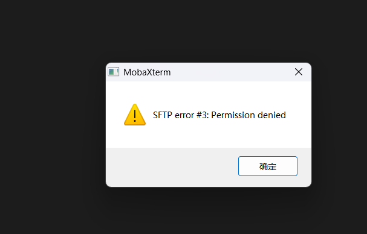
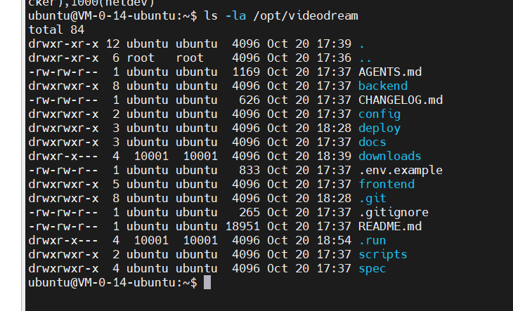

# MobaXterm SFTP 目录权限问题

## 问题

使用 `ubuntu` 登录服务器，打开 `/opt/videodream/downloads` 时提示：

```text
SFTP error #3: Permission denied
```



## 原因

该目录属于用户和组 `10001`，权限为 `750`，当前用户 `ubuntu` 无权访问。



## 解决方法

在服务器终端执行，为 `ubuntu` 增加该目录及现有内容的浏览、读取权限：

```bash
sudo setfacl -R -m u:ubuntu:rX /opt/videodream/downloads
```

如果提示找不到 `setfacl`，先安装工具，再执行上述命令：

```bash
sudo apt-get update
sudo apt-get install -y acl
```

执行成功后，点击 MobaXterm 左侧 SFTP 面板的绿色刷新按钮，即可打开目录。
