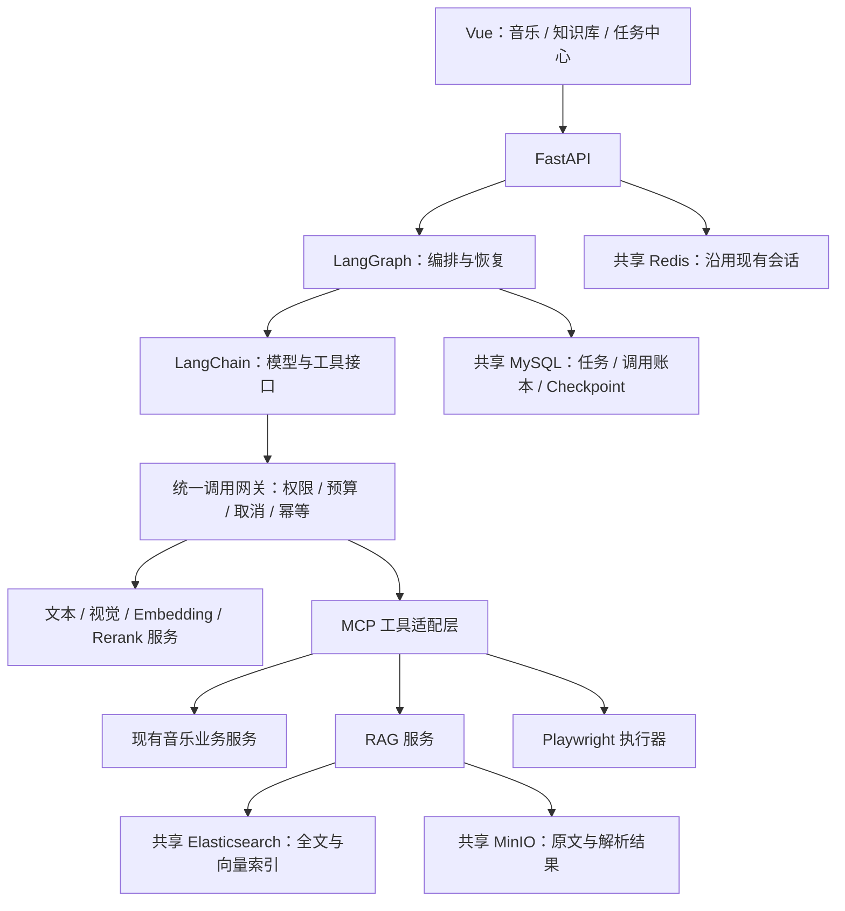

# VideoDream Agent 能力升级功能实现文档

版本：V1.2 ｜ 更新：2026-10-26 ｜ 状态：P1–P4 已实现；P5 已完成本地回归、合成实测及音乐资料问答修复验证，完整人工及部署验收待完成。

| 实施项 | 当前结果 |
| --- | --- |
| 入口 | 桌面左侧“场景歌单”下方：知识库、Agent 任务中心；手机底部“我的” → 对应入口 |
| 数据 | V7 新增 5 张 Agent 表，V8 新增 4 张知识库表；用户继续使用雪花 ID，接口传字符串 |
| 模型 | 复用硅基流动账号；文本 DeepSeek-V4-Flash，向量 bge-m3（1024 维），可选重排 bge-reranker-v2-m3 |
| 回归与实测 | 后台 755 项通过；真实 RAG 100/100 完成；浏览器正常导入 10/10 成功 |
| 验收边界 | [评测记录](evaluations/agent-upgrade-2026-10-26.md)；合成结果不能替代生产资料和人工引用核验 |

## 1. 目标与范围

| 模块 | 实现目标 |
| --- | --- |
| LangChain | 统一模型、工具、文档处理和检索接口 |
| LangGraph | 管理节点、条件分支、子任务、人工审批和中断恢复 |
| Music Agent | 迁移场景歌单、用户画像 Agent，保留业务规则 |
| RAG 知识库 | 文档入库、混合检索、引用回答、权限控制和版本管理 |
| Browser Agent | 实现“观察 → 决策 → 执行 → 验证”闭环 |
| 任务中心 | 查看进度、审批、接管、取消、恢复和历史记录 |
| ERP 扩展 | 预留业务工具接口；具体 ERP 对接单独定义并验收 |

**首个浏览器场景**

在明确支持的音乐站点搜索歌单 → 提取曲目 → 生成导入预览 → 用户确认 → 调用现有歌单服务保存 → 查询已保存歌单，核对结果。

## 2. 技术架构



| 决策 | 约定 |
| --- | --- |
| LangChain 职责 | 模型调用、结构化工具、文档与检索组件适配 |
| LangGraph 职责 | 显式工作流、循环、子图、人工中断和状态恢复 |
| 持久化 | 实现 MySQL Checkpointer，包含 checkpoint 与 pending writes |
| 数据库选型 | 复用项目 MySQL，不新增 PostgreSQL |
| 业务规则 | 继续由现有业务服务执行，Agent 调用受控接口 |
| 依赖版本 | 验证 LangChain、LangGraph、模型适配器兼容性后固定版本 |
| 共享中间件 | 保持已有版本、插件、网络和端口 |

## 3. LangChain 与 LangGraph 实现

### 3.1 组件分工

| 组件 | 实现内容 | 约束 |
| --- | --- | --- |
| 模型适配 | 文本、视觉、Embedding、Rerank 配置与调用 | 每次真实模型请求都经过统一网关 |
| Structured Tools | 输入输出 Schema、参数校验、受控业务调用 | 工具权限由服务端确定 |
| 文档处理 | Loader、清洗、切分、Embedding、Retriever | 保留页码、章节或时间定位信息 |
| Graph State | 任务、节点、资源引用、业务版本和执行计数 | 不写入媒体文件或完整原文 |
| Checkpointer | 状态快照、父快照、元数据、pending writes | 中断后能恢复未完成节点写入 |
| Interrupt | 审批、登录、补充输入和人工接管 | 恢复时重新验证权限及版本 |
| 子图 | 复杂任务使用 Planner 与执行子图 | 子任务共享根任务预算 |
| Memory | 授权历史、现有用户画像和任务状态 | 按用户权限读取，避免跨用户记忆 |

### 3.2 音乐 Agent 迁移

```text
解析需求 → 选择来源 → 检索候选 → 分析筛选 → 校验完整播放
                                           ↓
                                 检查数量及质量目标
                                           ↓
                                    继续检索 / 结束
```

| 项目 | 实现规则 |
| --- | --- |
| 迁移对象 | 场景歌单 Agent、用户画像 Agent |
| 播放与来源 | 匹配、完整播放和来源规则由业务服务强制执行 |
| 新任务 | 固定 engine、graph_version、skill_version，恢复时保持版本一致 |
| 旧任务 | 继续使用旧引擎完成，不在执行中切换 |
| 调用重放 | 复用已结算模型结果和已完成动作记录 |
| 用量不明 | 暂停后续付费调用，等待账本核对 |
| 错误处理 | 权限、预算等策略错误立即停止；普通来源失败可反馈给规划节点 |
| 页面展示 | 展示操作摘要、结果和引用，不展示模型私有推理 |

## 4. RAG 知识库

### 4.1 功能与链路

| 功能 | 实现内容 |
| --- | --- |
| 知识库管理 | 新建、编辑、删除；owner / editor / viewer 权限 |
| 文档接入 | 文本型 PDF、DOCX、Markdown、TXT |
| 视频内容接入 | 导入用户有权访问的视频字幕和摘要 |
| 入库链路 | 解析 → 清洗 → 切分 → 向量化 → 写索引 → 发布版本 |
| 检索问答 | 关键词 + 向量召回 → RRF 融合 → 可选重排 → 同章节相邻片段补齐 → 证据裁剪 → 回答 |
| 来源引用 | 定位原文页码、章节或视频时间点 |
| 版本管理 | 新版本完成索引后发布；查询仅使用有效已发布版本 |
| 删除 | 先使文档不可检索，再异步删除索引和对象 |
| 历史记录 | 保存问题、回答、引用来源、配置版本、用量、耗时及费用估算 |

### 4.2 默认参数

| 参数 | 默认值 / 规则 |
| --- | --- |
| 单文件大小 | 20 MiB |
| 解析文本上限 | 200,000 字符 |
| 切分大小 | 同一来源位置的连续段落先合并，再按最多 600 tokens 切分；标题、表格和说明尽量同段 |
| 章节上下文 | 每段检索正文添加章节前缀（最多 120 tokens，计入 600 上限）；超长章节续段仍携带标题 |
| 重叠长度 | 同一章节内约 80 tokens；不跨章节、PDF 页码或字幕时间定位合并 |
| 关键词召回 | Top 20 |
| 向量召回 | Top 20 |
| 融合方式 | 应用侧 RRF |
| 重排上限 | 最多 30 个候选 |
| 最终证据 | 6 段主证据，各补充同文档、同版本、同章节/页码的前后相邻段，去重后最多 18 段；主证据优先，总预算 9,000 tokens，最多引用 6 段 |
| Embedding 示例 | BGE-M3，1024 维；接入前确认实际服务、模型和输出维度 |
| 维度校验 | 与索引不匹配时拒绝入库和查询 |
| 证据不足 | 明确说明缺少的信息，或向用户请求补充 |

**切分修复与兼容（2026-10-26）**：`text-locators-v2` / `cl100k-section-recursive-v2` 修复按空行独立切分导致标题、表格和说明分离的问题。已有版本仍可检索；通过现有 reindex 创建新版本，成功后才切换 `active_version`，原文和旧版本保留。相邻段保留各自原文、chunk_id 和定位，不拼接成错误引用；补齐查询沿用知识库权限及有效版本过滤，模型调用前和返回前再次校验。偏移针对解析后的规范化文本，不包含合成的章节前缀。

**数据与回退**：无 MySQL 表结构、索引或关系变更；仅沿用现有文档版本、任务和模型调用记录。Redis Key、类型、值结构、TTL、读写和失效规则均无变更，本修复不引入 Redis 状态。ES 沿用现有字段和项目索引，MinIO 保留各版本解析结果。重建失败继续使用原 `active_version`；需要回退时，在权限和版本状态校验后切回保留的已发布旧版本，并回退解析/检索代码；不删除旧版本或原文。

### 4.3 权限与引用

| 环节 | 强制规则 |
| --- | --- |
| 检索范围 | 服务端计算允许访问的知识库；关键词和向量检索均带权限过滤 |
| 模型调用前 | 再次检查成员权限、文档状态和已发布版本 |
| 回答返回前 | 再次验证权限；权限已变化时停止返回受影响结果 |
| 引用生成 | 引用必须来自本次真实检索证据，不允许生成不存在的来源 |
| 原文访问 | 每次鉴权；历史回答中的来源也按当前权限访问 |
| 外部内容 | 文档、网页均作为数据处理，不能改变工具权限或审批要求 |

### 4.4 与系统主功能的关系

| 主功能 | 知识库当前提供的帮助 |
| --- | --- |
| 音乐使用 | 查询乐理、风格、歌单编排和聆听资料，回答保留文档引用 |
| 音频文件管理 | 根据已上传的资料解释格式、码率、无损、元数据整理等问题 |
| 视频摘要 | 把有权访问的字幕/摘要导入知识库，跨资料检索并保留时间或章节定位 |
| 内容积累 | 用户维护自己的资料、版本和成员权限，持续复用并核查答案来源 |

**接入边界**：当前音乐场景歌单和每日推荐没有自动调用知识库；公共 Agent MCP 已提供 `knowledge_query` / `task_status` 工具。让知识库规则自动参与选曲、排序或推荐属于后续业务接入，不能把独立资料问答视为已完成该接入。

## 5. 浏览器自动化闭环

### 5.1 执行流程

| 步骤 | 输入 / 动作 | 完成条件 |
| --- | --- | --- |
| 1. 定义任务 | 保存目标、允许站点、验收条件、执行限制 | 目标及权限明确 |
| 2. 观察页面 | 读取 URL、文本、可交互元素和必要截图 | 形成带版本的当前观察 |
| 3. 模型决策 | 根据最新观察选择下一步动作 | 输出符合 Schema 的动作 |
| 4. 参数校验 | 校验站点、动作类型、参数、预算及任务状态 | 满足执行规则 |
| 5. 执行动作 | Playwright navigate / click / fill / scroll / extract | 返回执行结果 |
| 6. 再次观察 | 获取新页面状态 | 不复用过期元素或观察 |
| 7. 验证目标 | 查询页面与业务服务状态 | 达标结束，否则继续或等待人工 |
| 8. 写入确认 | 展示实际写入内容并绑定审批 | 审批有效后执行，查询结果核验 |

### 5.2 边界与默认限制

| 项目 | 规则 |
| --- | --- |
| 站点范围 | 仅支持已明确适配并测试的站点 |
| 自动操作上限 | 30 次动作 |
| 自动执行时间 | 180 秒；人工等待不占自动执行时间 |
| 普通读取重试 | 最多 2 次 |
| 人工等待上限 | 24 小时 |
| 浏览器全局并发 | 1 |
| 登录、验证码、歧义 | 转入已鉴权的人工接管流程 |
| 敏感信息 | 凭据直接交给执行器，不进入模型输入和持久化日志 |
| 审批范围 | 绑定用户、实际写入 payload、版本和过期时间 |
| 接管校验 | 绑定 task、observation revision 和 session |
| 写入结果不明 | 先查询实际结果，再决定是否重试 |
| 浏览器重建 | 重新观察，旧元素及旧观察失效 |
| 资源释放 | 成功、失败、取消、超时均关闭浏览器；人工等待不持有浏览器 |

## 6. 任务中心与移动端

| 页面 | 核心内容 |
| --- | --- |
| 任务列表 | 类型、状态、进度、时间、取消与筛选 |
| 任务详情 | 操作摘要、事件、子任务、用量、结果、错误和恢复入口 |
| 审批面板 | 实际写入内容、影响对象、有效期、同意 / 拒绝 |
| 浏览器接管 | 当前页面状态、登录或验证操作、继续执行 |
| 知识库列表 | 创建、编辑、成员管理及文档数量 |
| 文档详情 | 入库进度、版本、错误、重建、来源 |
| 知识问答 | 问答、引用、原文定位和历史 |

**入口**：桌面音乐中心左侧“场景歌单”下方直接进入；移动端底部“我的” → “知识库”或“Agent 任务中心”。两端均由 `app/App.vue` 切换，音乐中心保持挂载。

**移动端要求**

- 适配 360px 及以上宽度，列表使用卡片，详情和审批可使用抽屉。
- 上传、问答、审批、取消均可触控完成。
- 页面切换保持现有音乐播放体验。
- 长表格、长文本使用局部滚动，避免整页横向溢出。

## 7. 主要接口

| 方法 | 路径 | 用途 |
| --- | --- | --- |
| GET / POST | `/api/agent/tasks` | 任务列表 / 创建任务 |
| GET | `/api/agent/tasks/{id}` | 任务详情 |
| GET | `/api/agent/tasks/{id}/events` | SSE 事件订阅 |
| POST | `/api/agent/tasks/{id}/cancel` | 取消任务 |
| POST | `/api/agent/tasks/{id}/resume` | 恢复等待或中断任务 |
| POST | `/api/agent/tasks/{id}/retry` | 按重试规则重新执行 |
| POST | `/api/agent/actions/{id}/decision` | 提交审批决定 |
| POST | `/api/agent/tasks/{id}/takeover` | 进入或提交人工接管 |
| GET / POST | `/api/knowledge/bases` | 知识库列表 / 创建 |
| PATCH / DELETE | `/api/knowledge/bases/{id}` | 修改 / 删除知识库 |
| GET / PUT / DELETE | `/api/knowledge/bases/{id}/members` | 查询 / 设置 / 移除成员 |
| GET / POST | `/api/knowledge/bases/{id}/documents` | 文档列表 / 上传 |
| POST | `/api/knowledge/documents/import` | 导入授权字幕或摘要 |
| POST | `/api/knowledge/documents/{id}/reindex` | 重建文档索引 |
| DELETE | `/api/knowledge/documents/{id}` | 删除文档 |
| GET | `/api/knowledge/documents/{id}/versions/{version}/source` | 鉴权访问原文 |
| POST | `/api/knowledge/queries` | 发起知识问答 |
| MCP | `/api/agent/mcp` | 同一后端端口的工具入口 |

| 接口约定 | 规则 |
| --- | --- |
| 异步创建 | 新建异步任务返回 HTTP 202 和 task_id |
| 幂等 | 创建和执行使用幂等标识；审批、恢复、成员修改等校验版本 |
| 冲突 | 状态或版本冲突返回 409 |
| 权限 | 返回 403，或沿用已有资源隐藏策略 |
| 用户 ID | BIGINT 在前端按字符串处理 |
| SSE | 必须鉴权，使用事件序号断线续传 |
| 兼容 | 保留现有音乐接口和响应契约 |

## 8. MySQL 完整结构预览

### 8.1 范围与字段约定

在项目 `videodream` 数据库新增 **9 张表**。现有表不新增或修改物理列、索引和外键。

| 缩写 / 标记 | 完整定义 |
| --- | --- |
| ID | CHAR(32)，ASCII 字符集、二进制排序规则 |
| HASH | CHAR(64)，ASCII 字符集、二进制排序规则 |
| U64 | BIGINT UNSIGNED |
| U32 | INT UNSIGNED |
| U16 | SMALLINT UNSIGNED |
| BIGINT | 与现有用户主键一致的 BIGINT 类型 |
| TIME | DATETIME(3)，显式按 UTC 写入和读取 |
| `?` | 允许 NULL；其他字段均为 NOT NULL |
| `=值` | 明确的数据库默认值；未标注默认值的字段由服务显式赋值 |
| 公共列 | 每张表均包含 `created_at TIME`、`updated_at TIME`，NOT NULL，无数据库默认值 |
| 存储与字符集 | InnoDB、utf8mb4；ID / HASH 使用上述专用字符集与排序规则 |
| 外键策略 | ON UPDATE RESTRICT、ON DELETE RESTRICT |

以下字段清单加上公共列，构成各表完整字段结构。

### 8.2 表字段

**agent_tasks：任务与调度**

```text
ID       id [PK], parent_id?, root_id?
BIGINT   user_id
VARCHAR  kind(32), engine(24), graph_version(64), skill_version(64),
         business_ref(96)?, status(32), worker_id(64)?
HASH     idempotency_key
U64      revision=0, next_event_seq=0
U16      attempts=0
TIME     available_at, lease_until?, started_at?, finished_at?
JSON     request, context, limits, usage, result?
```

**agent_actions：工具动作、审批和执行结果**

```text
ID       id [PK], task_id
HASH     step_key, payload_hash, observation_hash?
VARCHAR  kind(24), tool(80), status(24), approval_state(16),
         external_ref(128)?, error_code(64)?
BIGINT   approved_by?
U16      attempts=0
JSON     arguments, result?
TIME     approval_expires_at?, started_at?, finished_at?
```

**agent_model_calls：模型调用、预算预留与结算账本**

```text
ID       id [PK], task_id, root_task_id
BIGINT   user_id
DATE     accounting_day
VARCHAR  phase(24), provider(80), model(128), state(16),
         provider_request_id(128)?, response_ref(512)?, error_code(64)?
HASH     request_hash
U16      attempt=0
BOOLEAN  dispatched=false
U64      reserved_tokens=0, actual_tokens?
JSON     usage, pricing?, response?
TIME     started_at?, settled_at?
```

**agent_checkpoints：LangGraph 状态与待提交写入**

```text
ID        task_id
VARCHAR   namespace(255), checkpoint_id(64),
          parent_checkpoint_id(64)?, payload_format(32)
LONGBLOB  payload
JSON      metadata, pending_writes
U64       revision=0
PK        (task_id, namespace, checkpoint_id)
```

**agent_events：可恢复的任务事件流**

```text
ID       task_id
U64      sequence_no
VARCHAR  event_type(40)
JSON     payload
PK       (task_id, sequence_no)
```

**knowledge_bases：知识库配置与归属**

```text
ID       id [PK]
BIGINT   owner_id
VARCHAR  name(100), status(16)
U64      revision=1
JSON     config
```

**knowledge_members：知识库成员权限**

```text
ID       kb_id
BIGINT   user_id
VARCHAR  role(16)
PK       (kb_id, user_id)
```

**knowledge_documents：文档及当前版本指针**

```text
ID       id [PK], kb_id
BIGINT   uploaded_by
VARCHAR  title(255), status(24)
U32      active_version?, target_version=1
U64      revision=0
```

**knowledge_document_versions：原文、解析结果和索引版本**

```text
ID       document_id
U32      version, chunk_count=0
VARCHAR  source_kind(24), source_locator(1024)?,
         source_key(512), parsed_key(512)?,
         parser_version(64), embedding_model(128),
         es_index(96), status(24), error(500)?
HASH     sha256, pipeline_hash
U16      embedding_dimensions
JSON     chunk_config
TIME     published_at?
PK       (document_id, version)
```

### 8.3 索引与关系

| 表 | 除主键外的索引 | 外键 / 关系 |
| --- | --- | --- |
| agent_tasks | UNIQUE(user_id, idempotency_key)；INDEX(status, available_at, lease_until)；INDEX(user_id, kind, created_at)；INDEX(parent_id, status) | user_id → 现有用户表；parent_id / root_id → agent_tasks.id |
| agent_actions | UNIQUE(task_id, step_key)；INDEX(approval_state, approval_expires_at) | task_id → agent_tasks.id；approved_by → 用户表 |
| agent_model_calls | UNIQUE(task_id, request_hash, attempt)；INDEX(user_id, accounting_day, state)；INDEX(root_task_id, state) | task_id / root_task_id → agent_tasks.id；user_id → 用户表 |
| agent_checkpoints | INDEX(task_id, namespace, created_at) | task_id → agent_tasks.id；父 checkpoint 由应用校验 |
| agent_events | INDEX(created_at) | task_id → agent_tasks.id |
| knowledge_bases | INDEX(owner_id, status, updated_at) | owner_id → 用户表 |
| knowledge_members | INDEX(user_id, kb_id) | kb_id → knowledge_bases.id；user_id → 用户表 |
| knowledge_documents | INDEX(kb_id, status, updated_at) | kb_id → knowledge_bases.id；uploaded_by → 用户表 |
| knowledge_document_versions | INDEX(status, updated_at)；INDEX(document_id, sha256, pipeline_hash) | document_id → knowledge_documents.id |

**关系约束**

- 外键所需索引在迁移中显式补齐；引用现有用户表的主键名称和类型以当前迁移为准。
- business_ref 为应用校验的多态业务引用，不建立无法保证有效性的外键。
- 发布文档时校验 active_version 对应同一文档的已完成版本。
- 删除账号前先转移知识库、取消任务并处理依赖，再执行账号清理。
- 现有音乐任务 context 增加编排标记；旧状态和预算字段作为兼容投影，在事务内同步。

### 8.4 JSON 数据契约

| 字段 | 必含内容 / 约束 |
| --- | --- |
| agent_tasks.request | 用户目标、输入、输入版本；保存可重复执行所需参数 |
| agent_tasks.context | 当前节点、资源引用、观察版本、业务版本 |
| agent_tasks.limits | token、时间、动作次数、子任务等上限 |
| agent_tasks.usage | 实际用量、预留用量、未知用量标记、执行计数 |
| agent_tasks.result | 最终结果或部分结果、业务资源引用 |
| agent_actions.arguments | 校验后且脱敏的实际执行参数 |
| agent_actions.result | 动作输出、结果验证信息和外部资源引用 |
| agent_model_calls.usage | 供应商返回的各类计量单位和实际用量 |
| agent_model_calls.pricing | 单价、币种、价格版本、估算标记 |
| agent_model_calls.response | 可复用的结构化结果；较大结果通过 response_ref 引用 |
| agent_checkpoints.metadata | 图版本、checkpoint 元信息 |
| agent_checkpoints.pending_writes | task、channel、write_index、带类型的值；支持恢复待提交写入 |
| agent_events.payload | 面向客户端的操作摘要、状态变化和结果引用；不含敏感内容 |
| knowledge_bases.config | 切分、检索、模型配置及索引版本 |
| knowledge_document_versions.chunk_config | 切分长度、重叠、切分器版本、定位信息规则 |

## 9. Elasticsearch、MinIO 与 Redis

### 9.1 Elasticsearch

索引：`videodream_rag_chunks_v1`。

| 字段 | 类型 / 规则 |
| --- | --- |
| chunk_id、kb_id、document_id | keyword |
| content_hash、pipeline_hash | keyword |
| version、chunk_no | integer |
| content | text，复用共享实例已有中文分析器 |
| embedding | dense_vector，1024 维，cosine 相似度 |
| locator.page、locator.offset_start、locator.offset_end | integer |
| locator.start_ms、locator.end_ms | long |
| locator.section | keyword |

检索结果必须再次校验文档状态和 active_version；新 Embedding 模型或维度使用新索引和新文档版本重建。

### 9.2 MinIO

Bucket：`videodream`；访问权限限制到项目资源。

| Key 模板 | 内容 |
| --- | --- |
| `knowledge/{kb_id}/{document_id}/{version}/source` | 上传原文或授权导入内容 |
| `knowledge/{kb_id}/{document_id}/{version}/parsed.json` | 解析文本与定位信息 |
| `agents/{user_id}/{task_id}/{call_id}.json` | 设计预留；当前结果保存在 MySQL JSON，尚未启用 response_ref 外置 |
| `browser/{user_id}/{task_id}/{action_id}.png` | 设计预留；当前接管截图仅保留在进程内存，不写 MinIO |

### 9.3 Redis 变更明细

| 项目 | 本次设计 |
| --- | --- |
| 新增 / 修改 Key 模板与示例 | 无 |
| 类型、值结构、TTL | 无变更 |
| 读写、失效、一致性规则 | 无变更，沿用现有会话实现 |
| 原因 | 任务与调用账本持久化到 MySQL，知识检索使用 ES；首版不增加问答缓存 |

### 9.4 数据保留

| 数据 | 默认保留规则 |
| --- | --- |
| 任务和模型调用账本 | 90 天；未结算、子任务依赖、partial 和音乐业务引用持续保留 |
| 任务事件 | 30 天 |
| 已结束任务 checkpoint | 7 天；活动任务所需 checkpoint 持续保留 |
| 浏览器截图 | 当前接管内存会话最长 10 分钟；24 小时持久化策略尚未启用 |
| 知识原文、解析结果和有效索引 | 保留到明确删除，再异步清理 |
| 备份 | 沿用共享环境既有备份策略 |

## 10. 一致性、恢复与预算

### 10.1 执行规则

| 场景 | 处理方式 |
| --- | --- |
| 节点重放 | 复用已完成动作和模型调用结果，避免重复外部副作用 |
| 模型请求前 | 在事务中预留根任务和用户当日预算；预留成功才允许 dispatch |
| 模型请求完成 | 结算实际用量，保存可复用结果，释放多余预留 |
| 已发出但结果不明 | 保留预留量，进入 waiting_usage，暂停后续付费调用 |
| 取消后的迟到响应 | 可以结算账本，不再发布任务结果 |
| 子任务执行 | 共享根任务预算，不能通过拆分任务绕过限制 |
| 审批与恢复 | 校验用户、payload hash、业务 / 观察版本、状态和有效期 |
| 外部写入结果不明 | 查询实际结果后再决定是否重试 |
| 文档发布 | 索引完成并校验成功后切换 active_version |
| 文档删除 | 先失效，再异步清理 ES 与 MinIO |
| Embedding 变更 | 新索引、新版本重建；不混用不兼容向量 |
| 网络边界 | 不跨外部网络请求持有数据库事务 |

### 10.2 状态与调度

```text
queued → running → succeeded / partial / failed / cancelled

等待状态：
waiting_input / waiting_auth / waiting_approval /
waiting_children / waiting_usage / interrupted
```

| 调度要求 | 规则 |
| --- | --- |
| Worker 领取 | 使用任务租约、版本和事务保护，避免重复领取 |
| 等待子任务 | 释放 Worker 执行槽位 |
| 人工等待 | 不占用执行线程，不持有浏览器 |
| 恢复 | 重新验证权限、预算、版本及外部状态 |
| 事件序号 | 与任务状态变化协调写入，支持按 sequence_no 续传 |

### 10.3 默认预算

| 任务类型 | Token 上限 | 执行时间 |
| --- | --- | --- |
| 音乐 Agent | 沿用现有 150,000 tokens 限制 | 沿用现有限制 |
| 知识入库 | 500,000 tokens | 300 秒 |
| 知识问答 | 20,000 tokens | 90 秒 |
| 浏览器任务 | 30,000 tokens | 180 秒自动执行 |

- 新功能建议默认每用户每日 1,000,000 tokens，可配置；每日发现等现有特殊限制继续保留。
- 根任务实际用量与预留量共同参与预算判断，所有真实模型请求均受控。
- Embedding、Rerank 等按供应商实际单位记账；费用估算与供应商最终账单分开展示。

## 11. 配置与共享环境

| 配置类别 | 内容 |
| --- | --- |
| 文本 / 视觉 | 复用现有模型配置 |
| Embedding | 独立的 `LLM_EMBEDDING_*` 配置，包含服务、模型和维度 |
| Rerank | 独立的 `LLM_RERANK_*` 配置 |
| 价格 | 可选 `VIDEODREAM_AGENT_PRICING` JSON：模型单价、币种、版本；缺省费用未知 |
| Agent | 引擎开关、并发、预算、超时、数据保留 |
| ES | 项目索引及现有兼容客户端 |
| MinIO | 项目 Bucket / 路径及受限凭据 |
| 私有配置入口 | `/Users/hl/Documents/Project/dev-infra/projects/` |

| 环境要求 | 约定 |
| --- | --- |
| 共享目录 | `/Users/hl/Documents/Project/dev-infra` |
| Compose 分组 | shared-middleware |
| 基础组件 | 复用共享 MySQL、Redis、Elasticsearch、MinIO |
| 专用组件 | Agent Worker、浏览器执行器、模型服务归本项目 |
| 后端端口 | 8001 |
| 前端端口 | 5174；已运行的 8002 服务保持原端口 |
| 本地接入 | 优先外部环境文件、覆盖配置和包装脚本 |
| 共享服务操作 | 不擅自重启、替换或停止，不创建重复实例 |

## 12. 文件与模块影响

| 模块 | 计划变更 |
| --- | --- |
| 公共 Agent Runtime | LangChain 适配、LangGraph 编排、任务 / 动作 / 模型账本、MySQL Checkpointer |
| 音乐与画像 Agent | 接入新运行时，保留原业务校验和接口契约 |
| 知识库 | 文档解析、版本发布、混合检索、引用、权限 |
| 浏览器 Agent | Playwright 执行、观察、动作校验、审批、接管和回收 |
| 路由与生命周期 | 新接口、SSE、Worker 启停、取消和恢复 |
| 账号清理 | 知识库归属转移、任务终止及依赖清理 |
| 前端 | 任务中心、知识库、引用问答和移动端适配 |
| 依赖 | 经兼容性验证后固定 LangChain / LangGraph 等版本 |
| 规格文档 | 实施时同步音乐 Agent、每日发现和架构等对应文档 |

**拟新增目录**

```text
backend/agents/
backend/modules/knowledge/
backend/modules/browser_agent/
frontend/src/features/agents/
frontend/src/features/knowledge/
```

本文件记录设计与当前实现。用户已授权按本文开发；新增功能及对应文档在原文件中同步。

## 13. 迁移、兼容与回滚

### 13.1 迁移顺序

| 步骤 | 操作 | 校验 |
| --- | --- | --- |
| 1 | 使用共享环境既有工具备份 | 核对项目归属、依赖和备份可用性 |
| 2 | 准备兼容新旧 Flyway 版本的桥接构建 | 能识别迁移后的 Schema |
| 3 | 执行 V7__agent_runtime.sql | 5 张 Agent 表、索引、外键完整 |
| 4 | 执行 V8__knowledge_bases.sql | 4 张知识库表、索引、外键完整 |
| 5 | 创建项目 ES 索引并验证 Bucket 权限 | 仅可访问本项目资源 |
| 6 | 按功能开关逐步接入新任务 | 旧任务继续按原引擎完成 |
| 7 | 在原端口执行回归和验收 | 接口、业务规则及移动端通过 |

迁移版本为 V7/V8，不修改已执行迁移。启动要求 V8；仅 `VIDEODREAM_AGENT_ENGINE=legacy` 时允许 V6/V7 桥接，新接口仍要求 V8。既有音乐表结构保留，context 与公共任务投影在事务内同步。发布说明见 [V7](../deploy/sql/prod/v7/README.md)、[V8](../deploy/sql/prod/v8/README.md)。

### 13.2 回滚顺序

| 步骤 | 操作 |
| --- | --- |
| 1 | 关闭新任务入口，暂停或取消在途任务 |
| 2 | 结算已知调用，保留未知用量预留与核对信息 |
| 3 | 关闭本项目 Worker 与浏览器，释放专用资源 |
| 4 | 回退到能兼容新增 Schema 和 Flyway 版本的构建 |
| 5 | 保留新增表、调用账本、索引和文件，按项目规则后续处理 |

不删除 Flyway 历史，不清空共享 Redis，不删除数据卷，不执行影响其他项目的全局清理。

## 14. 验收与实施顺序

### 14.1 验收标准

以下均为**待实现、待验证的目标**，不代表已达到的结果。

| 类别 | 验收内容 / 目标 |
| --- | --- |
| 音乐回归 | 现有场景、来源、完整播放、保存和取消行为通过 |
| 图恢复 | 中断、pending writes、恢复、图 / Skill 版本一致性用例通过 |
| 幂等 | 重复创建、重复审批、节点重放不重复写入业务数据 |
| 预算 | 并发预留有效，未知用量阻止后续付费请求，子任务不绕过根预算 |
| 权限 | 跨用户访问、权限撤销、文档删除场景全部通过 |
| RAG 测试集 | 至少 100 条标注问题，包含不可回答与来源冲突场景 |
| 召回 | 可回答问题子集的 Recall@20 目标 ≥ 90% |
| 引用 | 人工核验的引用正确率目标 ≥ 95% |
| 浏览器正常场景 | 10 次正常用例至少 9 次完成验收目标 |
| 浏览器异常场景 | 登录、验证码、超时、取消、写入结果不明按预期退出或等待 |
| 移动端 | 360 / 390 / 430px 下上传、问答、审批、取消可用 |
| 性能与成本 | 记录真实 P50 / P95、用量、失败率和费用估算 |

**验证约束**

- 模拟测试、真实模型测试、第三方站点测试分别记录结果。
- 使用共享实例中的独立测试数据库、ES 索引和对象前缀；只清理本次测试资源。
- 测试前检查脚本是否创建额外中间件；额外实例按共享环境规则另行申请。
- 使用原端口启动或重启相关应用后验证；不影响共享服务及其他项目。

### 14.2 实施阶段

| 阶段 | 交付内容 |
| --- | --- |
| P1 | LangChain 接入、公共任务与调用账本、LangGraph 和 MySQL Checkpointer |
| P2 | 音乐 / 画像 Agent 迁移，兼容与回归验证 |
| P3 | 知识入库、检索、引用、权限和知识库页面 |
| P4 | 浏览器歌单导入、人工接管和任务中心 |
| P5 | 真实模型评测、故障恢复、性能与部署验收 |

### 14.3 已实施与待验收

| 类别 | 当前状态 / 限制 |
| --- | --- |
| 调度恢复 | 租约、worker 隔离、checkpoint/pending writes、幂等、取消后迟到结果仅结算；隔离库测试通过 |
| 计量 | 根任务与每日预算、并发预留、供应商 token、结果重放、unknown 阻止后续付费、管理员核对接口 |
| 音乐迁移 | 新场景/画像走 LangGraph，旧任务保留原引擎与 Skill；每日候选增强保留原专项引擎 |
| 知识库 | PDF/DOCX/MD/TXT、授权视频字幕/摘要；混合检索、引用、权限撤销复核、版本发布及异步清理 |
| 并发删除 | 文档写入和清理由 MySQL 文档锁互斥；先使文档不可见，再异步删除 ES/MinIO |
| 浏览器 | 网易云公开读取；审批本地保存后核验。目录先进入详情，反馈无曲目结果，防止无效提取循环 |
| 界面 | 360/390/430px 上传、问答、引用、审批、取消通过；桌面补齐直接入口，构建通过 |
| 暂不处理 | Android 桥接停用代码，按用户要求留到生成 App 时处理 |
| 待验收 | 人工引用正确率、真实业务资料集、登录/验证码接管、生产部署及恢复演练、实际费用（价格尚未配置） |

本地仅复用共享 MySQL/Redis/ES/MinIO；应用继续 8001/5174。评测使用独立库、测试索引与对象前缀，结束后仅清理本次资源；项目备份保留。
