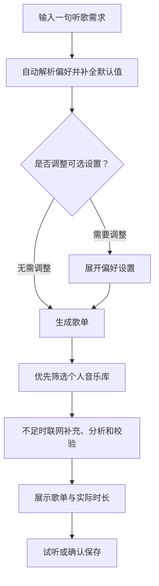
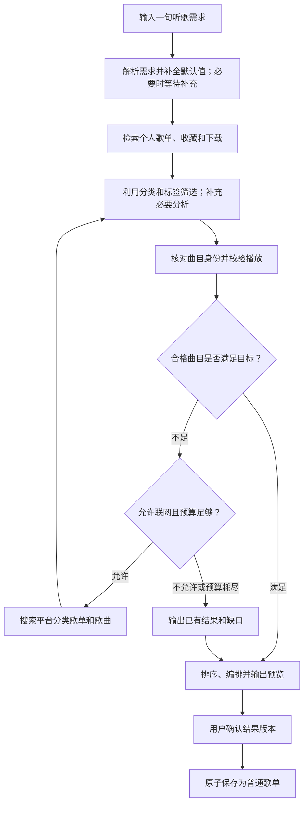

# VideoDream 场景歌单 Agent 功能设计

| 属性名 | 备注 |
|---|---|
| 文档版本 | V1.1 |
| 更新日期 | 2026-10-13 |
| 技术方案 | Skill + MCP |
| 文档状态 | 功能已实施；本地闭环和网易云来源已验证；在线模型验收受服务余额限制 |
| 核心交互 | 用户输入一句听歌需求，其他选项默认补全 |

## 1. 功能目标

| 项目 | 设计 |
|---|---|
| 用户输入 | 当前情绪、正在进行的活动或希望达到的效果；任意一项即可 |
| 示例 | “工作时听”“心情低落，想放松”“打游戏，来点有节奏的” |
| 核心能力 | 理解需求 → 检索候选 → 筛选匹配 → 校验 → 输出歌单 |
| 来源优先级 | 当前用户的歌单 → 收藏 → 已下载音乐；不足时联网补充 |
| 分类利用 | 优先利用已有歌单分类、名称、描述和曲目标签 |
| 结果交付 | 可试听、可查看推荐理由、可重新生成、确认后保存 |
| Agent 特点 | 根据检索和校验结果，自主决定下一步工具调用 |
| 首期形态 | 一个音乐 Agent；Skill 和 MCP 工具支持后续多个 Agent 共用 |

## 2. 功能范围

### 2.1 项目已有能力与新增能力

| 能力 | 当前基础 | 本次设计 |
|---|---|---|
| 个人音乐库 | 已有歌单、收藏、下载、播放历史 | 增加面向推荐的检索和筛选 |
| 在线歌曲搜索 | 已有歌曲搜索与来源解析 | 封装为 MCP 工具 |
| 播放 | 已有播放解析和播放器 | 增加推荐曲目的播放校验 |
| 歌词 | 现有查询依赖已下载文件 | 增加基于歌曲身份的歌词查询 |
| 平台歌单分类 | 需要新增接入 | 获取分类目录或使用分类关键词搜索 |
| 在线歌单搜索 | 需要新增接入 | 搜索歌单并获取曲目 |
| 歌曲特征 | 需要新增 | 标签、歌词语义及必要的音频分析 |
| Agent 调度 | 需要新增 | 工具选择、执行预算、任务恢复和结果保存 |

**上线条件：至少一个平台完成真实的歌单检索、曲目获取和播放校验。**

### 2.2 检索模式

| 模式 | 行为 |
|---|---|
| 个人库优先，默认 | 先筛选个人音乐库，合格歌曲不足时联网补充 |
| 仅个人库 | 只从个人音乐库选择歌曲，不搜索新歌曲 |
| 探索新歌 | 优先搜索在线分类歌单，个人历史辅助理解偏好 |

> “仅个人库”限制候选来源；已有在线歌曲的播放和歌词获取仍可能需要联网。新增网络请求由单独设置控制。

## 3. 用户交互

### 3.1 输入与需求解析

**只保留一个必填输入框，其他选项收起并使用默认值。**

用户描述情绪、活动或想达到的效果中的任意一项即可生成歌单。

#### 必填项

| 属性名 | 备注 |
|---|---|
| `need`：听歌需求 | 合并情绪、活动、期望效果；用户用一句话描述，系统自动解析 |
| 输入示例 | “工作时听”“心情低落，想放松”“打游戏，来点有节奏的” |
| 输入要求 | 不要求用户同时说明三个维度，也不要求使用固定格式 |

#### 可选项与默认值

这些选项放在折叠的「偏好设置」中，用户无需展开即可生成。

| 属性名 | 备注 |
|---|---|
| `vocals`：人声偏好 | 默认**允许人声**；可选择纯音乐 |
| `languages`：语言 | 默认**中文**；可选择其他语言或不限 |
| `exclusions`：排除条件 | 默认**无排除条件**；可选填歌曲、歌手或主题 |
| `target_count`：歌曲数量 | 默认 **20 首**；可调整 |
| `target_duration_minutes`：目标时长 | 默认 **60 分钟**；可调整 |
| `source_mode`：检索模式 | 默认**个人库优先**；可选择仅个人库、探索新歌 |
| `network_allowed`：网络请求 | 默认**允许新增网络检索和分析请求**；可关闭 |

#### 自动解析规则

| 规则 | 处理方式 |
|---|---|
| 自然语言识别 | “纯音乐”“英文歌”“不要某歌手”等直接转换为偏好 |
| 默认值补全 | 用户未提及的条件自动采用默认值 |
| 冲突处理 | 以用户最后明确设置的条件为准，并显示解析后的条件 |
| 情绪推断 | “心情低落”默认推荐舒缓、陪伴方向；明确要求伤感时按伤感方向推荐 |
| 推荐方向 | 用户明确提出的期望效果优先于当前情绪 |
| 人声含义 | “允许人声”同时允许有人声歌曲和纯音乐 |
| 语言适用范围 | 中文要求用于有人声歌曲；纯音乐不因没有语言被排除 |
| 数量与时长 | 默认以 **20 首为主要目标、60 分钟为参考目标**，展示实际时长 |
| 时长优先 | 用户明确说“凑够一小时”时，自动将时长作为主要目标 |
| 追问条件 | 仅在条件矛盾或无法形成可执行需求时追问；普通输入直接生成 |

> 20 首与 60 分钟无法保证同时精确满足。系统按主要目标执行，并展示实际首数和时长。

### 3.2 简化后的操作流程

流程图中的来源顺序对应默认模式；其他模式及网络限制按第 2.2 节执行。

#### 使用示例

| 用户输入 | 系统执行 |
|---|---|
| “工作时听” | 推荐适合专注的歌曲；采用中文、允许人声、20 首等默认设置 |
| “睡觉，纯音乐” | 选择低刺激纯音乐；不应用人声歌曲的语言限制 |
| “打游戏，英文歌，30 首” | 覆盖语言和数量默认值，优先个人库，不足时联网补充 |
| “只用我的歌单，不要联网” | 限定个人库并关闭新增网络请求；不足时展示缺口 |

### 3.3 页面与操作

| 页面区域 | 内容 |
|---|---|
| 入口 | 音乐中心增加“场景歌单”视图 |
| 输入区 | 一个自然语言必填框；其他选项放入折叠的「偏好设置」 |
| 执行区 | 检索、分析、校验进度；支持取消 |
| 结果区 | 歌单名称、歌曲顺序、歌手、时长、来源、推荐理由 |
| 结果状态 | 匹配证据、播放校验时间、未知特征、未满足条件 |
| 操作 | 试听、播放全部、调整需求重新生成、确认保存 |
| 历史记录 | 查看任务及结果；按状态继续任务或创建重试任务 |

**保存行为：**生成完成后先展示预览；用户确认具体结果版本后，创建普通歌单。

## 4. 执行流程

以下为默认“个人库优先”流程：

### 4.1 歌单分类的使用

| 分类来源 | 用途与限制 |
|---|---|
| 个人歌单名称、描述 | 定位候选；用户自定义名称只能作为线索 |
| 平台场景分类 | 将“工作、游戏、睡眠”等需求映射到检索条件 |
| 平台情绪、主题分类 | 获取治愈、快乐、情歌、励志等候选 |
| 曲目级标签 | 辅助逐首筛选；保留来源和可信度 |
| 分类缺失的平台 | 使用关键词搜索，并标记其检索方式 |

**首期分类映射采用版本化配置，不新增分类数据库表。**

平台是否支持分类目录、标签过滤或关键词搜索，由适配器声明。

### 4.2 类型判断与匹配

| 目标 | 判断依据 | 处理规则 |
|---|---|---|
| 情歌 | 歌词中的爱情、关系、思念表达 | 区分甜蜜、失恋、思念等主题 |
| 励志 | 歌词中的坚持、成长、奋斗表达 | 结合上下文，识别讽刺或消极叙事 |
| 兴奋、有节奏感 | 节拍、能量、节奏稳定性 | 平台分类用于召回，必要时分析音频 |
| 专注 | 人声、能量变化、听感干扰 | 结合用户对人声和曲风的偏好 |
| 睡眠 | 低刺激、平缓变化、较少突变 | 对需要严格满足的特征补充证据 |

| 匹配规则 | 执行要求 |
|---|---|
| 硬条件优先 | 人声、语言、排除项等有效筛选条件必须满足；关键特征未知时不计为合格 |
| 软偏好排序 | 综合场景适配、期望效果、个人偏好和证据可信度 |
| 分类证据 | 歌单分类描述整体，不能直接赋予所有曲目相同特征 |
| 按需分析 | 优先复用有效标签和缓存；证据不足时补充歌词或音频分析 |
| 证据记录 | 每项特征记录来源、置信度、分析时间和覆盖范围 |
| 覆盖限制 | 局部试听不能证明整首无人声、始终平缓或音频完整 |
| 排序编排 | 去重，控制同歌手集中度，减少不合理的能量突变 |
| 条件放宽 | 用户明确同意后更新需求；系统不自动放宽硬条件 |

### 4.3 校验规则

| 校验项 | 执行要求 |
|---|---|
| 歌曲身份 | 核对平台 ID、歌名、歌手、版本、时长 |
| 跨平台去重 | 元数据匹配结合版本信息；不只按歌名合并 |
| 播放可用性 | 解析资源并实际探测音频；仅有链接不算通过 |
| 试听限制 | 区分试听与完整可播放；按用户要求筛选 |
| 认证需求 | 标记需要登录；等待认证后继续 |
| 时效 | 显示校验时间；用户播放时重新解析临时资源 |
| 数量不足 | 返回已有合格曲目及缺少首数或时长 |
| 搜索覆盖 | 达到预算时说明已检查范围，不宣称已遍历整个音乐库 |

## 5. Skill + MCP 架构

| 模块 | 职责 |
|---|---|
| Skill | 描述推荐方法、分类映射、工具使用顺序、证据标准和停止条件 |
| Agent Runtime | 加载 Skill、处理模型工具调用、管理任务和结果 |
| MCP Server | 提供结构化工具参数、返回值及错误 |
| 业务服务 | 执行音乐检索、歌词获取、分析、校验和保存 |
| 后端策略 | 强制身份隔离、来源限制、预算及保存授权 |
| 模型服务 | 复用项目 AI 配置；接入前验证工具调用能力 |
| 部署 | 前端 `5174`，后端 `8001`；MCP 复用后端进程和端口 |

**调用方式：**由本地 Runtime 将模型的工具调用转换为 MCP 调用；模型服务无需访问本机地址。

### 5.1 Skill 设计

| 属性名 | 备注 |
|---|---|
| 名称 | `scene-playlist` |
| 加载方式 | 项目 Runtime 按技能注册配置读取；定义项目自己的加载机制 |
| 主文件 | `SKILL.md`：触发条件、执行方法、工具规则、输出要求 |
| 配套资源 | 场景分类映射、特征证据规则、输入输出 Schema |
| 版本 | 主文件、分类映射、输入、解析及结果 Schema 共同计算 SHA-256；任务开始时固定版本；版本变化后旧任务需重新生成 |
| 权限边界 | Skill 不保存密钥；权限和执行限制由后端强制校验 |
| 复用 | 多个 Agent 共享同一技能版本，任务上下文分别维护 |

### 5.2 MCP 工具

| 工具名 | 功能与主要返回内容 |
|---|---|
| `search_my_music` | 分页检索当前用户歌单、收藏、下载；返回来源和候选信息 |
| `list_music_categories` | 获取平台分类能力、分类目录或可用关键词映射 |
| `search_online_playlists` | 按场景、情绪、主题搜索歌单；返回分类依据 |
| `get_playlist_tracks` | 分页获取歌单曲目；返回稳定歌曲身份 |
| `search_online_tracks` | 补充单曲或替代来源；返回版本和访问限制 |
| `get_track_features` | 获取标签、歌词语义及必要音频特征；返回证据和覆盖范围 |
| `validate_tracks` | 校验身份、播放及试听限制；返回原因和校验时间 |
| `save_playlist` | 在明确保存授权下，保存指定任务的指定结果版本 |

**统一返回：**数据、来源、覆盖范围、错误代码、是否可重试、耗时及预算消耗。

工具参数不接受模型自行指定用户身份。

### 5.3 权限设计

| 项目 | 规则 |
|---|---|
| MCP 地址 | `/api/music/mcp`，采用无状态 Streamable HTTP |
| 任务凭证 | 服务端签发短期凭证，绑定用户、原始会话、任务和工具范围 |
| 有效期 | 5 分钟；运行时每轮重新签发；凭证还绑定当前 Worker，替换后旧凭证失效 |
| 每次调用 | 重新检查会话、账号状态、音乐开关和数据归属 |
| 中间件接入 | MCP 路径使用任务凭证验证器，并执行共享功能检查 |
| 管理员使用 | 推荐任务按当前账号的个人数据范围执行 |
| 保存工具 | 默认不授予写权限；用户确认后签发绑定结果版本的保存授权 |
| 外部文本 | 歌词、网页和平台描述作为数据处理，不执行其中的指令 |
| 数据发送 | 模型仅接收必要候选和偏好摘要；凭证、密钥不进入提示词 |
| 外部客户端 | 首期供项目内部调用；开放外部客户端时补充标准认证方案 |

## 6. 任务管理

### 6.1 状态与恢复

| 状态 | 含义 |
|---|---|
| `pending` / `running` | 等待执行 / 正在执行 |
| `waiting_input` | 等待用户补充需求 |
| `waiting_auth` | 等待认证或认证服务恢复 |
| `finished` / `partial` | 满足目标 / 输出部分结果及缺口 |
| `failed` / `cancelled` | 执行失败 / 用户取消 |
| `interrupted` | Worker 中断或服务重启，等待用户继续 |

| 执行规则 | 设计 |
|---|---|
| Worker 租约 | MySQL 中维护；每 15 秒续租，60 秒到期 |
| 并发保护 | 领取与更新检查状态、Worker、租约和 `revision` |
| 等待状态 | 释放执行租约；暂停期间不消耗执行时间 |
| 服务恢复 | 检测租约到期的任务并标记中断；用户继续后重新校验会话 |
| 取消与删除 | 设置状态或删除标记；后续工具和保存检查均拒绝继续 |
| 重试与微调 | 创建关联原任务的新任务，保留原结果 |
| 进度记录 | 保存操作摘要、计数、错误和证据，不保存模型内部推理 |

### 6.2 建议初始上限

| 属性名 | 备注 |
|---|---|
| 决策次数 | 最多 12 次模型决策 |
| 联网搜索 | 最多 3 轮；请求重试也计入调用预算 |
| 候选数量 | 最多 100 首进入深入分析和校验 |
| 输出数量 | 默认 20 首，最多 50 首 |
| 工具批量 | 每批最多 20 首 |
| 执行时长 | 累计运行最多 600 秒 |
| 模型用量 | 总计最多 80,000 tokens，包含歌词分类；调用前预留输入输出预算 |
| 并发 | 默认每用户最多 1 个执行任务；全局上限可配置 |
| 快照大小 | 单任务持久化 JSON 总计不超过 512 KiB，步骤最多 200 条；结束时移除临时候选，结果仅保留已验证曲目 |
| 其他调用上限 | 每任务最多 60 次工具调用、160 次平台网络请求、100 次语义分析；模型请求单独按决策和 tokens 预算计费 |
| 音频上限 | 单次下载 32 MiB、45 秒；完整音轨分析最长 20 分钟；ffmpeg 解码超时 30 秒 |

## 7. 数据设计

**通用约定：**新表使用 InnoDB、utf8mb4；外键字段与现有表类型、排序规则一致。

时间使用 Unix 秒 `DOUBLE`；JSON 经后端 Schema 校验。

### 7.1 新增：`music_recommendation_runs`

| 属性名 | 备注 |
|---|---|
| `run_id` | `CHAR(32) NOT NULL`；主键 |
| `user_id` | `BIGINT NOT NULL`；关联 `users.id`，删除用户时级联删除 |
| `parent_run_id` | `CHAR(32) NULL`；关联本表 `run_id`，删除父任务时置空 |
| `status` | `VARCHAR(24) NOT NULL DEFAULT 'pending'`；任务状态 |
| `request` | `JSON NOT NULL`；原始 `need`、结构化需求、默认值补全结果、来源及网络限制 |
| `context` | `JSON NOT NULL`；绑定会话、预算消耗、搜索游标、错误和等待原因 |
| `steps` | `JSON NOT NULL`；工具调用摘要及进度，初始 `[]` |
| `result` | `JSON NOT NULL`；歌单预览、曲目证据、校验状态及缺口，初始 `{}` |
| `policy_version` | `VARCHAR(40) NOT NULL`；分类映射及执行策略版本 |
| `skill_version` | `VARCHAR(64) NOT NULL`；Skill 内容哈希 |
| `idempotency_key` | `CHAR(64) NOT NULL`；请求键的 SHA-256，新生成操作使用新键，重试复用原键 |
| `revision` | `INT UNSIGNED NOT NULL DEFAULT 0`；并发更新版本 |
| `result_version` | `INT UNSIGNED NOT NULL DEFAULT 0`；预览结果版本 |
| `saved_playlist_id` | `CHAR(24) NULL`；关联 `music_playlists.id`，歌单删除后置空 |
| `saved_at` | `DOUBLE NULL`；成功保存时间；歌单删除后保留 |
| `worker_id` | `VARCHAR(64) NULL`；当前执行者 |
| `lease_until` | `DOUBLE NULL`；租约到期时间 |
| `created_at` | `DOUBLE NOT NULL`；创建时间 |
| `updated_at` | `DOUBLE NOT NULL`；更新时间 |
| `deleted` | `BOOLEAN NOT NULL DEFAULT FALSE`；软删除标记 |
| 唯一索引 | `rec_request(user_id, idempotency_key)` |
| 查询索引 | `rec_owner(user_id, deleted, created_at)` |
| 调度索引 | `rec_worker(deleted, status, lease_until)` |

### 7.2 新增：`music_track_features`

| 属性名 | 备注 |
|---|---|
| `user_id` | `BIGINT NOT NULL`；关联 `users.id`，删除用户时级联删除 |
| `track_key` | `CHAR(64) NOT NULL`；复用现有按用户隔离的歌曲标识计算规则 |
| `track_snapshot` | `JSON NOT NULL`；平台、歌曲 ID、标题、歌手、版本、时长等稳定元数据 |
| `features` | `JSON NOT NULL`；主题、情绪、语言、人声、节拍、能量等；未知属性为 `null` |
| `evidence` | `JSON NOT NULL`；证据来源、置信度、歌词和音频覆盖范围 |
| `content_signature` | `CHAR(64) NOT NULL`；分析输入签名，涵盖实际使用的元数据、标签、歌词或音频 |
| `analyzer_version` | `VARCHAR(40) NOT NULL`；分析器版本 |
| `checked_at` | `DOUBLE NOT NULL`；分析时间 |
| `expires_at` | `DOUBLE NOT NULL`；缓存到期时间 |
| 主键 | `(user_id, track_key)` |
| 清理索引 | `feature_expiry(expires_at)` |
| 曲目关系 | 不关联 `music_tracks` 外键；候选曲目可能尚未保存 |
| 缓存规则 | 成功结果默认 7 天；未获取到特征的结果 24 小时 |
| 失效规则 | 稳定身份、时长、链接、本地文件大小/mtime、实际歌词内容、在线/离线分析模式、语义模型及 API 配置或分析器版本变化时失效；曲目合并清除旧、新标识缓存 |
| 校验隔离 | 不用特征缓存替代本次播放可用性校验 |

### 7.3 修改：`music_playlist_tracks`

以下为修改后的完整字段结构：

| 属性名 | 备注 |
|---|---|
| `playlist_id` | 现有 `CHAR(24) NOT NULL` |
| `track_id` | 现有 `CHAR(64) NOT NULL` |
| `added_at` | 现有 `DOUBLE NOT NULL` |
| `position` | 新增 `INT UNSIGNED NULL DEFAULT NULL`；生成歌单从 0 开始排序 |
| 主键 | 保留 `(playlist_id, track_id)` |
| 外键一 | `playlist_id → music_playlists.id`，`ON DELETE CASCADE` |
| 外键二 | `track_id → music_tracks.id`，`ON DELETE CASCADE` |
| 新增索引 | `playlist_position(playlist_id, position)` |
| 旧歌单兼容 | `position` 保持空值，按 `added_at, track_id` 排序 |
| 有序歌单 | 按 `position` 排序；新增曲目追加，曲目合并保留有效顺序 |
| 写入兼容 | 现有未指定列名的 `INSERT ... VALUES` 改为显式列名 |

### 7.4 复用表及配置

| 属性名 | 备注 |
|---|---|
| `system_settings` | 表结构保持 `id INT PRIMARY KEY`、`config MEDIUMTEXT NOT NULL` |
| 新增配置内容 | Agent 开关、网络开关、允许来源、预算和并发上限；默认关闭 Agent |
| `resources` | 表结构不变；新增 `kind='music_recommendation'`、`resource_key=run_id` 的资源记录 |
| 资源同步 | 任务与资源摘要在同一 MySQL 事务内更新；同步删除标记 |
| `music_tracks` / `music_playlists` | 结构不变；保存时写入普通歌曲与歌单数据 |
| `account_migrations` | 结构不变；记录 `music-agent-v1` 迁移完成时间与备份位置 |

### 7.5 Redis

**本功能不新增、不修改 Redis key。**任务、租约、取消和幂等均由 MySQL 管理。

| 属性名 | 备注 |
|---|---|
| 复用 key | `videodream:session:{sid}`；示例 `videodream:session:abc123` |
| 类型与内容 | 现有 Hash；`uid` 为用户 ID 字符串、`digest` 为会话密文摘要、`version` 为账号认证版本字符串；Agent 仅读取用户和认证版本 |
| TTL | 沿用现有 `604800` 秒；Agent 不延长会话 |
| 读写 | 工具调用时读取并验证；创建、更新、删除沿用现有认证模块 |
| 失效 | 会话过期、退出登录、账号停用或认证版本变化后拒绝调用 |
| 一致性 | 凭证有效且会话有效才允许执行；Redis 不可用时暂停受保护操作 |

### 7.6 保存、迁移与回滚

| 项目 | 方案 |
|---|---|
| 保存事务 | 锁定任务 → 校验归属、状态、结果版本和授权 → 写歌曲、歌单、顺序 → 更新任务及资源摘要 → 提交 |
| 重复保存 | 已保存的相同结果返回原歌单，避免重复创建 |
| 歌单已删除 | 保留 `saved_at`，返回“已保存歌单已删除”；重新创建需要新操作和确认 |
| 迁移前 | 备份受影响音乐表，检查 MySQL 版本、外键和 JSON 支持 |
| 迁移执行 | 幂等检查表、列和索引；完成全部步骤后记录迁移版本 |
| 历史数据 | 不批量分析旧歌曲；旧歌单顺序字段保持空值 |
| 回滚顺序 | 关闭入口 → 停止任务 → 备份新增数据 → 部署兼容版本 |
| 表结构回滚 | 脚本先备份所有 `music_%` 表、关闭 Agent、停止未结束任务、隐藏任务资源，再删除新增两表及 `position` 列（同时删除其索引）和迁移记录；MySQL DDL 不按事务回滚处理 |
| 保留结果 | 已生成的普通歌单和曲目保留；删除顺序字段会失去生成顺序 |

## 8. 接口与项目改动范围

### 8.1 已实现接口

统一前缀：`/api/music/recommendations`。

| 接口 | 功能 |
|---|---|
| `GET /capabilities` | 查询管理员功能与网络开关、允许来源及 Skill 版本 |
| `POST /` | 创建任务；支持请求幂等键；接收 `need` 及可选偏好 |
| `GET /` | 分页查询当前用户任务 |
| `GET /{run_id}` | 查询进度、预览结果及版本 |
| `POST /{run_id}/continue` | 提交补充输入或完成认证后继续 |
| `POST /{run_id}/cancel` | 取消任务 |
| `POST /{run_id}/retry` | 创建关联原任务的新任务 |
| `POST /{run_id}/save` | 确认并保存指定结果版本 |
| `DELETE /{run_id}` | 删除任务记录；不连带删除已保存歌单 |

### 8.2 实施范围

| 模块 | 计划改动 |
|---|---|
| 前端音乐中心 | 新增单输入框、折叠偏好、进度、结果、任务历史及保存操作 |
| Agent 模块 | 新增 Runtime、任务存储、策略校验、默认值补全和预算管理 |
| Skill 模块 | 新增技能文件、映射配置和加载器 |
| MCP 模块 | 新增 Client、Server 和工具 Schema |
| 音乐业务 | 提取可复用服务，新增分类歌单适配器和曲目特征分析 |
| 音乐库 | 新增表迁移、顺序读写、原子保存 |
| 认证与资源管理 | 接入任务凭证、资源归属、账号取消和删除 |
| 系统设置 | 新增功能、来源及预算配置 |
| 服务运行 | 保持前端 `5174`、后端 `8001`；统一验证地址 `http://127.0.0.1:5174/` |

## 9. 实施阶段与验收

### 9.1 实施阶段

| 阶段 | 交付范围 |
|---|---|
| 第一阶段：来源验证 | 验证一个平台的分类检索、歌单曲目、歌词和播放能力 |
| 第二阶段：完整闭环 | 简化输入、个人库优先、Skill、MCP、Agent 调度、校验、预览和确认保存 |
| 第三阶段：质量增强 | 扩展平台，完善音频分析、编排及推荐效果评估 |
| 后续扩展 | 新增其他 Agent，复用现有 Skill 和 MCP 工具 |

### 9.2 验收标准

| 验收场景 | 预期结果 |
|---|---|
| 仅输入一句听歌需求 | 无需展开偏好即可生成；默认允许人声、中文、无排除条件、20 首、参考 60 分钟、个人库优先、允许新增网络请求 |
| 自然语言指定偏好 | 正确覆盖默认值；纯音乐不受人声语言要求影响 |
| 同时存在数量和时长 | 默认数量优先；明确要求凑够时长时以时长为主，展示实际结果 |
| 个人库合格曲目足够 | 不触发新歌曲搜索 |
| 个人库不足且允许联网 | 利用平台分类补充并重新校验 |
| 仅个人库或禁止联网 | 按限制执行，明确展示结果缺口 |
| 纯音乐、排除失恋主题 | 有证据支持；未知特征不冒充满足硬条件 |
| 分类正确但单曲不合适 | 剔除该曲目并尝试补充 |
| 身份错误、仅试听、无法播放 | 展示原因，按要求剔除或替换 |
| 用户取消、账号停用、会话失效 | 停止后续受保护操作 |
| 服务重启或 Worker 丢失 | 任务可识别为中断，支持重新认证后继续 |
| 并发执行、重复保存、旧版本保存 | 防止重复写入，拒绝过期版本 |
| 旧歌单迁移与回滚 | 原有读写可用，已生成普通歌单保留 |

## 10. 方案收益与成本

| 优点 | 成本及限制 |
|---|---|
| 一句话输入，默认值自动补全 | 需要一致的需求解析和偏好优先级规则 |
| 复用现有音乐能力 | 需要提取共享业务服务 |
| Skill 可独立维护和复用 | 需要版本管理及效果评估 |
| MCP 工具可供多个 Agent 使用 | 增加协议、认证和工具 Schema 的维护成本 |
| 利用平台分类减少分析 | 分类覆盖和质量依赖平台实际能力 |
| 自主补充搜索和校验 | 需要严格控制调用次数、时间和模型用量 |
| 推荐过程可解释 | 音乐偏好具有主观性，结果不能保证人人满意 |

## 11. 文档与实施记录

| 属性名 | 备注 |
|---|---|
| 文档范围 | 记录 Skill + MCP 功能设计、实际实现、数据结构和验收情况 |
| 当前交付 | 前后端代码、项目 Skill、迁移及来源验证脚本、相关测试和本文件 |
| 实施授权 | 用户已明确授权按本文件实现全部功能，无需逐项确认；已执行本地迁移，无 Git 提交或推送 |

## 12. 实现细节

### 12.1 代码与执行

| 模块 | 已实现行为 |
|---|---|
| `backend/music_agent/api.py` | 当前账号任务创建、分页、查询、取消、继续、关联重试、指定结果版本保存和软删除 |
| `runtime.py` / `store.py` | MySQL 任务、租约、幂等及乐观版本；解析、模型调用和工具执行均校验 Worker；取消、等待及中断记录累计执行时间 |
| `model.py` | 复用管理后台 AI 配置；支持 Chat Completions 与 Responses 工具调用；禁用网络时使用本地解析和确定性 MCP 调度；模型请求关闭自动重试，事先预留输入输出 tokens |
| `mcp.py` / `auth.py` | 官方 MCP SDK 无状态 Streamable HTTP；本地 Client 调用固定 `8001`；短期任务凭证和独立保存授权；每个 ASGI 事件循环使用独立协议传输实例 |
| `service.py` | 后端强制个人库优先、候选范围和批次限制；先分析/校验个人候选并完成可检索分页，合格曲目不足时才放行联网；保存曲目和顺序在同一事务中完成 |
| `platforms.py` | 网易云、QQ 歌单关键词检索和曲目适配；网易云、QQ 身份歌词及 LRCLIB 身份匹配补充；复用已有网易云/QQ/酷狗单曲检索 |
| `features.py` | 歌词语义及本地语言识别；librosa 整曲节拍、能量、变化、稳定性分析；不将无歌词判成纯音乐，不从节拍推断人声；情歌/励志需要曲目级语义证据 |
| `validation.py` | 平台 ID、标题、歌手、版本时长比对；完整有界下载、ffprobe 探测和 ffmpeg 解码到结尾；拒绝试听、时长不符、身份错误及无法证明完整的音源 |
| `models.py` / `skill.py` | 受限输入、解析及结果 Schema；最多 50 首结果和 100 首拒绝摘要；单份特征/证据不超过 16 KiB；内容哈希包含全部业务 Schema |
| 前端 | 音乐中心“场景歌单”；需求输入、收起偏好、解析展示、进度/用量、取消/继续、试听/播放全部、证据、覆盖及缺口、确认保存、任务历史和管理配置 |

### 12.2 JSON 与配置

本次 MySQL 表结构以第 7 节为准：新增 `music_recommendation_runs`、`music_track_features`，仅为 `music_playlist_tracks` 增加 `position` 和 `playlist_position`；其他表结构不变。未新增分类表，因为分类映射保存在项目 Skill 的版本化 JSON 中。Redis 无结构或 TTL 变更，理由及已有会话 key 的一致性规则见第 7.5 节。

| JSON 字段 | 实际结构 |
|---|---|
| 任务 `request` | `{need, preferences, parsed?}`；仅显式修改的偏好覆盖自然语言解析；解析后包含场景、情绪、效果、语言、人声、排除主题、主要目标和网络/来源限制 |
| 任务 `context` | `{session_id, limits, budget, message, candidates, personal_searched?, coverage?, online_playlists?, base_seconds?, active_started_at?, waiting_reason?, stop_reason?, actual_tokens?}`；会话和临时候选不向前端或模型公开 |
| 任务 `steps` | `[{tool, at, elapsed, count, error}]`；错误为 `{code, message, retryable}`，只保存执行摘要 |
| 任务 `result` | `{title, tracks, duration_seconds, gap:{count,seconds,primary}, coverage, rejected, notice, budget}`；曲目包含稳定身份、推荐理由、特征与证据、未知项、匹配分及播放校验时间 |
| 特征 `features` | `{vocals,language,themes,moods,scene_scores,tempo,energy,variation,rhythm_stability}`；未知属性为 `null`，无场景评分时为空对象 |
| 特征 `evidence` | `{base_signature,network_analysis,fields,lyrics,audio}`；字段证据记录来源、置信度、覆盖和时间；歌词/音频分别记录覆盖范围；不存音频文件、歌词全文或模型密钥 |
| 特征 `content_signature` | SHA-256：稳定元数据、分析模式/模型、本地文件指纹和实际使用的歌词/解码音频摘要；歌词更新或分析方式变化后重新分析 |

管理后台新增配置均写入现有 `system_settings.config`：

| 配置 | 默认值与范围 |
|---|---|
| `music_agent_enabled` | `false`；管理员启用后可创建/继续/保存任务 |
| `music_agent_network_enabled` | `true`；全局关闭后禁止新增平台和模型网络请求 |
| `music_agent_sources` | `[netease, qq, kugou]`；可选来源；歌单能力由适配器分别声明 |
| `music_agent_decisions` | `12`；范围 `2..12`，包含联网需求解析 |
| `music_agent_search_rounds` | `3`；范围 `0..3`，歌单/单曲搜索共享预算 |
| `music_agent_candidates` | `100`；范围 `1..100` |
| `music_agent_seconds` | `600`；范围 `30..600`，等待期间不累计 |
| `music_agent_tokens` | `80000`；范围 `2000..80000`；记录保守预留量，实际用量另记 |
| `music_agent_concurrency` | `2`；范围 `1..8`；每用户固定最多一个 pending/running 任务 |
| `music_agent_api` | `auto`；可选择 `chat` 或 `responses`；自动模式对 `gpt-6`/`gpt-5.6` 使用 Responses，其他模型使用 Chat |

### 12.3 迁移与回滚操作

| 操作 | 实际结果或命令 |
|---|---|
| 本地数据库 | MySQL `8.0.44`；迁移 `music-agent-v1` 已完成 |
| 迁移前备份 | `C:/softWare/project/UniversalVideo/.run/library-backups/20261013-164827-62b1b95b.json`；包含迁移前音乐表完整行数据 |
| 查看/应用 | 使用项目 Python 执行 `scripts/music-agent-migration.py status` 或 `apply`；音乐库初始化会幂等应用迁移 |
| 回滚前提 | 先停止后端，使用能兼容原表结构的代码版本；新代码再次初始化数据库会重新应用迁移 |
| 回滚命令 | 项目 Python 执行 `scripts/music-agent-migration.py rollback --apply`；脚本强制先备份；已保存的普通歌单和曲目保留，生成顺序不再保留 |
| 恢复策略 | DDL 不支持事务回滚；发生故障时保留脚本输出的备份，重新执行兼容迁移，再按备份恢复新增任务/特征及顺序；不覆盖现有普通歌单 |
| 回滚验证 | 独立临时数据库已验证：迁移可重复应用、回滚保留普通歌单、任务资源隐藏、新增表/列移除、备份完整、迁移可重新执行 |

### 12.4 验收记录与限制

| 验收项 | 结果 |
|---|---|
| 相关后端回归 | 79 项通过：Agent、个人库、播放、歌词、来源和账号隔离；另有隔离数据库迁移回滚测试通过 |
| 本轮新增保护 | 旧 Worker 解析写入拒绝、工具预算结构化错误、离线/在线与模型/歌词变化缓存失效、暂停时间记账、512 KiB 更新原子拒绝、个人库优先、未知时长本地音轨整曲解码 |
| 全量后端基线 | 270 项中 269 项通过；现有 `test_browser_sessions` 在 Windows 上按 Unix `0700` 校验目录权限失败（`511 != 448`），与本功能无关 |
| 前端 | TypeScript 检查和生产构建通过；Playwright 验证桌面、390/360 像素手机页面、离线生成、确认保存及历史；无页面错误或横向溢出 |
| 真实网易云来源 | 歌单 `13432605646`、歌曲 `256470`“远走高飞 / 林忆莲”：真实歌单搜索、曲目、身份歌词和完整音频校验通过，音轨约 `227.7` 秒；满足至少一个真实平台的上线条件 |
| QQ 来源 | 适配已实现；当前真实搜索返回空列表，平台标记 `meta.is_filter=-2`；不把空结果报告成已完成真实平台验收 |
| 当前模型服务 | 项目已有 DeepSeek `deepseek-v4-flash` 返回 HTTP `402 Insufficient Balance`；工具调度已用可控模型响应测试，真实在线模型完整生成仍需充值或更换可用 AI 配置 |
| 默认入口 | 遵循默认关闭 Agent 的设计；管理后台“系统配置”可启用；关闭新增网络请求后，可从有充分本地证据的个人歌曲生成，未知特征或无本地音频会显示缺口 |
| 固定服务地址 | 前端 `5174`、后端/MCP `8001`；统一访问 `http://127.0.0.1:5174/` |
