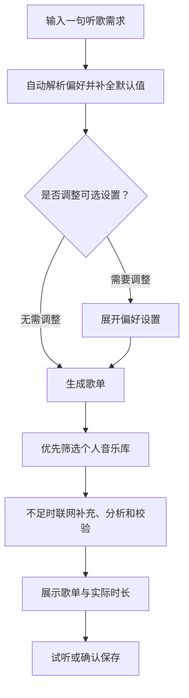
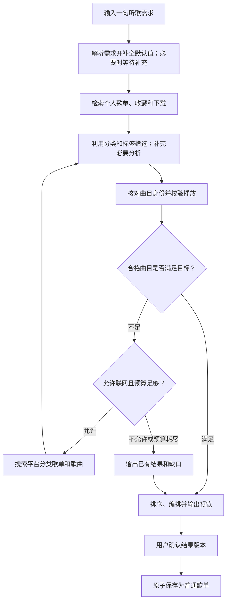
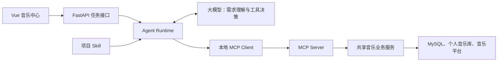

# VideoDream 场景歌单 Agent 功能设计

> 2026-10-23 数据库管理更新：表结构统一由 Flyway 管理，完整定义见 `backend/migrations/sql/V1__baseline.sql`。启动时只检查版本；本文早期自动建表、自动应用结构迁移的说明由 [Flyway 规格](Flyway数据库版本管理设计.md) 替代。历史业务和文件迁移保留为显式命令，已有业务表及 Redis 契约不变。

| 属性名 | 备注 |
|---|---|
| 文档版本 | V1.2 |
| 更新日期 | 2026-10-21 |
| 技术方案 | Skill + MCP |
| 文档状态 | 功能已实施；本地闭环和网易云来源已验证；在线模型验收受服务余额限制 |
| 核心交互 | 用户输入一句听歌需求，其他选项默认补全 |

## 1. 功能目标

| 项目 | 设计 |
|---|---|
| 用户输入 | 当前情绪、正在进行的活动或希望达到的效果；任意一项即可 |
| 示例 | “工作时听”“心情低落，想放松”“打游戏，来点有节奏的” |
| 核心能力 | 理解需求 → 检索候选 → 筛选匹配 → 校验 → 输出歌单 |
| 来源优先级 | 当前用户的歌单 → 收藏 → 已下载音乐；不足时联网补充 |
| 分类利用 | 优先利用已有歌单分类、名称、描述和曲目标签 |
| 结果交付 | 可试听、可查看推荐理由、可重新生成、确认后保存 |
| Agent 特点 | 根据检索和校验结果，自主决定下一步工具调用 |
| 首期形态 | 一个音乐 Agent；Skill 和 MCP 工具支持后续多个 Agent 共用 |

## 2. 功能范围

### 2.1 项目已有能力与新增能力

| 能力 | 当前基础 | 本次设计 |
|---|---|---|
| 个人音乐库 | 已有歌单、收藏、下载、播放历史 | 增加面向推荐的检索和筛选 |
| 在线歌曲搜索 | 已有歌曲搜索与来源解析 | 封装为 MCP 工具 |
| 播放 | 已有播放解析和播放器 | 增加推荐曲目的播放校验 |
| 歌词 | 现有查询依赖已下载文件 | 增加基于歌曲身份的歌词查询 |
| 平台歌单分类 | 需要新增接入 | 获取分类目录或使用分类关键词搜索 |
| 在线歌单搜索 | 需要新增接入 | 搜索歌单并获取曲目 |
| 歌曲特征 | 需要新增 | 标签、歌词语义及必要的音频分析 |
| Agent 调度 | 需要新增 | 工具选择、执行预算、任务恢复和结果保存 |

**上线条件：至少一个平台完成真实的歌单检索、曲目获取和播放校验。**

### 2.2 检索模式

| 模式 | 行为 |
|---|---|
| 个人库优先，默认 | 先筛选个人音乐库，合格歌曲不足时联网补充 |
| 仅个人库 | 只从个人音乐库选择歌曲，不搜索新歌曲 |
| 探索新歌 | 优先搜索在线分类歌单，个人历史辅助理解偏好 |

> “仅个人库”限制候选来源；已有在线歌曲的播放和歌词获取仍可能需要联网。新增网络请求由单独设置控制。

## 3. 用户交互

### 3.1 输入与需求解析

**只保留一个必填输入框，其他选项收起并使用默认值。**

用户描述情绪、活动或想达到的效果中的任意一项即可生成歌单。

#### 必填项

| 属性名 | 备注 |
|---|---|
| `need`：听歌需求 | 合并情绪、活动、期望效果；用户用一句话描述，系统自动解析 |
| 输入示例 | “工作时听”“心情低落，想放松”“打游戏，来点有节奏的” |
| 输入要求 | 不要求用户同时说明三个维度，也不要求使用固定格式 |

#### 可选项与默认值

这些选项放在折叠的「偏好设置」中，用户无需展开即可生成。

| 属性名 | 备注 |
|---|---|
| `vocals`：人声偏好 | 默认**允许人声**；可选择纯音乐 |
| `languages`：语言 | 默认**不限**，用空列表 `[]` 表示；可显式选择中文、英文、日文、韩文等语言 |
| `exclusions`：排除条件 | 默认**无排除条件**；可选填歌曲、歌手或主题 |
| `target_count`：歌曲数量 | 默认 **20 首**；可调整 |
| `target_duration_minutes`：目标时长 | 默认 **60 分钟**；可调整 |
| `source_mode`：检索模式 | 默认**个人库优先**；可选择仅个人库、探索新歌 |
| `network_allowed`：网络请求 | 默认**允许新增网络检索和分析请求**；可关闭 |

#### 自动解析规则

| 规则 | 处理方式 |
|---|---|
| 自然语言识别 | “纯音乐”“英文歌”“不要某歌手”等直接转换为偏好 |
| 默认值补全 | 用户未提及的条件自动采用默认值 |
| 冲突处理 | 以用户最后明确设置的条件为准，并显示解析后的条件 |
| 情绪推断 | “心情低落”默认推荐舒缓、陪伴方向；明确要求伤感时按伤感方向推荐 |
| 推荐方向 | 用户明确提出的期望效果优先于当前情绪 |
| 人声含义 | “允许人声”同时允许有人声歌曲和纯音乐 |
| 语言适用范围 | 仅在显式指定语言时筛选有人声歌曲；默认不限，不因外语或语言未知被排除；纯音乐不因没有语言被排除 |
| 数量与时长 | 默认以 **20 首为主要目标、60 分钟为参考目标**，展示实际时长 |
| 时长优先 | 用户明确说“凑够一小时”时，自动将时长作为主要目标 |
| 追问条件 | 仅在条件矛盾或无法形成可执行需求时追问；普通输入直接生成 |

> 20 首与 60 分钟无法保证同时精确满足。系统按主要目标执行，并展示实际首数和时长。

### 3.2 简化后的操作流程



流程图中的来源顺序对应默认模式；其他模式及网络限制按第 2.2 节执行。

#### 使用示例

| 用户输入 | 系统执行 |
|---|---|
| “工作时听” | 推荐适合专注的歌曲；采用语言不限、允许人声、20 首等默认设置 |
| “睡觉，纯音乐” | 选择低刺激纯音乐；不应用人声歌曲的语言限制 |
| “打游戏，英文歌，30 首” | 覆盖语言和数量默认值，优先个人库，不足时联网补充 |
| “只用我的歌单，不要联网” | 限定个人库并关闭新增网络请求；不足时展示缺口 |

### 3.3 页面与操作

| 页面区域 | 内容 |
|---|---|
| 入口 | 音乐中心增加“场景歌单”视图 |
| 输入区 | 一个自然语言必填框；其他选项放入折叠的「偏好设置」 |
| 执行区 | 检索、分析、校验进度；支持取消 |
| 结果区 | 歌单名称、歌曲顺序、歌手、时长、来源、推荐理由 |
| 结果状态 | 匹配证据、播放校验时间、未知特征、未满足条件 |
| 操作 | 试听、播放全部、调整需求重新生成、确认保存 |
| 历史记录 | 查看任务及结果；按状态继续任务或创建重试任务 |

**保存行为：**生成完成后先展示预览；用户确认具体结果版本后，创建普通歌单。

## 4. 执行流程

以下为默认“个人库优先”流程：



### 4.1 歌单分类的使用

| 分类来源 | 用途与限制 |
|---|---|
| 个人歌单名称、描述 | 定位候选；用户自定义名称只能作为线索 |
| 平台场景分类 | 将“工作、游戏、睡眠”等需求映射到检索条件 |
| 平台情绪、主题分类 | 获取治愈、快乐、情歌、励志等候选 |
| 曲目级标签 | 辅助逐首筛选；保留来源和可信度 |
| 分类缺失的平台 | 使用关键词搜索，并标记其检索方式 |

**首期分类映射采用版本化配置，不新增分类数据库表。**

平台是否支持分类目录、标签过滤或关键词搜索，由适配器声明。

### 4.2 类型判断与匹配

| 目标 | 判断依据 | 处理规则 |
|---|---|---|
| 情歌 | 歌词中的爱情、关系、思念表达 | 区分甜蜜、失恋、思念等主题 |
| 励志 | 歌词中的坚持、成长、奋斗表达 | 结合上下文，识别讽刺或消极叙事 |
| 兴奋、有节奏感 | 节拍、能量、节奏稳定性 | 平台分类用于召回，必要时分析音频 |
| 专注 | 人声、能量变化、听感干扰 | 结合用户对人声和曲风的偏好 |
| 睡眠 | 低刺激、平缓变化、较少突变 | 对需要严格满足的特征补充证据 |

| 匹配规则 | 执行要求 |
|---|---|
| 硬条件优先 | 人声、语言、排除项等有效筛选条件必须满足；关键特征未知时不计为合格 |
| 软偏好排序 | 综合场景适配、期望效果、个人偏好和证据可信度 |
| 分类证据 | 歌单分类描述整体，不能直接赋予所有曲目相同特征 |
| 按需分析 | 优先复用有效标签和缓存；证据不足时补充歌词或音频分析 |
| 证据记录 | 每项特征记录来源、置信度、分析时间和覆盖范围 |
| 覆盖限制 | 局部试听不能证明整首无人声、始终平缓或音频完整 |
| 排序编排 | 去重，控制同歌手集中度，减少不合理的能量突变 |
| 条件放宽 | 用户明确同意后更新需求；系统不自动放宽硬条件 |

### 4.3 校验规则

| 校验项 | 执行要求 |
|---|---|
| 歌曲身份 | 核对平台 ID、歌名、歌手、版本、时长 |
| 跨平台去重 | 元数据匹配结合版本信息；不只按歌名合并 |
| 播放可用性 | 解析资源并实际探测音频；仅有链接不算通过 |
| 试听限制 | 区分试听与完整可播放；按用户要求筛选 |
| 认证需求 | 标记需要登录；等待认证后继续 |
| 时效 | 显示校验时间；用户播放时重新解析临时资源 |
| 数量不足 | 返回已有合格曲目及缺少首数或时长 |
| 搜索覆盖 | 达到预算时说明已检查范围，不宣称已遍历整个音乐库 |

## 5. Skill + MCP 架构



| 模块 | 职责 |
|---|---|
| Skill | 描述推荐方法、分类映射、工具使用顺序、证据标准和停止条件 |
| Agent Runtime | 加载 Skill、处理模型工具调用、管理任务和结果 |
| MCP Server | 提供结构化工具参数、返回值及错误 |
| 业务服务 | 执行音乐检索、歌词获取、分析、校验和保存 |
| 后端策略 | 强制身份隔离、来源限制、预算及保存授权 |
| 模型服务 | 复用项目 AI 配置；接入前验证工具调用能力 |
| 部署 | 前端 `5174`，后端 `8001`；MCP 复用后端进程和端口 |

**调用方式：**由本地 Runtime 将模型的工具调用转换为 MCP 调用；模型服务无需访问本机地址。

### 5.1 Skill 设计

| 属性名 | 备注 |
|---|---|
| 名称 | `scene-playlist` |
| 加载方式 | 项目 Runtime 按技能注册配置读取；定义项目自己的加载机制 |
| 主文件 | `SKILL.md`：触发条件、执行方法、工具规则、输出要求 |
| 配套资源 | 场景分类映射、特征证据规则、输入输出 Schema |
| 版本 | 主文件、分类映射、输入、解析及结果 Schema 共同计算 SHA-256；任务开始时固定版本；版本变化后旧任务需重新生成 |
| 权限边界 | Skill 不保存密钥；权限和执行限制由后端强制校验 |
| 复用 | 多个 Agent 共享同一技能版本，任务上下文分别维护 |

### 5.2 MCP 工具

| 工具名 | 功能与主要返回内容 |
|---|---|
| `search_my_music` | 分页检索当前用户歌单、收藏、下载；返回来源和候选信息 |
| `list_music_categories` | 获取平台分类能力、分类目录或可用关键词映射 |
| `search_online_playlists` | 按场景、情绪、主题搜索歌单；返回分类依据 |
| `get_playlist_tracks` | 分页获取歌单曲目；返回稳定歌曲身份 |
| `search_online_tracks` | 补充单曲或替代来源；返回版本和访问限制 |
| `get_track_features` | 获取标签、歌词语义及必要音频特征；返回证据和覆盖范围 |
| `validate_tracks` | 校验身份、播放及试听限制；返回原因和校验时间 |
| `save_playlist` | 在明确保存授权下，保存指定任务的指定结果版本 |

**统一返回：**数据、来源、覆盖范围、错误代码、是否可重试、耗时及预算消耗。

工具参数不接受模型自行指定用户身份。

### 5.3 权限设计

| 项目 | 规则 |
|---|---|
| MCP 地址 | `/api/music/mcp`，采用无状态 Streamable HTTP |
| 任务凭证 | 服务端签发短期凭证，绑定用户、原始会话、任务和工具范围 |
| 有效期 | 5 分钟；运行时每轮重新签发；凭证还绑定当前 Worker，替换后旧凭证失效 |
| 每次调用 | 重新检查会话、账号状态、音乐开关和数据归属 |
| 中间件接入 | MCP 路径使用任务凭证验证器，并执行共享功能检查 |
| 管理员使用 | 推荐任务按当前账号的个人数据范围执行 |
| 保存工具 | 默认不授予写权限；用户确认后签发绑定结果版本的保存授权 |
| 外部文本 | 歌词、网页和平台描述作为数据处理，不执行其中的指令 |
| 数据发送 | 模型仅接收必要候选和偏好摘要；凭证、密钥不进入提示词 |
| 外部客户端 | 首期供项目内部调用；开放外部客户端时补充标准认证方案 |

## 6. 任务管理

### 6.1 状态与恢复

| 状态 | 含义 |
|---|---|
| `pending` / `running` | 等待执行 / 正在执行 |
| `waiting_input` | 等待用户补充需求 |
| `waiting_auth` | 等待认证或认证服务恢复 |
| `finished` / `partial` | 满足目标 / 输出部分结果及缺口 |
| `failed` / `cancelled` | 执行失败 / 用户取消 |
| `interrupted` | Worker 中断或服务重启，等待用户继续 |

| 执行规则 | 设计 |
|---|---|
| Worker 租约 | MySQL 中维护；每 15 秒续租，60 秒到期 |
| 并发保护 | 领取与更新检查状态、Worker、租约和 `revision` |
| 等待状态 | 释放执行租约；暂停期间不消耗执行时间 |
| 服务恢复 | 检测租约到期的任务并标记中断；用户继续后重新校验会话 |
| 取消与删除 | 设置状态或删除标记；后续工具和保存检查均拒绝继续 |
| 重试与微调 | 创建关联原任务的新任务，保留原结果 |
| 进度记录 | 保存操作摘要、计数、错误和证据，不保存模型内部推理 |

### 6.2 建议初始上限

| 属性名 | 备注 |
|---|---|
| 决策次数 | 规划调整最多6次；解析、语义、纠错共享最多40次模型请求 |
| 联网搜索 | 最多 5 轮；请求重试也计入调用预算 |
| 候选数量 | 最多 100 首进入深入分析和校验 |
| 输出数量 | 默认 20 首，最多 50 首 |
| 工具批量 | 工具参数最多20首；实际首批最多3首，其后最多5首，随缺口和剩余额度收缩 |
| 执行时长 | 累计运行最多 600 秒 |
| 模型用量 | 完整任务总计最多150,000 tokens，包含输入、输出和已计入total_tokens的推理；调用前原子预留，返回后按实际结算 |
| 并发 | 默认每用户最多 1 个执行任务；全局上限可配置 |
| 快照大小 | 单任务持久化 JSON 总计不超过 512 KiB，步骤最多 200 条；结束时移除临时候选，结果仅保留已验证曲目 |
| 其他调用上限 | 每任务最多60次工具调用、默认300次平台请求、100次候选分析；全部模型调用共享40次和15万token上限 |
| 音频上限 | 单次下载 32 MiB、45 秒；完整音轨分析最长 20 分钟；ffmpeg 解码超时 30 秒 |

## 7. 数据设计

**通用约定：**新表使用 InnoDB、utf8mb4；外键字段与现有表类型、排序规则一致。

时间使用 Unix 秒 `DOUBLE`；JSON 经后端 Schema 校验。

### 7.1 新增：`music_recommendation_runs`

| 属性名 | 备注 |
|---|---|
| `run_id` | `CHAR(32) NOT NULL`；主键 |
| `user_id` | `BIGINT NOT NULL`；关联 `users.id`，删除用户时级联删除 |
| `parent_run_id` | `CHAR(32) NULL`；关联本表 `run_id`，删除父任务时置空 |
| `status` | `VARCHAR(24) NOT NULL DEFAULT 'pending'`；任务状态 |
| `request` | `JSON NOT NULL`；原始 `need`、结构化需求、默认值补全结果、来源及网络限制 |
| `context` | `JSON NOT NULL`；绑定会话、预算消耗、搜索游标、错误和等待原因 |
| `steps` | `JSON NOT NULL`；工具调用摘要及进度，初始 `[]` |
| `result` | `JSON NOT NULL`；歌单预览、曲目证据、校验状态及缺口，初始 `{}` |
| `policy_version` | `VARCHAR(40) NOT NULL`；分类映射及执行策略版本 |
| `skill_version` | `VARCHAR(64) NOT NULL`；Skill 内容哈希 |
| `idempotency_key` | `CHAR(64) NOT NULL`；请求键的 SHA-256，新生成操作使用新键，重试复用原键 |
| `revision` | `INT UNSIGNED NOT NULL DEFAULT 0`；并发更新版本 |
| `result_version` | `INT UNSIGNED NOT NULL DEFAULT 0`；预览结果版本 |
| `saved_playlist_id` | `CHAR(24) NULL`；关联 `music_playlists.id`，歌单删除后置空 |
| `saved_at` | `DOUBLE NULL`；成功保存时间；歌单删除后保留 |
| `worker_id` | `VARCHAR(64) NULL`；当前执行者 |
| `lease_until` | `DOUBLE NULL`；租约到期时间 |
| `created_at` | `DOUBLE NOT NULL`；创建时间 |
| `updated_at` | `DOUBLE NOT NULL`；更新时间 |
| `deleted` | `BOOLEAN NOT NULL DEFAULT FALSE`；软删除标记 |
| 唯一索引 | `rec_request(user_id, idempotency_key)` |
| 查询索引 | `rec_owner(user_id, deleted, created_at)` |
| 调度索引 | `rec_worker(deleted, status, lease_until)` |

### 7.2 新增：`music_track_features`

| 属性名 | 备注 |
|---|---|
| `user_id` | `BIGINT NOT NULL`；关联 `users.id`，删除用户时级联删除 |
| `track_key` | `CHAR(64) NOT NULL`；复用现有按用户隔离的歌曲标识计算规则 |
| `track_snapshot` | `JSON NOT NULL`；平台、歌曲 ID、标题、歌手、版本、时长等稳定元数据 |
| `features` | `JSON NOT NULL`；主题、情绪、语言、人声、节拍、能量等；未知属性为 `null` |
| `evidence` | `JSON NOT NULL`；证据来源、置信度、歌词和音频覆盖范围 |
| `content_signature` | `CHAR(64) NOT NULL`；分析输入签名，涵盖实际使用的元数据、标签、歌词或音频 |
| `analyzer_version` | `VARCHAR(40) NOT NULL`；分析器版本 |
| `checked_at` | `DOUBLE NOT NULL`；分析时间 |
| `expires_at` | `DOUBLE NOT NULL`；缓存到期时间 |
| 主键 | `(user_id, track_key)` |
| 清理索引 | `feature_expiry(expires_at)` |
| 曲目关系 | 不关联 `music_tracks` 外键；候选曲目可能尚未保存 |
| 缓存规则 | 成功结果默认 7 天；未获取到特征的结果 24 小时 |
| 失效规则 | 稳定身份、时长、链接、本地文件大小/mtime、实际歌词内容、在线/离线分析模式、语义模型及 API 配置或分析器版本变化时失效；曲目合并清除旧、新标识缓存 |
| 校验隔离 | 不用特征缓存替代本次播放可用性校验 |

### 7.3 修改：`music_playlist_tracks`

以下为修改后的完整字段结构：

| 属性名 | 备注 |
|---|---|
| `playlist_id` | 现有 `CHAR(24) NOT NULL` |
| `track_id` | 现有 `CHAR(64) NOT NULL` |
| `added_at` | 现有 `DOUBLE NOT NULL` |
| `position` | 新增 `INT UNSIGNED NULL DEFAULT NULL`；生成歌单从 0 开始排序 |
| 主键 | 保留 `(playlist_id, track_id)` |
| 外键一 | `playlist_id → music_playlists.id`，`ON DELETE CASCADE` |
| 外键二 | `track_id → music_tracks.id`，`ON DELETE CASCADE` |
| 新增索引 | `playlist_position(playlist_id, position)` |
| 旧歌单兼容 | `position` 保持空值，按 `added_at, track_id` 排序 |
| 有序歌单 | 按 `position` 排序；新增曲目追加，曲目合并保留有效顺序 |
| 写入兼容 | 现有未指定列名的 `INSERT ... VALUES` 改为显式列名 |

### 7.4 复用表及配置

| 属性名 | 备注 |
|---|---|
| `system_settings` | 表结构保持 `id INT PRIMARY KEY`、`config MEDIUMTEXT NOT NULL` |
| 新增配置内容 | Agent 开关、网络开关、允许来源、预算和并发上限；默认关闭 Agent |
| `resources` | 表结构不变；新增 `kind='music_recommendation'`、`resource_key=run_id` 的资源记录 |
| 资源同步 | 任务与资源摘要在同一 MySQL 事务内更新；同步删除标记 |
| `music_tracks` / `music_playlists` | 结构不变；保存时写入普通歌曲与歌单数据 |
| `account_migrations` | 结构不变；保留历史 `music-agent-v1` 记录与备份位置，新结构版本由 Flyway 管理 |

### 7.5 Redis

**本功能不新增、不修改 Redis key。**任务、租约、取消和幂等均由 MySQL 管理。

| 属性名 | 备注 |
|---|---|
| 复用 key | `videodream:session:{sid}`；示例 `videodream:session:abc123` |
| 类型与内容 | 现有 Hash；`uid` 为用户 ID 字符串、`digest` 为会话密文摘要、`version` 为账号认证版本字符串；Agent 仅读取用户和认证版本 |
| TTL | 沿用现有 `604800` 秒；Agent 不延长会话 |
| 读写 | 工具调用时读取并验证；创建、更新、删除沿用现有认证模块 |
| 失效 | 会话过期、退出登录、账号停用或认证版本变化后拒绝调用 |
| 一致性 | 凭证有效且会话有效才允许执行；Redis 不可用时暂停受保护操作 |

### 7.6 保存、迁移与回滚

| 项目 | 方案 |
|---|---|
| 保存事务 | 锁定任务 → 校验归属、状态、结果版本和授权 → 写歌曲、歌单、顺序 → 更新任务及资源摘要 → 提交 |
| 重复保存 | 已保存的相同结果返回原歌单，避免重复创建 |
| 歌单已删除 | 保留 `saved_at`，返回“已保存歌单已删除”；重新创建需要新操作和确认 |
| 迁移前 | 备份受影响音乐表，检查 MySQL 版本、外键和 JSON 支持 |
| 迁移执行 | 幂等检查表、列和索引；完成全部步骤后记录迁移版本 |
| 历史数据 | 不批量分析旧歌曲；旧歌单顺序字段保持空值 |
| 回滚顺序 | 关闭入口 → 停止任务 → 备份新增数据 → 部署兼容版本 |
| 表结构回滚 | 脚本先备份所有 `music_%` 表、关闭 Agent、停止未结束任务、隐藏任务资源，再删除新增两表及 `position` 列（同时删除其索引）和迁移记录；MySQL DDL 不按事务回滚处理 |
| 保留结果 | 已生成的普通歌单和曲目保留；删除顺序字段会失去生成顺序 |

## 8. 接口与项目改动范围

### 8.1 已实现接口

统一前缀：`/api/music/recommendations`。

| 接口 | 功能 |
|---|---|
| `GET /capabilities` | 查询管理员功能与网络开关、允许来源及 Skill 版本 |
| `POST /` | 创建任务；支持请求幂等键；接收 `need` 及可选偏好 |
| `GET /` | 分页查询当前用户任务 |
| `GET /{run_id}` | 查询进度、预览结果及版本 |
| `POST /{run_id}/continue` | 提交补充输入或完成认证后继续 |
| `POST /{run_id}/cancel` | 取消任务 |
| `POST /{run_id}/retry` | 创建关联原任务的新任务 |
| `POST /{run_id}/save` | 确认并保存指定结果版本 |
| `DELETE /{run_id}` | 删除任务记录；不连带删除已保存歌单 |

### 8.2 实施范围

| 模块 | 计划改动 |
|---|---|
| 前端音乐中心 | 新增单输入框、折叠偏好、进度、结果、任务历史及保存操作 |
| Agent 模块 | 新增 Runtime、任务存储、策略校验、默认值补全和预算管理 |
| Skill 模块 | 新增技能文件、映射配置和加载器 |
| MCP 模块 | 新增 Client、Server 和工具 Schema |
| 音乐业务 | 提取可复用服务，新增分类歌单适配器和曲目特征分析 |
| 音乐库 | 新增表迁移、顺序读写、原子保存 |
| 认证与资源管理 | 接入任务凭证、资源归属、账号取消和删除 |
| 系统设置 | 新增功能、来源及预算配置 |
| 服务运行 | 保持前端 `5174`、后端 `8001`；统一验证地址 `http://127.0.0.1:5174/` |

## 9. 实施阶段与验收

### 9.1 实施阶段

| 阶段 | 交付范围 |
|---|---|
| 第一阶段：来源验证 | 验证一个平台的分类检索、歌单曲目、歌词和播放能力 |
| 第二阶段：完整闭环 | 简化输入、个人库优先、Skill、MCP、Agent 调度、校验、预览和确认保存 |
| 第三阶段：质量增强 | 扩展平台，完善音频分析、编排及推荐效果评估 |
| 后续扩展 | 新增其他 Agent，复用现有 Skill 和 MCP 工具 |

### 9.2 验收标准

| 验收场景 | 预期结果 |
|---|---|
| 仅输入一句听歌需求 | 无需展开偏好即可生成；默认允许人声、语言不限、无排除条件、20 首、参考 60 分钟、个人库优先、允许新增网络请求 |
| 自然语言指定偏好 | 正确覆盖默认值；纯音乐不受人声语言要求影响 |
| 同时存在数量和时长 | 默认数量优先；明确要求凑够时长时以时长为主，展示实际结果 |
| 个人库合格曲目足够 | 不触发新歌曲搜索 |
| 个人库不足且允许联网 | 利用平台分类补充并重新校验 |
| 仅个人库或禁止联网 | 按限制执行，明确展示结果缺口 |
| 纯音乐、排除失恋主题 | 有证据支持；未知特征不冒充满足硬条件 |
| 分类正确但单曲不合适 | 剔除该曲目并尝试补充 |
| 身份错误、仅试听、无法播放 | 展示原因，按要求剔除或替换 |
| 用户取消、账号停用、会话失效 | 停止后续受保护操作 |
| 服务重启或 Worker 丢失 | 任务可识别为中断，支持重新认证后继续 |
| 并发执行、重复保存、旧版本保存 | 防止重复写入，拒绝过期版本 |
| 旧歌单迁移与回滚 | 原有读写可用，已生成普通歌单保留 |

## 10. 方案收益与成本

| 优点 | 成本及限制 |
|---|---|
| 一句话输入，默认值自动补全 | 需要一致的需求解析和偏好优先级规则 |
| 复用现有音乐能力 | 需要提取共享业务服务 |
| Skill 可独立维护和复用 | 需要版本管理及效果评估 |
| MCP 工具可供多个 Agent 使用 | 增加协议、认证和工具 Schema 的维护成本 |
| 利用平台分类减少分析 | 分类覆盖和质量依赖平台实际能力 |
| 自主补充搜索和校验 | 需要严格控制调用次数、时间和模型用量 |
| 推荐过程可解释 | 音乐偏好具有主观性，结果不能保证人人满意 |

## 11. 文档与实施记录

| 属性名 | 备注 |
|---|---|
| 文档范围 | 记录 Skill + MCP 功能设计、实际实现、数据结构和验收情况 |
| 当前交付 | 前后端代码、项目 Skill、迁移及来源验证脚本、相关测试和本文件 |
| 实施授权 | 用户已明确授权按本文件实现全部功能，无需逐项确认；已执行本地迁移，无 Git 提交或推送 |

## 12. 实现细节

### 12.1 代码与执行

| 模块 | 已实现行为 |
|---|---|
| `backend/modules/music/agent/api.py` | 当前账号任务创建、分页、查询、取消、继续、关联重试、指定结果版本保存和软删除 |
| `runtime.py` / `store.py` | MySQL 任务、租约、幂等及乐观版本；解析、模型调用和工具执行均校验 Worker；取消、等待及中断记录累计执行时间 |
| `model.py` | 复用管理后台 AI 配置；支持 Chat Completions 与 Responses 工具调用；禁用网络时使用本地解析和确定性 MCP 调度；模型请求关闭自动重试，事先预留输入输出 tokens |
| `mcp.py` / `auth.py` | 官方 MCP SDK 无状态 Streamable HTTP；本地 Client 调用固定 `8001`；短期任务凭证和独立保存授权；每个 ASGI 事件循环使用独立协议传输实例 |
| `service.py` | 后端强制个人库优先、候选范围和批次限制；先分析/校验个人候选并完成可检索分页，合格曲目不足时才放行联网；保存曲目和顺序在同一事务中完成 |
| `platforms.py` | 网易云、QQ 歌单关键词检索和曲目适配；网易云、QQ 身份歌词及 LRCLIB 身份匹配补充；复用已有网易云/QQ/酷狗单曲检索 |
| `features.py` | 歌词语义及本地语言识别；librosa 整曲节拍、能量、变化、稳定性分析；不将无歌词判成纯音乐，不从节拍推断人声；情歌/励志需要曲目级语义证据 |
| `validation.py` | 平台 ID、标题、歌手、版本时长比对；完整有界下载、ffprobe 探测和 ffmpeg 解码到结尾；拒绝试听、时长不符、身份错误及无法证明完整的音源 |
| `models.py` / `skill.py` | 受限输入、解析及结果 Schema；最多 50 首结果和 100 首拒绝摘要；单份特征/证据不超过 16 KiB；内容哈希包含全部业务 Schema |
| 前端 | 音乐中心“场景歌单”；需求输入、收起偏好、解析展示、进度/用量、取消/继续、试听/播放全部、证据、覆盖及缺口、确认保存、任务历史和管理配置 |

### 12.2 JSON 与配置

本次 MySQL 表结构以第 7 节为准：新增 `music_recommendation_runs`、`music_track_features`，仅为 `music_playlist_tracks` 增加 `position` 和 `playlist_position`；其他表结构不变。未新增分类表，因为分类映射保存在项目 Skill 的版本化 JSON 中。Redis 无结构或 TTL 变更，理由及已有会话 key 的一致性规则见第 7.5 节。

语言默认值调整为不限：前端初始选项、后端 `Preferences`/`ParsedNeed` 默认值及 Skill 提示词一致使用 `languages: []`；用户在需求中指定语言或显式修改偏好时仍应用该条件。空列表已由现有 JSON 字段和匹配逻辑支持，本次调整无需新增或修改 MySQL 表、字段、索引及关系，也无需修改 Redis key、类型、值结构、TTL、读写或失效规则。历史任务保留原语言条件；Skill 内容与 Schema 的版本哈希会变化，旧版本未完成任务需重新生成。无需数据迁移；回滚时恢复前后端默认值和 Skill 提示词即可，已有空列表仍兼容，无需数据回滚。

Token预算默认值和可配置上限为`150000`，范围`2000..150000`。新增`music_agent_model_calls=40`，规划调整默认/最高6次。读取旧`system_settings.config`时在应用层限制新任务上限，不覆盖其他配置。该表结构仍为`id INT NOT NULL PRIMARY KEY, config MEDIUMTEXT NOT NULL`；无新索引、外键或DDL。新任务保存有效配置快照；旧记录不重算。详细结算与回滚见第16节。

| JSON 字段 | 实际结构 |
|---|---|
| 任务 `request` | `{need, preferences, parsed?}`；仅显式修改的偏好覆盖自然语言解析；解析后包含场景、情绪、效果、语言、人声、排除主题、主要目标和网络/来源限制 |
| 任务 `context` | `{session_id, limits, budget, message, candidates, personal_searched?, coverage?, online_playlists?, base_seconds?, active_started_at?, waiting_reason?, stop_reason?, actual_tokens?}`；会话和临时候选不向前端或模型公开 |
| 任务 `steps` | `[{tool, at, elapsed, count, error}]`；错误为 `{code, message, retryable}`，只保存执行摘要 |
| 任务 `result` | `{title, tracks, duration_seconds, gap:{count,seconds,primary}, coverage, rejected, notice, budget}`；曲目包含稳定身份、推荐理由、特征与证据、未知项、匹配分及播放校验时间 |
| 特征 `features` | `{vocals,language,themes,moods,scene_scores,tempo,energy,variation,rhythm_stability}`；未知属性为 `null`，无场景评分时为空对象 |
| 特征 `evidence` | `{base_signature,network_analysis,fields,lyrics,audio}`；字段证据记录来源、置信度、覆盖和时间；歌词/音频分别记录覆盖范围；不存音频文件、歌词全文或模型密钥 |
| 特征 `content_signature` | SHA-256：稳定元数据、分析模式/模型、本地文件指纹和实际使用的歌词/解码音频摘要；歌词更新或分析方式变化后重新分析 |

管理后台新增配置均写入现有 `system_settings.config`：

| 配置 | 默认值与范围 |
|---|---|
| `music_agent_enabled` | `false`；管理员启用后可创建/继续/保存任务 |
| `music_agent_network_enabled` | `true`；全局关闭后禁止新增平台和模型网络请求 |
| `music_agent_sources` | `[netease, qq, kugou]`；可选来源；歌单能力由适配器分别声明 |
| `music_agent_decisions` | `6`；范围`2..6`，只计规划调整；所有模型请求另受40次总上限 |
| `music_agent_search_rounds` | `5`；范围 `0..5`，歌单/单曲搜索共享预算 |
| `music_agent_candidates` | `100`；范围 `1..100` |
| `music_agent_seconds` | `600`；范围 `30..600`，等待期间不累计 |
| `music_agent_tokens` | `150000`；范围`2000..150000`；实际、执行中预留、待确认分开记录 |
| `music_agent_concurrency` | `2`；范围 `1..8`；每用户固定最多一个 pending/running 任务 |
| `music_agent_api` | `auto`；可选择 `chat` 或 `responses`；自动模式对 `gpt-6`/`gpt-5.6` 使用 Responses，其他模型使用 Chat |

### 12.3 迁移与回滚操作

| 操作 | 实际结果或命令 |
|---|---|
| 本地数据库 | MySQL `8.0.44`；迁移 `music-agent-v1` 已完成 |
| 迁移前备份 | `C:/softWare/project/UniversalVideo/.run/library-backups/20261013-164827-62b1b95b.json`；包含迁移前音乐表完整行数据 |
| 查看/应用 | 使用项目 Python 执行 `scripts/database.py info`、`validate`、`migrate`；应用启动仅检查结构版本 |
| 回滚前提 | 先停止后端并备份，确认目标代码兼容性；Flyway 已接管数据库禁止旧脚本直接删除表和字段 |
| 回滚命令 | 按 Flyway 规格使用对应回滚 SQL 形成补偿迁移，或恢复匹配数据库备份；旧 Agent 结构迁移/回滚脚本已删除 |
| 恢复策略 | DDL 不支持事务回滚；发生故障时保留脚本输出的备份，重新执行兼容迁移，再按备份恢复新增任务/特征及顺序；不覆盖现有普通歌单 |
| 回滚验证 | 独立临时数据库已验证：迁移可重复应用、回滚保留普通歌单、任务资源隐藏、新增表/列移除、备份完整、迁移可重新执行 |

### 12.4 验收记录与限制

| 验收项 | 结果 |
|---|---|
| 相关后端回归 | 79 项通过：Agent、个人库、播放、歌词、来源和账号隔离；另有隔离数据库迁移回滚测试通过 |
| 本轮新增保护 | 旧 Worker 解析写入拒绝、工具预算结构化错误、离线/在线与模型/歌词变化缓存失效、暂停时间记账、512 KiB 更新原子拒绝、个人库优先、未知时长本地音轨整曲解码 |
| 全量后端基线 | 270 项中 269 项通过；现有 `test_browser_sessions` 在 Windows 上按 Unix `0700` 校验目录权限失败（`511 != 448`），与本功能无关 |
| 前端 | TypeScript 检查和生产构建通过；Playwright 验证桌面、390/360 像素手机页面、离线生成、确认保存及历史；无页面错误或横向溢出 |
| 真实网易云来源 | 歌单 `13432605646`、歌曲 `256470`“远走高飞 / 林忆莲”：真实歌单搜索、曲目、身份歌词和完整音频校验通过，音轨约 `227.7` 秒；满足至少一个真实平台的上线条件 |
| QQ 来源 | 适配已实现；当前真实搜索返回空列表，平台标记 `meta.is_filter=-2`；不把空结果报告成已完成真实平台验收 |
| 当前模型服务 | 项目已有 DeepSeek `deepseek-v4-flash` 返回 HTTP `402 Insufficient Balance`；工具调度已用可控模型响应测试，真实在线模型完整生成仍需充值或更换可用 AI 配置 |
| 默认入口 | 遵循默认关闭 Agent 的设计；管理后台“系统配置”可启用；关闭新增网络请求后，可从有充分本地证据的个人歌曲生成，未知特征或无本地音频会显示缺口 |
| 固定服务地址 | 前端 `5174`、后端/MCP `8001`；统一访问 `http://127.0.0.1:5174/` |

## 13. 场景歌单：歌词、下载与补齐

本节为当前功能规则；与前文冲突时以本节为准。歌曲匹配与评分规则见[第14章](#14-歌曲匹配与评分规则)。

### 13.1 功能与默认值

| 项目 | 规则 |
|---|---|
| 默认需求 | 允许人声、语言不限、个人库优先；20首为主目标，60分钟为参考 |
| 结果操作 | 未保存、部分完成的结果均支持播放、歌词、评分明细和下载 |
| 下载 | 全选/取消、下载选中/全部；MP3或M4A；复用进度、取消、失败重试和ZIP导出 |
| 完成条件 | 去重后的合格歌曲达到主目标立即停止；首数目标不因时长达标而提前完成 |
| 未完成 | 保留部分结果，显示缺口、停止原因、网络用量及待校验数量，可手动补齐 |

### 13.2 歌词查询与人声分类

| 项目 | 规则 |
|---|---|
| 查询顺序 | 当前用户缓存/人工歌词 → 原平台（网易云、QQ）→ LRCLIB；本地歌曲先读已有歌词/LRC |
| 身份核对 | 平台按歌曲ID；LRCLIB核对歌名、歌手和时长，避免错版本 |
| 查询时机 | 候选分析、打开歌词面板、切歌、点击“匹配歌词”；在线歌曲无需先下载 |
| 缓存 | 有效歌词7天；空结果/仅制作信息24小时；人工歌词不自动过期；来源错误不缓存为空结果 |
| 刷新与隔离 | 匹配按钮复用有效缓存；不覆盖人工内容、不修改历史评分；按用户隔离 |
| 网络限制 | 生成过程计入任务预算；手动查询独立执行，仍遵守网络开关和来源限制 |

原文保留，将行区分为制作信息、歌词正文和纯音乐声明。作词、作曲、版权等制作信息不参与语义分析。

| `vocal_role` | 含义 | 演唱/语言加分 |
|---|---|---|
| `lead` | 明确主唱或说唱 | 满足场景与置信度条件时加分 |
| `background` | 器乐为主，少量背景人声或采样 | 不加分 |
| `instrumental` | 纯音乐 | 不加分 |
| `unknown` | 无歌词、仅署名、证据不足或声明与正文冲突 | 不加分 |

分类注明“依据歌词判断”，不等同音频人声检测；短歌词、时间戳、少量英文采样不能单独证明主要演唱语言或人声时长。

### 13.3 搜索、预算与补齐

当前环境关键配置：

```json
{
  "music_agent_search_rounds": 5,
  "music_agent_network_requests": 300,
  "music_agent_tokens": 150000,
  "music_agent_model_calls": 40,
  "music_agent_decisions": 6,
  "music_agent_seconds": 600
}
```

| 规则 | 行为 |
|---|---|
| 搜索次数 | 歌单/单曲共享5次，空结果也计数；游戏覆盖英、韩、日、中及器乐，不设语言配额 |
| 网络上限 | 后台可设160–600次，新安装默认300；旧配置/任务缺字段按160；新额度仅作用于新任务 |
| 校验预留 | 总额度最后25%仅用于播放校验；300次时普通操作最多225次，预留75次 |
| 批次大小 | 首批最多3首验证协议；随后缺≥5首最多5首，缺2–4首最多2首，缺1首逐首；接近预算及无增益阈值进一步缩小 |
| 处理优先级 | 校验已分析候选 → 分析未处理候选 → 读取已发现歌单 → 新搜索；每首完成后检查目标 |
| 搜索/规划次数耗尽 | 在共享预算内处理已有候选；模型故障、用量未知、硬预算耗尽立即停止外部工作，仅本地收尾 |
| 进入预留区 | `network_reserve`触发转入播放校验；总额度、时间、token等硬预算耗尽则返回部分结果 |
| 来源失败 | 记录来源/页，避免重复失败循环；预算充足也不保证一定有足够合格歌曲 |

**补齐剩余歌曲**由用户点击触发：复用原需求和结果，创建关联子任务并分配新预算；原结果和已保存歌单保留，新结果需另行确认保存。

| 复用证据 | 失效条件 |
|---|---|
| 播放校验 | 超过1小时 |
| 明确人声类型分析 | 超过7天 |
| 未知人声类型分析 | 超过24小时 |
| 无时间戳 | 重新校验/分析；分析服务继续检查自身缓存有效期 |

### 13.4 下载目标

| 操作/情况 | 行为 |
|---|---|
| 点击下载 | 展开目标面板，每次默认“本地和下载” |
| 选择目标 | 已有歌单或新建歌单；新名称去首尾空白，1–80字符 |
| 开始/取消 | 点击“开始下载”才创建任务和新歌单；取消不写入；提交期间禁止重复操作 |
| 下载成功 | 文件保存至项目下载目录并进入“本地和下载”；同时加入所选歌单，重复成员不重复添加 |
| 下载失败 | 不加入歌单，允许重试；新建歌单即使全失败也保留 |
| 加入歌单失败 | 保留文件并明确报错；重试优先复用文件，文件丢失才重新下载 |
| 歌单被删除 | 返回错误，不自动创建替代歌单；本地文件保留 |
| 并发与去重 | 同账号仅一个活动批量下载；按平台+ID去重；已有本地文件不重复在线下载 |

### 13.5 接口与权限

| 接口 | 用途/校验 |
|---|---|
| `POST /api/music/parse` | 为在线歌曲获取有效令牌 |
| `POST /api/music/batches` | 创建批量下载；校验令牌、并发限制及目标歌单权限 |
| `POST /api/music/lyrics/online` | 在线播放器歌词；校验登录、功能开关、令牌及链接一致性；`online`不能被当作本地文件名 |
| `POST /api/music/recommendations/{run_id}/tracks/{key}/lyrics` | 结果歌曲歌词；校验用户、结果版本及歌曲身份；返回`lines/plain/source/message` |
| `POST /api/music/recommendations/{run_id}/fill` | 补齐部分结果；校验会话、所有者、状态及版本；`Idempotency-Key`保证重复请求返回同一子任务 |

批量下载请求示例（选择已有歌单）：

```json
{
  "tracks": [
    { "token": "歌曲令牌", "webpage_url": "https://music.163.com/song?id=123" }
  ],
  "audio_format": "mp3",
  "playlist_id": "目标歌单ID"
}
```

新建歌单时以`"playlist_name": "游戏收藏"`替换`playlist_id`，二者互斥；均省略则只保存到“本地和下载”。结果歌词和补齐接口请求体示例：

```json
{
  "result_version": 1
}
```

### 13.6 模型需求解析容错

| 项目 | 规则 |
|---|---|
| 格式 | 已识别的OpenAI/硅基流动官方地址启用JSON对象模式；其他兼容地址使用提示词约束；均通过`ParsedNeed`校验 |
| 可接受内容 | JSON对象或Markdown JSON代码块 |
| 重试条件 | 空正文、无效JSON/schema、Chat的`length`或Responses的`incomplete` |
| 重试次数/额度 | 同输入最多一次、整任务最多2次纠错；解析每次输出上限4000，均计入共享token和模型总调用，预算不足不强行重试 |
| 连续失败 | 显示“模型需求解析失败：具体原因，已重试一次。请稍后重试或更换模型” |
| 偏好保护 | 不把无效回复当作指令，不静默降级丢弃歌手等偏好；认证、限流、连接错误沿用原处理 |
| 日志 | 任务ID、结束状态、正文长度、实际token、重试次数、失败类型；不记录正文、推理或密钥 |

### 13.7 数据、兼容与回滚

**无新增表、列、索引或外键，无需DDL迁移。** 下列变化均复用已有字段或JSON内容。

| 存储位置 | 用途/扩展 |
|---|---|
| `music_lyrics` | 原文、人工标记；`signature`保存歌曲身份及平台声明 |
| `music_track_features.features/evidence` | 人声角色、分类证据；分析器版本隔离旧缓存 |
| `music_recommendation_runs.result` | 评分版本、分项、停止原因及缺口 |
| `music_recommendation_runs.context` | `limits.network_requests`额度快照、`fill_missing`补齐标志、`candidates`复用候选及用户身份 |
| `music_recommendation_runs.parent_run_id` | 关联原任务；沿用父任务外键与`rec_request`幂等唯一键 |
| `system_settings.config` | 搜索次数、网络请求上限等配置 |
| `resources.payload` | 批量任务的`playlist_id`及`items[].playlist_pending`，用于恢复目标及补加歌单 |
| `music_playlists` / `music_playlist_tracks` | 新歌单与成员关系，沿用唯一键去重 |
| `music_tracks` / `music_downloads` | 歌曲身份及下载文件，沿用现有写入流程 |

| 兼容/一致性 | 规则 |
|---|---|
| 旧结果/任务 | 旧评分保留标签；下载目标缺省为空；网络额度缺省160；运行任务Skill版本变化时需重新生成 |
| 歌词更新 | MySQL事务写入并失效对应特征；写入前复查人工歌词，避免并发覆盖 |
| 任务与额度 | 沿用MySQL行锁事务；前端复用音乐库刷新 |
| Redis | 无key、类型、值结构、TTL、读写、失效或一致性规则变更；缓存位于MySQL |
| 回滚 | 等待任务停止，恢复代码及配置旧值；保留歌词、下载文件和已保存歌单；必要时按主键恢复任务快照，避免覆盖后续数据 |
| 本地快照 | `.run/scene-v2-verification/data-before-upgrade.json`；`.run/network-budget-before.json`（权限0600） |

<details>
<summary>现有核心表完整结构（参考，无需执行迁移）</summary>

以下表沿用InnoDB、utf8mb4及现有排序规则。

```sql
CREATE TABLE music_lyrics (
 track_id CHAR(64) NOT NULL PRIMARY KEY, text MEDIUMTEXT NOT NULL,
 source VARCHAR(80) NOT NULL, format VARCHAR(8) NOT NULL, signature TEXT NOT NULL,
 checked_at DOUBLE NOT NULL, manual BOOLEAN NOT NULL DEFAULT FALSE,
 updated_at DOUBLE NOT NULL, user_id BIGINT NOT NULL DEFAULT 1,
 KEY music_lyrics_owner(user_id),
 FOREIGN KEY(track_id) REFERENCES music_tracks(id) ON DELETE CASCADE
);
CREATE TABLE music_track_features (
 user_id BIGINT NOT NULL, track_key CHAR(64) NOT NULL, track_snapshot JSON NOT NULL,
 features JSON NOT NULL, evidence JSON NOT NULL, content_signature CHAR(64) NOT NULL,
 analyzer_version VARCHAR(40) NOT NULL, checked_at DOUBLE NOT NULL, expires_at DOUBLE NOT NULL,
 PRIMARY KEY(user_id,track_key), KEY feature_expiry(expires_at),
 FOREIGN KEY(user_id) REFERENCES users(id) ON DELETE CASCADE
);
CREATE TABLE music_recommendation_runs (
 run_id CHAR(32) NOT NULL PRIMARY KEY, user_id BIGINT NOT NULL, parent_run_id CHAR(32) DEFAULT NULL,
 status VARCHAR(24) NOT NULL DEFAULT 'pending', request JSON NOT NULL, context JSON NOT NULL,
 steps JSON NOT NULL, result JSON NOT NULL, policy_version VARCHAR(40) NOT NULL,
 skill_version VARCHAR(64) NOT NULL, idempotency_key CHAR(64) NOT NULL,
 revision INT UNSIGNED NOT NULL DEFAULT 0, result_version INT UNSIGNED NOT NULL DEFAULT 0,
 saved_playlist_id CHAR(24) DEFAULT NULL, saved_at DOUBLE DEFAULT NULL, worker_id VARCHAR(64) DEFAULT NULL,
 lease_until DOUBLE DEFAULT NULL, created_at DOUBLE NOT NULL, updated_at DOUBLE NOT NULL,
 deleted BOOLEAN NOT NULL DEFAULT FALSE,
 UNIQUE KEY rec_request(user_id,idempotency_key), KEY rec_owner(user_id,deleted,created_at),
 KEY rec_worker(deleted,status,lease_until), KEY parent_run_id(parent_run_id),
 KEY saved_playlist_id(saved_playlist_id),
 FOREIGN KEY(user_id) REFERENCES users(id) ON DELETE CASCADE,
 FOREIGN KEY(parent_run_id) REFERENCES music_recommendation_runs(run_id) ON DELETE SET NULL,
 FOREIGN KEY(saved_playlist_id) REFERENCES music_playlists(id) ON DELETE SET NULL
);
CREATE TABLE system_settings (id INT NOT NULL PRIMARY KEY, config MEDIUMTEXT NOT NULL);
```

</details>

### 13.8 验收与验证边界

| 范围 | 验收重点 |
|---|---|
| 歌词与评分 | 署名/采样不加演唱及语言分；游戏英＞韩＞日＞中，其他场景无语言分；无证据不兜底 |
| 调度与补齐 | 第5次搜索允许、第6次拒绝；按缺口缩小批次；预留区仅校验；达标即停；补齐幂等且不改父任务 |
| 权限与缓存 | 跨用户、错误版本、失效令牌被拒绝；人工歌词保护；过期证据重查；旧数据兼容 |
| 下载 | 默认/已有/新建歌单、取消无写入、去重、失败重试、复用文件及ZIP |
| 模型容错 | 空正文、截断、格式错误仅重试一次；保留显式偏好；预算异常正常传播 |

相关后端单元/临时MySQL集成测试、前端类型检查及构建、模拟接口的桌面/手机交互验证已通过。服务使用后端8001、前端5174。未重新执行真实付费模型的完整补齐与外部音源批量下载；来源可用性和实际听感仍需运行验证。

## 14. 歌曲匹配与评分规则

### 14.1 合格条件与排序原则

先检查合格条件，再按分数排序。语言或演唱加分不能抵消硬性条件不满足。

| 检查项 | 规则 |
|---|---|
| 播放 | 通过身份与播放校验；按用户要求检查完整播放 |
| 用户偏好 | 满足显式语言、人声、排除歌曲/歌手/主题等条件；显式纯音乐条件优先 |
| 场景证据 | 必须有可信场景适配证据，场景分≥0.15；未知不使用0.3兜底 |
| 去重与目标 | 去重后的合格歌曲计入目标数量；达到主目标且指定歌手的一轮候选评估完成后停止；无指定歌手沿用原停止条件 |

### 14.2 评分分项

总分 **0–100**，用于排序，不代表概率。

| 分项 | 分值 | 条件 |
|---|---:|---|
| 场景适配 | 0–60 | 可信场景分 × 60；“打游戏”归一为“游戏” |
| 明确演唱 | +20 | 允许人声，且明确演唱证据置信度≥0.7 |
| 游戏语言偏好 | 英文+15、韩语+10、日文+7、中文+5 | **仅游戏场景**，主要演唱语言证据置信度≥0.7 |
| 个人库 | +5 | 来自个人库 |

其他场景语言加分为0；其他语言、主语言不明、背景采样、纯音乐和未知不加语言分，但“语言不限”不会排除它们。显式纯音乐偏好优先。播放完整性、语言、人声及主题排除是硬条件，加分不能抵消。

### 14.3 场景适配计算

| 场景分计算 | 公式/规则 |
|---|---|
| 游戏、运动 | `tempo = clamp((BPM-60)/100, 0, 1)`；基础分为tempo与energy均值；有稳定性证据时为`0.8*基础分 + 0.2*stability` |
| 工作、专注、放松、睡眠 | `0.65*(1-energy) + 0.35*(1-min(variation,1))` |
| 期望效果 | 刺激：`0.7*场景分 + 0.3*energy`；平静：`0.7*场景分 + 0.3*(1-energy)` |
| 证据要求 | 音频字段置信度≥0.7且覆盖整曲；否则回退到可信歌词场景语义，睡眠仍严格校验整曲 |
| 不合格 | 无证据或场景分低于0.15；不再用0.3兜底 |
| 同分编排 | 歌手分散、相邻能量平滑；不改变显示分 |

歌词语义采用0、0.25、0.5、0.75、1锚点。这是工程排序规则，需结合听感校准。

### 14.4 评分示例

场景适配同为48分、均来自在线来源时：

| 歌曲类型 | 场景 | 演唱 | 语言 | 总分 |
|---|---:|---:|---:|---:|
| 英文主唱 | 48 | 20 | 15 | 83 |
| 韩语主唱 | 48 | 20 | 10 | 78 |
| 日文主唱 | 48 | 20 | 7 | 75 |
| 中文主唱 | 48 | 20 | 5 | 73 |
| 少量英文背景采样 | 48 | 0 | 0 | 48 |

游戏场景、在线英文演唱歌曲的结果结构：

```json
{
  "features": {
    "vocal_role": "lead",
    "language": "英文"
  },
  "match": {
    "scoring_version": "scene-score-v2",
    "score": 83,
    "breakdown": {
      "scene": 48,
      "vocals": 20,
      "language": 15,
      "personal": 0
    }
  }
}
```


## 15. 歌手偏好评分与检索覆盖

用户明确表达喜欢、想听或优先的歌手，解析为 `preferred_artists: string[]`，默认空数组，最多10项、每项100字。排除、歌词引用、歌名或偶然提及不算正向偏好；不把歌手写入主题。明确“只听”属于限定请求，需要澄清是否接受优先且允许其他歌手补足，不能静默降为软偏好。离线解析仅支持明确句式；一般自然语言由模型按结构解析。

### 15.1 评分与不变的场景筛选

没有指定歌手时，14节的评分和分项完全不变，版本仍为 `scene-score-v2`。
指定歌手时，使用 `scene-score-v3`：`最终分 = 原评分 × 0.8 + 歌手分`；匹配任一指定歌手加20分，否则0分；多个命中不叠加，最终仍为百分制。原有分项在结果中按0.8折算，另保存 `base_score`、`base_weight` 和 `matched_artists`，便于解释计算；分项显示保留两位小数，合计可能有0.01舍入差，最终分以原评分整体折算为准。

**本次不修改14.3的场景公式，也不修改合格判定。** 场景适配证据、置信度0.7、场景最低分0.15、睡眠整曲证据与能量/变化上限、语言/人声条件、主题/歌曲/歌手排除及播放身份/完整性检查均保持原规则。歌手分只影响通过这些检查后的排序；未知场景分仍为未知，不因歌手命中变成合格。

匹配只使用歌曲的完整歌手署名，支持大小写、Unicode宽度、空白标准化及明确别名（EXO/엑소、BIGBANG/빅뱅、周杰伦/周杰倫/Jay Chou）。合作署名按平台分隔符及 feat./ft. 拆分；不按任意子串匹配，保留 AC/DC 等名字中的标点。歌单标题、歌曲标题不作为歌手身份证据。成员个人与小分队不自动等同于组合。

### 15.2 检索、评估和结束

指定歌手使用各自的名字检索单曲，不依赖混合歌单关键词。探索模式在授权平台检索；个人库优先/仅个人库先定向查询个人库。定向查询不覆盖整个个人库的分页进度。个人库优先在原个人库扫描、分析、校验门槛满足后才允许在线补充；离线不新增外部请求。

每位指定歌手先完成一次成功的定向搜索；来源失败时可在剩余搜索预算内尝试下一授权来源。成功但无匹配候选表示“本轮检索未找到匹配候选”，不代表全网无歌。已检索匹配候选每位最多先评估5首，按已评估数量交替处理，先校验再继续分析。个人库有合格候选可完成本轮；个人库无合格候选且允许联网时，继续等待在线补充。候选不够时继续原有检索补足流程，不要求指定歌手平均分配最终名额。

达到数量或时长目标时，仍需完成指定歌手本轮评估。搜索、候选、网络、工具及时间预算全部沿用原设置；网络最后25%继续只做播放校验。如果无法完成歌手评估，返回部分完成，并展示原因和覆盖信息，即使歌曲数量已够也不声称偏好已完整处理。

### 15.3 页面

解析摘要显示优先歌手；匹配证据显示歌手分、命中歌手、原评分和折算公式。检索范围逐位展示候选数、评估数、合格数及状态：已有合格候选、本轮无匹配候选、已评估候选不合格、尚未完成评估。不合格原因复用原筛选返回的原因。未指定歌手时不显示歌手分。旧任务保留原快照和评分版本，重新生成应用新规则。

### 15.4 MySQL、Redis、兼容与回滚

没有新增或修改 MySQL 表、列、索引、外键关系，完整物理结构沿用本文既有 `music_recommendation_runs` 定义。只扩展现有 JSON 值，原因是偏好和评估进度属于任务快照，不是歌曲固有特征：

| 字段路径 | 完整新增结构及默认值 |
|---|---|
| `request.parsed.preferred_artists` | 字符串数组，默认 `[]`，最多10项，每项≤100字 |
| `context.artist_searches` | 默认 `[]`，最多40条；每条 `{artist: string, source: "personal"或平台名, success: boolean}`；搜索完成或失败后写入 |
| `result.coverage.artists` | 默认省略；数组，每条 `{artist: string, search_attempted: boolean, candidate_count: integer, evaluated_count: integer, qualified_count: integer, status: "qualified"/"no_qualified"/"no_candidates"/"incomplete", complete: boolean, reasons: string[]}`；本轮每位最多5首，原因去重最多6项 |
| `result.tracks[].match` | 保留原字段；新增 `base_score: number或null`、`base_weight: number`（1或0.8）、`matched_artists: string[]`（最多10项）；`breakdown`最多5项，指定歌手时增加 `artist: 0或20`；`scoring_version`按是否启用歌手分区分v2/v3 |

读写规则：需求解析时保存偏好；搜索后记录来源成功/失败；生成结果时根据当前候选重新计算评分和覆盖，使用既有任务事务与租约保护。歌曲特征缓存不写入用户偏好，避免跨任务污染。历史字段缺失时按空偏好、原评分处理，无批量历史回填、无需DDL迁移。Skill指纹变化，旧的未完成任务需重新生成；已完成历史仍可查看。

Redis没有新增或修改 key 模板、示例、类型、值结构或TTL；读写、失效和一致性沿用既有机制。本功能无需新的Redis数据，因为偏好保存在MySQL任务快照，评分按请求计算。

回滚：恢复本次代码、提示规则和页面版本；无需数据库迁移或删除旧数据。旧版本忽略新增JSON字段，已保存新结果仍携带其版本与分数。回滚后重新生成使用原评分，未完成的新版本任务需重试；不要将v3快照误标为v2。

### 15.5 验收

验证无歌手时评分不变、命中加20/未命中加0、多个歌手不叠加、别名与合作署名正确、小分队/成员/标题不误命中；验证每位歌手定向搜索、轮流评估、数量已够仍等待评估、来源失败/预算耗尽/离线状态正确。对全部场景、场景分边界、证据不足、睡眠阈值、人声/语言/排除与播放失败组合，比较启用偏好前后的合格状态和拒绝原因，必须完全一致。按原端口重启并验证相关服务。


## 16. 15万Token共享预算、快速中断与进度（2026-10-21）

本节覆盖旧版本关于预留不退、20万token和模型错误降级继续检索的规则。

### 16.1 场景与产品价值

`categories.json`是场景、别名、检索关键词和前端选项的统一来源：工作、专注、睡眠、游戏、运动、放松、情歌、励志。恋爱/谈恋爱/爱情/约会/浪漫/甜蜜归情歌；否定短语不作为正向场景。显式场景与描述冲突先澄清；非法场景在需求解析阶段有限纠错，禁止直接遍历歌曲。只有场景的简单需求可本地解析，复杂需求仍由模型理解主题、情绪、效果及排除条件。

分类用于召回候选；每首是否可推荐仍依据歌词/音频、置信度、语言、人声、排除项和完整播放。先检查语义及音频条件，再对通过的候选下载并校验播放。优先歌手覆盖和原评分公式继续生效。曲目特征按原签名缓存，已知7天、未知1天，不清空已有有效缓存。

### 16.2 预算和调用准入

一次用户触发的完整生成共用150000 token；解析、规划、歌词分析和纠错不能重置预算。继续沿用原预算；用户明确点击重新生成/新建任务补齐时创建新任务和新预算。分配仅作容量规划：解析8000、规划12000、分析110000、纠错15000、安全余量5000，可共享调剂；不强迫花满额度。

每次模型请求在MySQL行锁中检查：`已确认实际 + 执行中预留 + 待确认占用 + 本次输入估算 + 本次最大输出 + 安全余量 <= 有效上限`。默认安全余量5000，低额度配置取`min(5000, limit//30)`。输入估算取`tiktoken×1.25+512`与字节保守估算中的较大者。单任务仅允许一个模型请求在途，最多40次请求（含解析及纠错）、规划最多6次，SDK重试0次，无自动换供应商/协议重试。

| 调用 | 输入限制 | 输出额度 | 绝对超时 |
|---|---|---|---|
| 需求解析 | 6000 | 4000 | 60秒 |
| 规划调整 | 8000，固定系统提示+压缩当前状态；不无限追加历史 | 4000 | 60秒 |
| 歌词分析 | 普通批次3–5首、输入约16000内；长歌词单首不超过24000 | 8000，包含模型推理所占输出 | 90秒 |

接近目标/预算时缩小批次，首批至多3首验证协议。每次请求同时受任务累计600秒约束；连接超时5秒。当前使用异步非流式SDK请求，由外层绝对期限和取消协程关闭连接，不用阻塞线程超时冒充中断；本实现不采用流式首包/空闲计时，也不把模型推理期间无正文认定为空响应。

服务商`usage.total_tokens`是已发送请求的已确认实际用量，已含推理时不重复累加。实际小于预留释放差额；高于单次预留但累计仍在任务上限内时如实记录差额并允许后续准入；累计超过任务上限则停止后续模型调用。已进入HTTP发送阶段后，超时、断网、取消或缺少usage保留待确认估算，绝不当成0消耗或真实用量；明确在发送前失败则以0结算并释放预留。每次请求带唯一ID，结算幂等；取消、删除标记或租约换人后仍可仅结算同一请求，但不追加曲目、不恢复任务。服务商未提供真实完整用量时，本地预算无法承诺外部账单绝对硬封顶；断开连接也不保证服务商停止计费。

### 16.3 纠错、终止与结果

先在本地去除JSON代码围栏，不付费。格式错误、正文为空或截断允许原输入1次纠错，整任务最多2次纠错，并计入总调用和token。密钥、余额、授权、协议错误、429/5xx、连接断开、超时和用量缺失立即停止；非法工具、编造候选标识同样停止。模型错误通过`MODEL_STOP`专用工具信封到达调度器，不再归入`SOURCE_UNAVAILABLE`。

无歌词、普通不匹配、平台试听属于候选失败，可继续。模型故障之后只在本地汇总已验证结果和缺口，禁止再检索、下载、分析。任务取消/会话失效通过本进程事件及约0.5秒数据库/会话检查中断在途请求；健康本地服务以1秒内断开为验证目标。

累计10首不同已评估候选无新增合格曲目时，诊断拒绝原因，最多改变1次查询/来源，优先读取新歌单并评估新候选；调整没有新候选直接收尾，后续再次10首无增益即结束并展示缺口。无调整额度时直接返回部分结果。达到目标并完成优先歌手覆盖即结束。相同工具参数及相同模型输入防重复，跨继续保留记录。

页面每秒刷新阶段、当前批次、候选/分析/评估/合格数量、已确认实际/执行中预留/待确认占用及额度。已合格曲目先显示名称预览，正式结果继续按结果版本确认保存；取消后仍轮询直到在途用量转为已确认或待确认。

### 16.4 MySQL与Redis数据明细

本次**不新增、不修改MySQL物理表、列、索引或外键**；任务账本存入已有JSON，避免引入与任务状态跨表结算的一致性问题。完整表定义见7.1、7.2和13.7；具体复用：

| 表/字段 | 新增或调整的JSON结构 |
|---|---|
| `system_settings.config` | 默认/最高`music_agent_tokens=150000`、`music_agent_model_calls=40`、`music_agent_decisions=6`；读取旧值兼容限幅，管理员保存时才持久化有效新值 |
| `music_recommendation_runs.policy_version` | 新任务`scene-playlist-v2`；旧任务保留原值 |
| `request.preferences.scene` / `request.parsed.scene` | 可选显式标准场景、标准化解析场景；其他细分需求字段继续使用 |
| `context.limits` | 创建时快照，新增`model_calls`；继续不重置 |
| `context.budget` | `tokens`为已确认实际；`model_calls`为已准入模型请求数；`decisions`规划数；`corrections`纠错数；其他资源维持累计 |
| `context.actual_tokens` | 已确认实际总量，兼容已有字段 |
| `context.model_requests` | 最多40条`{id, phase:parse/planning/semantic, signature:sha256, reserved:int, started_at:epoch, deadline:epoch, state:in_flight/settled/unconfirmed, actual:int/null, correction:bool, settled_at?:epoch, dispatched?:bool, error?:安全摘要}`；`dispatched`在结算时记录是否已进入HTTP发送阶段，旧记录缺失不能当成false；只留摘要与哈希，不落歌词、密钥或推理 |
| `context.model_stop` | 已停止付费调用原因，存在即阻止新请求 |
| `context.no_progress` | `{evaluated:[候选key], qualified:[候选key], count:int, adjusted:bool}`，不同候选计数 |
| `context.adjustment_candidates` | 调整检索后新候选key列表，调度优先评估；保留原候选顺序与歌手覆盖范围 |
| `context.attempted_tools` | 已执行`[工具名,参数]`序列化签名，最多受60次工具上限约束，继续时恢复 |
| `context.stage/current_song/progress_at/counts` | 阶段、当前歌曲/批次、更新时间、终态计数；进度从已有候选计算，前端只获得安全字段 |
| `music_track_features` | 复用现有完整结构、主键`(user_id,track_key)`、`feature_expiry(expires_at)`索引及用户外键；无格式迁移 |

任务表的主键`run_id`、唯一键`rec_request(user_id,idempotency_key)`、`rec_owner`、`rec_worker`和父任务/保存歌单/用户外键全部沿用。账本准入和结算均锁定同一任务行，并经revision检查更新；总快照仍限512KiB。无新DDL或数据回填。

Redis不新增或修改key。沿用会话Hash `videodream:session:{sid}`，示例`videodream:session:example-session-id`；字段`uid/digest/version`，TTL604800秒（受现有账号模块会话设置控制）。本功能只读会话，登录/续期/退出由账号模块写入或删除；注销、账号版本变化或TTL到期立即使后续检查失败。Redis不可用则中断受保护操作，模型用量保留待确认。预算与任务状态仅由MySQL权威管理，不复制到Redis，避免双写不一致。

### 16.5 兼容、迁移和回滚

无SQL结构迁移。旧配置读时限幅，旧任务按旧实际记录展示并标注旧版；禁止旧策略任务继续付费调用，旧Skill哈希不兼容时提示新建任务，不伪造重算历史token。运行中租约失效时将`in_flight`转`unconfirmed`，继续不得自动重发。

回滚先停止接收新任务、取消在途调用，等待可结算用量完成；不能确认的占用必须保留。备份相关任务JSON和现有配置，再恢复前后端、Skill及需要的旧配置项；无需删表、删缓存或回退索引。已生成结果、用户歌单和账本保留。新策略未完成任务在旧代码下应禁止继续，待升级后人工选择新任务；禁止自动把未知占用归零。

### 16.6 验证范围

使用隔离MySQL测试库及独立Redis命名空间验证原子预留、实际结算与差额释放、重复结算、40次总调用上限、用量未知后禁止再调用、协程取消、取消后的迟到结算和无增益停止。模型网络以AsyncMock替代，验证不产生付费推理。前端执行类型检查、构建及原端口服务检查。真实供应商延迟、计费和结果质量需用配置可用的供应商独立验收，不能用模拟结果宣称真实线上模型已通过。


2026-10-21本地回归记录：后端场景歌单相关79项测试通过；前端51项测试通过；`vue-tsc -b && vite build`通过。包含真实AsyncOpenAI客户端配合本地HTTP模拟传输的取消/关闭验证，以及“谈恋爱→情歌→检索→批量分析→完整播放校验→达标停止”的隔离完整流程（模型与音源为模拟，3次模型请求、已确认1100 token、无在途或待确认余额）。原故障任务仅做只读回放，50首历史候选中47首在修复映射后满足既有条件，不代表已完成真实在线模型或听感验收。当前独立浏览器验收页停在登录入口，未使用用户凭据登录；页面已通过类型检查与构建，交互的真实账号人工验收仍有此边界。

### 16.7 MCP异步执行与发送前失败修复（2026-10-21）

FastMCP 1.30直接在事件循环执行同步工具。此前工具中的同步业务调用`model.complete()`，又使用`asyncio.run()`，会在请求发出前触发嵌套事件循环错误。旧的内存工具替身未覆盖这条真实调用路径。

全部8个MCP工具改为异步入口，通过`asyncio.to_thread()`执行原同步业务，传播账号、任务与网络限制ContextVars。数据库、媒体处理和模型同步入口不阻塞MCP事件循环；模型请求仍在独立异步客户端中运行，取消继续关闭实际HTTP传输。同步模型入口另加事件循环检查，误用时在预算准入前终止，避免创建无法发送的请求或未等待协程。

普通用户的权限响应过滤器兼容MCP通知的空202响应：没有正文时保留空响应和原状态码，有JSON正文时继续原有权限过滤，避免`notifications/initialized`触发JSON解析异常。任务凭据、普通用户数据隔离与写入授权继续生效。

HTTPX请求钩子在传输开始前标记发送阶段。SDK初始化等明确发生于发送前的故障，以`actual=0/state=settled/dispatched=false`结算，释放全部预留并停止任务；模型调用次数仍按已准入尝试累计。已进入传输阶段后的故障，以`actual=null/state=unconfirmed/dispatched=true`保留占用并停止后续调用。进入发送阶段不表示供应商收到请求或已经计费；没有usage时不推断账单。进程崩溃仍按既有恢复规则保留未知占用，不能靠缺失字段返还历史估算。

服务日志记录任务ID、阶段、异常类型、发送阶段标记和HTTP状态；不记录异常原文、堆栈、密钥、请求头或模型正文。结果中有合格歌曲才可标记`partial`；0首标记`failed`并提示查看停止原因后重新生成，保留缺口和检索范围，不显示已生成部分结果。

MySQL无新增或修改的物理表、完整表结构、索引、外键或关系，原因是只在既有`music_recommendation_runs.context.model_requests[]` JSON内增加可选布尔字段`dispatched`；完整表结构和索引关系继续使用7.1、7.2、13.7、16.4。读取时兼容旧JSON，准入和结算沿用同一任务行锁及幂等规则，不执行DDL迁移或历史数据回填。回滚时恢复这次代码和文档即可，旧代码忽略该可选字段；旧的待确认记录不自动清零。

Redis无新增或修改的key模板、示例、类型、值结构、TTL、读写、失效或一致性规则，原因是发送阶段与用量结算仍由MySQL任务账本管理；会话只读规则沿用16.4。

验收必须让真实`LocalClient → Streamable HTTP/ClientSession → FastMCP工具 → 同步业务 → AsyncOpenAI → HTTP传输`完整执行；仅替换HTTP传输和外部音源，不替换工具执行或模型调用函数。覆盖完整恋爱场景、模型等待期间健康检查及取消、发送前释放、发送后未知占用、事件循环误用、日志脱敏与0首失败状态；不产生真实付费推理。

本次验证：当前项目场景歌单与账号相关109项测试通过，使用隔离MySQL和Redis；完整恋爱场景由真实MCP客户端及SDK执行，模拟HTTP服务返回3首合格歌曲、3次模型请求和1100 token，预留及待确认占用均归零。模型等待期间取消能在1秒内关闭模拟HTTP传输，已发送的未知用量继续保留；0首结果为failed，有合格结果为partial。后端在原8001端口重启成功，8001健康检查、5174代理健康检查及前端首页均返回200。未运行真实付费模型请求，服务器部署需另行进行。

## 17. 检索与生成耗时优化（2026-10-21）

### 17.1 目标与流程

分别优化“首首合格歌曲可见”和“完整歌单生成完成”，保留歌词/音频证据及完整播放校验。150000 token、最多40次模型调用、最多6次规划、整任务时长和各项资源上限沿用16节；并发只用于外部I/O和本地音频处理，单任务仍仅有一个模型请求在途。

1. 对需求文字恰好是标准场景或其注册别名、且没有优先歌手的任务，优先用统一场景表的第一个关键词检索单曲，按授权来源顺序最多尝试两个平台，各执行一次第一页检索。先处理个人库和已发现歌单，遵守原来源模式；已执行工具签名跨继续保留。复杂需求、无增益调整和基础召回之后的补充仍可由模型规划，不能降低条件或绕过检索轮数限制。
2. 同一平台及歌曲标识的候选继续在入库时去重，不按相似标题合并不同录音或版本。用户明确排除的歌曲/歌手在歌词、模型和音频处理前即可拒绝；主题、人声、语言不能从标题猜测，仍须证据。
3. 普通候选中，已有未过期、版本相同的特征缓存优先调度；此检查仅为排序提示，真正复用仍核对用户、模型配置、歌词/本地文件签名和需要的音频覆盖。保留原候选顺序和歌手轮流评估规则。
4. 每批准备歌词最多3个并发工作，模型输入恢复为稳定顺序，继续按首批至多3首、后续至多5首及输入上限分批调用。模型返回后，需要音频分析的歌曲最多2个并发工作。
5. 完整播放校验最多同时处理2首，按完成顺序逐首落库，不等待慢歌曲。已有页面每秒轮询合格数量和前5首名称预览；完整结果仍按原版本确认保存。
6. 校验当前批次时，最多预取下一批3首候选的歌词。预取只使用已有歌词查询与缓存，不调用模型、不消耗分析次数；真实网络请求照常计数。只在当前批次即使全部合格仍有数量缺口、或为时长目标且尚有缺口时预取，并受剩余token、无增益窗口和播放校验预留区限制；优先歌手模式不额外预取，避免越过其评估范围。已命中明确排除项不预取。

### 17.2 同任务音频复用

`work.py`按`(user_id, run_id, worker_id)`管理任务内资源，MCP工具操作从已验证任务凭证选择资源。账号、资源所有者、执行租约、网络预算检查和工作上下文通过`copy_context()`传入每个线程，禁止依赖线程默认身份。

工作、专注、睡眠、游戏、运动、放松需要音频特征时，分析阶段下载的完整音频可在随后播放校验中复用。缓存身份包含用户、候选key、平台、歌曲ID、标题、歌手、时长和页面URL；最多保留5份、每份仍受32 MiB上限约束。仅保留完整传输成功的文件，不能缓存半截下载。校验仍独立核对平台身份、版本、时长并解码到末尾，不能将音频特征、URL可访问或短试听等同于完整播放。

本地文件每次继续检查资源权限。网络音频校验完成或语义不合格时删除对应临时文件；任务正常结束、失败或取消时在finally中清理全部剩余资源。缓存只存在当前执行进程，租约改变、进程重启或新任务不会复用，缺失时按原流程重新获取；无需跨进程文件一致性或持久化TTL。情歌和励志不需要音频特征，本项不宣称减少其原本不存在的重复下载。

### 17.3 停止与预算一致性

并发提交窗口不超过工作数，取消未开始的工作；达到目标时停止其余校验及预取。各线程在网络请求准入、下载块、外部操作前后和结果落库前检查任务。账号/租约失效、预算耗尽等策略异常必须传播，不能变成普通来源不可用。可选预取的普通歌词来源错误不影响已有候选校验；进入播放校验预留区后，预取不得继续占用预留额度。

网络计数及探索请求的75%预留边界准入均在同一MySQL任务行锁内检查和累计，新增线程不能各持额度，也不能因并发读取旧计数而穿过预留边界。预取线程带独立阶段标记，不能借用`validate_tracks`工具的预留区权限；模型账本仍按16节原子预留与结算。结束前等待已启动工作退出，停止后禁止追加歌词、特征或歌曲结果。

音频下载注册响应关闭回调；直连音频连接超时5秒、读取空闲超时3秒、传输阶段最多45秒和32 MiB。ffprobe/ffmpeg采用可取消子进程，每约0.1秒检查任务，取消或超时时终止并回收进程；librosa计算阶段之间也检查。模型沿用约0.5秒检查和可关闭的异步HTTP调用，异常后不再发起付费请求。

同步音乐平台解析和歌词HTTP请求保留现有连接/读取超时，取得响应之前无法承诺即时关闭；在途计算也只能在检查点退出。平台等待不占用事件循环，退出后必须先检查停止状态再写入。LRCLIB原有全局频控和Retry-After退避继续生效，不能为了并发取消限速。

### 17.4 耗时记录与数据明细

本次不新增或修改MySQL表、列、索引、外键；完整物理结构沿用7.1、7.2和13.7，以及16.4。复用`music_recommendation_runs.context`增加可选诊断JSON，无需SQL迁移：

```json
{
  "performance": {
    "first_qualified_seconds": 12.35,
    "completion_seconds": 48.2,
    "stages": {
      "search_online_tracks": {"seconds": 1.23, "count": 1, "cache_hits": 0},
      "lyrics": {"seconds": 2.4, "count": 3, "cache_hits": 0},
      "semantic": {"seconds": 8.5, "count": 1, "cache_hits": 0},
      "features": {"seconds": 0, "count": 2, "cache_hits": 2},
      "lyrics_prefetch": {"seconds": 1.2, "count": 3, "cache_hits": 0},
      "audio_download": {"seconds": 5.6, "count": 4, "cache_hits": 2},
      "identity": {"seconds": 0.8, "count": 2, "cache_hits": 0},
      "audio_probe": {"seconds": 0.1, "count": 2, "cache_hits": 0},
      "audio_decode": {"seconds": 0.3, "count": 2, "cache_hits": 0}
    }
  }
}
```

示例数字仅说明格式，不是实测延迟。`first_qualified_seconds`为第一次合格歌曲落库时的累计活动秒数，包含继续前已用时间，不含排队或暂停；没有合格歌曲时缺省。`completion_seconds`在收尾时记录。`stages`还可包含各工具名、`audio_features`及`metadata_reject`，字段限定为累计秒数、完成/尝试数和已识别缓存命中数；并发阶段秒数为各工作累计耗时，不能直接相加推断用户等待时长。`features`当前记录直接命中特征缓存的次数，`audio_download.cache_hits`记录同任务文件复用，不据此推断歌词服务的实际缓存命中率。

每个工具结束将本次差量合并到同一任务JSON，行锁和revision检查保护并发；停止或租约改变后不为保存诊断恢复任务。首次合格时间与该曲结果同一事务写入，仍受512 KiB任务快照上限约束。不持久化临时音频路径、完整歌词、API密钥或模型推理。

`music_track_features`、`music_lyrics`保持现有结构、用户隔离、身份/内容签名和有效期：已知特征/歌词7天、未知或无结果1天，手工歌词仍优先。预取写入现有歌词缓存，取消检查通过后才允许写入；不提前写分析结果。

Redis不新增或修改key、值、TTL、读写及失效规则。继续只读取16.4的会话Hash `videodream:session:{sid}`（示例`videodream:session:example-session-id`），类型Hash、字段`uid/digest/version`、TTL604800秒，登录/续期/退出由账号模块管理。预算与进度仍以MySQL为权威，不做Redis双写；临时媒体缓存在进程内且按任务租约隔离。

### 17.5 兼容与回滚

不改变策略版本、Skill文件及接口字段要求；旧任务没有`performance`时按空对象处理。原有特征缓存校验规则、已生成歌单、模型用量账本和继续额度均保留，无需数据回填。

回滚前停止接收新任务、取消并等待在途工作结算，保留已发送模型请求的待确认占用；清理任务临时音频后恢复本次业务代码。新增诊断JSON可保留，旧代码忽略，无需删表、回退索引、清空歌词缓存或修改Redis。强制进程退出时临时目录可能留待系统清理，不会被新任务复用。

### 17.6 验证与验收

使用隔离MySQL/Redis验证歌词并发及身份/租约/网络额度传播、特征缓存复用与优先排序、明确排除项零分析开销、两路播放校验、慢来源期间首批预览、下一批歌词与校验重叠且零模型调用、预取不得使用播放预留、时长目标达成后停止其余工作、取消后不落歌词或校验结果、跨工具仅下载一次、资源按租约隔离及异常清理、子进程快速终止和回收。保留150000 token/40次调用、未知用量与真实MCP异步回归。

模型使用真实SDK和MCP协议、模拟HTTP传输，不产生真实付费请求。完整恋爱场景中，基础召回省去一次规划模型请求，仍得到3首合格歌曲；模拟模型请求从3次减为2次、模拟用量从1100减为1000，不能作为实际供应商速度或真实计费承诺。

部署验收沿用后端8001与前端5174。线上分别观察首首可见时间、完整生成时间、各阶段累计耗时、命中缓存数及停止后的新增调用数；真实提速比例须以同配置、同需求的实际来源和模型测量。

本轮实现验证：音乐与账号相关196项测试、独立配置单测24项，共220项通过。数据库与Redis使用临时隔离实例，配置读取单测单独运行，避免隔离运行器替换其被测配置函数。编译检查与`git diff --check`通过；后端已按原8001端口重启，8001健康检查、5174代理健康检查及前端首页均返回200。未运行真实付费模型请求，未提交、推送或部署服务器。


### 每日发现接入（2026-10-23）

每日发现复用任务租约和模型账本，但使用独立策略与 Skill。`request.kind=daily_discovery` 由独立执行器处理；场景 continue/retry/fill 拒绝每日任务，公共读取/保存按类型分发。详见 [每日发现](features/daily-music-discovery.md)。

2026-10-23：共享模型账本新增可选 usage 输入/输出/推理细分及 reservation_delta，仅写入原 context JSON，无 DDL 或 Redis 变更；每日推荐允许模型停止后继续确定性流程，场景 Agent 保留原模型异常停止行为。详见 [今日推荐第 21 节](features/daily-music-discovery.md)。
