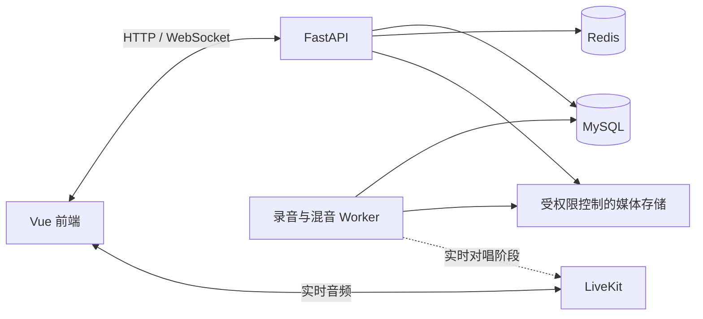

# VideoDream 社交板块功能设计

版本：v1.3
日期：2026-10-26
状态：核心功能已实施；实时音频等待独立 LiveKit 环境验收
适用范围：先供本人和朋友小范围使用；先实现录制合唱，再验证实时对唱。

## 1. 设计目标

在现有音乐中心、个人歌单、全局播放器、账号体系和场景歌单 Agent 的基础上，增加围绕音乐的社交空间：

1. 提供类似 QQ、微信的私聊和群聊。
2. 支持歌曲、歌单、场景规则和合唱作品分享。
3. 支持 1 个人或一群人一起听，并同步播放。
4. 提供带观众和排麦功能的 K 歌房。
5. 支持用户自定义场景歌单匹配规则，并发布到规则广场供他人复用。
6. 支持双人对唱，第一阶段优先完成录制合唱，后续验证实时对唱。
7. 为共同歌单、动态、预约和音乐品味匹配等社交功能预留扩展能力。

本文件保留已确认的设计，并在第 17、18 节记录本版实际实施范围、部署条件和验证边界。

## 2. 当前项目基础与接入点

| 现有能力 | 当前情况 | 社交板块的复用方式 |
|---|---|---|
| 账号与权限 | 已有登录、JWT、Refresh Token、账号停用、管理员后台 | 复用账号，增加好友、群组、房间和分享权限 |
| 音乐库与歌单 | 已有收藏、历史、自建歌单、本地音乐和封面 | 增加歌曲、歌单分享卡片及复制到个人库 |
| 全局播放器 | 已有队列、切歌、进度和音量 | 扩展一起听的同步播放模式 |
| 场景歌单 Agent | 已有需求解析、分析、筛选和评分 | 增加规则编辑、版本、发布和复用 |
| MySQL、Redis | 已使用 MySQL 保存长期数据，Redis 保存认证和临时状态 | 增加 social 前缀、实时状态和社交业务表 |
| 实时通信 | 当前没有 WebSocket 和实时音频房间 | 新增 WebSocket；音频房间采用 LiveKit 或兼容的 SFU |
| 录音和混音 | 当前没有人声录音、对齐和混音流程 | 新增音频 Worker 和受权限控制的媒体存储 |

代码接入时需要特别注意：

- 现有歌曲 ID 和文件按用户隔离，分享后要为接收者建立自己的收藏或歌单数据。
- 文件和自定义封面受所有者权限保护，分享必须生成独立授权入口。
- 现有播放器可以作为一起听的基础；K 歌和录制合唱需要独立的音频处理能力。
- 场景评分逻辑当前固定在后端，规则广场应保存经过校验的结构化规则，而不是直接执行任意代码。
- 现有 HTTP 认证中间件不自动覆盖 WebSocket，需要单独校验会话、账号状态和会话撤销。

## 3. 页面入口与功能关系

音乐中心侧栏增加：

| 入口 | 内容 |
|---|---|
| 消息 | 私聊、群聊、未读消息、系统通知 |
| 好友 | 好友列表、好友申请、搜索用户 |
| 一起听 | 创建房间、输入邀请码、好友正在听 |
| K 歌房 | 房间列表、观众、点歌、排麦、演唱 |
| 规则广场 | 浏览规则、收藏、复用、发布自己的规则 |
| 我的合唱 | 发起合唱、待补唱邀请、草稿和成品 |

歌曲、歌单、规则、房间和合唱作品均可作为聊天卡片发送。一起听房和 K 歌房复用房间、邀请、成员、聊天及管理能力。

## 4. 聊天功能

### 4.1 好友和关系

- 搜索账号、发送申请、同意、拒绝、备注、删除和拉黑。
- 支持好友、关注和拉黑三种关系类型，第一版先启用好友和拉黑。
- 默认只接受好友私信；陌生人需要先发送好友申请。
- 好友申请和入群邀请进入系统通知。
- 被拉黑用户不能发起新的私聊、好友申请或房间邀请。

#### 4.1.1 本人账号展示与添加好友

- “外观设置 → 个人资料”在头像下方展示只读的登录账号与用户 ID，并提供“复制账号”按钮；昵称仍可独立编辑，昵称仅用于展示。
- “音乐社交 → 好友”顶部展示“我的账号”和复制按钮，提示将登录账号发给朋友搜索添加；搜索输入框明确使用对方登录账号或至少两个字符的账号前缀。
- 复制成功显示“账号已复制”；浏览器不支持或拒绝剪贴板写入时，提示选中或长按只读账号手动复制，不显示虚假的成功提示。
- 桌面与手机均可查看、选中并复制账号；窄屏下输入框和按钮可换行。
- 用户 ID 使用雪花算法，直接作为 `users.id` 主键；旧账号和全部关系同步迁移。前端、HTTP 和 WebSocket 使用十进制字符串传递用户 ID，禁止转换为 JavaScript Number。加好友仍通过登录账号搜索。
- 展示部分直接复用认证状态中的 `username`、`id`。雪花主键 V6 涉及的完整 MySQL 结构、关系迁移、Redis 失效与回滚规则见《VideoDream 用户与管理员功能设计》第 18 节；V5 已应用的迁移不改写。

### 4.2 私聊和群聊

- 私聊、群聊、群名、群公告、群主和管理员。
- 创建群、邀请成员、接受邀请、退出群、移除成员和转让群主。
- 文字、表情、图片、语音消息、文件和音乐卡片。
- 回复、转发、复制、撤回、搜索历史、置顶和免打扰。
- 未读数、断线重连、发送失败重试、离线消息和多设备同步。
- 私聊可以显示已读；第一版群聊只保存未读游标，不展示逐条已读名单。
- 撤回窗口默认两分钟，撤回后显示提示。
- 清空聊天记录只影响当前用户的展示；消息权威数据仍按保留规则处理。
- 图片默认上限 10 MB，普通文件默认 50 MB，语音消息默认两分钟，均由管理员配置。
- 在线状态和“正在听什么”分别提供关闭开关。

### 4.3 消息可靠性

1. 消息先写入 MySQL，再通过 Outbox 推送。
2. 每个会话使用递增序号，客户端按序号保存和补取。
3. 发送重试携带同一个 `client_msg_id`，数据库唯一索引避免重复消息。
4. WebSocket 只负责及时推送，不能作为消息持久化来源。
5. 连接断开后按最后确认序号补取；Redis 通知丢失不会导致消息丢失。

## 5. 歌曲、歌单和内容分享

### 5.1 分享卡片

| 卡片 | 接收者操作 |
|---|---|
| 歌曲 | 试听、播放、收藏、加入歌单、邀请一起听 |
| 歌单 | 查看曲目、播放、收藏、复制到自己的歌单 |
| 场景规则 | 查看规则、收藏、复用生成 |
| 合唱作品 | 播放、查看参与者、发起同曲合唱 |
| 房间 | 加入房间、查看房间状态、发送邀请 |

### 5.2 分享范围

- 指定私聊或群聊。
- 好友可见。
- 所有登录用户可见。
- 持有分享链接且已登录的用户可见。

分享使用发布时的内容快照。原歌单后来增删歌曲不会悄悄改变已经发出的卡片；作者可以更新分享或撤销分享。

### 5.3 权限和媒体规则

- 在线歌曲保存平台身份和歌曲版本，接收者播放时重新获取自己可用的音源。
- 收藏分享歌单时，为接收者创建独立歌单，不共享原歌单的编辑权。
- 本地歌曲默认只分享歌曲信息；对方播放文件需要所有者明确开启文件分享。
- 自定义封面通过受权限控制的媒体入口访问，不能暴露本地路径或长期匿名地址。
- 转发继续检查原分享权限；分享撤销后，已发卡片显示失效状态。
- 已复制到自己歌单的内容仍归接收者；原分享的文件授权失效后，对方不能继续访问原文件。
- 现有第三方解析能力不能自动等同于多人传播或伴奏授权；房间播放和 K 歌版本要记录来源和适用范围。

## 6. 一起听

第一版支持双人和多人房，建议人数上限 10 人。房间可以创建为私密、好友可见或邀请码加入。

### 6.1 功能

- 创建双人房或多人房。
- 好友邀请、邀请码加入。
- 共同点歌、待播队列和房间聊天。
- 同步播放、暂停、切歌和进度。
- 房主移交、成员退出、断线恢复。
- 显示一起听时长和结束记录。
- 房主控制播放；房主可以授予其他成员共同控制权限。
- 投票切歌作为后续扩展。

### 6.2 播放同步

1. 服务端确定歌曲版本和房间播放状态。
2. 客户端预加载音源并报告准备情况。
3. 服务端发布统一开始时间。
4. 客户端根据校准后的服务端时间计算播放位置。
5. 定期检查偏差，小偏差渐进调整，大偏差重新定位。

房间权威状态包含歌曲、播放位置、开始时间、暂停状态和版本号。成员操作必须携带版本号，避免并发切歌覆盖。

体验约束：

- 音量由每个人独立控制。
- 晚加入成员从当前进度开始。
- 歌曲版本、剪辑或时长不同，不能强行视为同一音源。
- 音源不可用时显示具体状态，可以换源或跳过。
- 浏览器需要用户操作才能播放时，显示“加入并开始听”。
- 稳定网络下将校正后的偏差 500 毫秒以内作为初期目标，最终以实测结果校准。

## 7. K 歌房

第一版每个房间建议最多 20 人，先实现单人轮唱，再加入实时双人演唱。

### 7.1 身份和权限

| 身份 | 权限 |
|---|---|
| 房主 | 房间设置、管理员、排麦、跳过、禁言、移除成员 |
| 管理员 | 管理点歌、排麦和房间秩序 |
| 演唱者 | 使用麦位、伴奏、歌词和演唱控制 |
| 观众 | 听歌、聊天、回应、点歌、申请上麦 |

### 7.2 轮麦流程

`进入观众席 → 点歌并申请上麦 → 加入队列 → 轮到自己 → 检查麦克风 → 演唱 → 自动下麦 → 下一位准备`

支持：

- 当前演唱者、下一位和排麦列表。
- 原唱导唱、伴奏、人声音量分别控制。
- 歌词滚动及演唱进度。
- 麦克风测试和输入设备选择。
- 取消排麦、主动让麦、房主管理。
- 掉线后短暂保留位置，超时跳过。
- 观众鼓掌、点赞和表情回应。
- 录制前取得参与者明确同意，默认关闭录制。

### 7.3 K 歌曲库

现有歌曲和逐行歌词不足以直接提供稳定 K 歌体验。每个可演唱版本至少保存：

- 固定版本伴奏。
- 对齐后的歌词。
- 可选导唱。
- 时长和文件校验值。
- 使用来源和房间播放、录制、分享范围。

第一版从少量可用伴奏开始。逐字高亮、音准评分、升降调和自动人声分离放到后续阶段。

## 8. 双人对唱

### 8.1 第一阶段：录制合唱

流程：

1. 发起者选择歌曲和 A/B 演唱段落。
2. 使用固定伴奏录制自己的部分。
3. 保存独立人声，生成补唱邀请。
4. 好友听着伴奏和第一人的演唱，录制另一部分。
5. 对齐两条人声，调整音量并混音。
6. 双方试听、重录或微调。
7. 双方确认后发布作品。

设计约束：

- A/B 角色可以交换。
- 歌词区分 A 唱、B 唱和共同演唱。
- 两条原始人声分别保存，成品只混入一份伴奏。
- 录制前检测设备延迟，保留手动对齐能力。
- 邀请可以指定好友或创建补唱链接。
- 每个演唱位置同时只能由一个人占用。
- 第一版每个位置保留一个当前录音，重录替换前可试听。
- 作品默认私密；公开或扩大分享范围需要双方确认。
- 任一方重录导致成品变化，双方需要重新确认。
- 上传或混音失败支持重试，不要求重新录制。

### 8.2 第二阶段：实时对唱

- 两人使用同一个伴奏版本和演唱时间线。
- 双方分别发布人声，观众订阅合成后的房间音频。
- 演唱者优先监听本地伴奏和自身声音，对方声音提供独立监听开关。
- 支持分段轮唱、共同副歌和观众互动。

普通互联网存在传播延迟。服务端可以改善观众听到的混合效果，但两名歌手相互监听时仍会存在延迟；实时齐唱必须用真实设备和网络单独验证。

## 9. 规则广场

规则广场发布的是可复用的“选歌方法”，其他用户可以用自己的音乐库和偏好重新生成，不直接复制发布者的私有歌曲文件。

### 9.1 可配置内容

| 类别 | 可配置项 |
|---|---|
| 场景 | 工作、专注、游戏、运动、睡眠等 |
| 筛选 | 语言、人声、主题、歌手、歌曲排除 |
| 音频特征 | BPM、能量、变化程度、节奏稳定性 |
| 排序 | 场景、歌手、语言、个人收藏等权重 |
| 多样性 | 同一歌手最多几首，是否减少重复 |
| 来源 | 个人库优先、仅个人库、在线发现 |
| 输出 | 数量或时长目标 |
| 未知数据 | 排除，或允许但不增加对应分数 |

自然语言辅助只负责生成可检查的结构化配置，用户确认后才保存和执行；用户不能上传或执行任意脚本。

### 9.2 发布与复用

`创建草稿 → 试跑 → 查看入选和淘汰原因 → 填写标题、标签、说明 → 发布版本 → 收藏或复用`

版本规则：

- 已发布版本不可直接覆盖，修改后生成新版本。
- 复用默认绑定指定版本，避免作者修改后结果突然变化。
- 用户可以订阅更新，收到提示后选择升级。
- 支持基于规则改编，保留原作者和来源。
- 每次生成记录最终生效的规则快照。
- 规则下架后停止新复用，历史任务仍可查看。
- 试跑显示预计用量，避免反复试跑产生不可见消耗。

规则优先级：系统限制 → 本次明确调整 → 选中的规则版本 → 默认值。

建议规则配置示例：

```json
{
  "scene": "放松",
  "filters": {
    "languages": ["中文", "日文"],
    "excluded_themes": ["失恋"],
    "energy_max": 0.45,
    "unknown_feature": "exclude"
  },
  "ranking": {
    "scene": 70,
    "artist": 15,
    "personal": 15
  },
  "diversity": {
    "max_per_artist": 2
  },
  "source_mode": "personal_first",
  "output": {
    "goal": "duration",
    "target_duration_minutes": 45
  }
}
```

## 10. 推荐的其他社交功能

| 功能 | 价值 | 建议顺序 |
|---|---|---|
| 共同歌单 | 好友共同添加和整理歌曲，连接聊天和一起听 | 优先 |
| 合唱邀请箱 | 集中处理待补唱和待确认作品 | 随录制合唱加入 |
| 房间预约 | 提前约定一起听或唱歌 | 第二阶段 |
| 音乐动态 | 分享最近喜欢的歌和演唱作品 | 用户量增加后 |
| 听歌品味匹配 | 根据主动公开的偏好寻找共同点 | 后续 |
| 规则评价 | 反馈规则的适用场景和生成效果 | 规则广场稳定后 |
| 歌曲接龙和主题歌局 | 提高朋友间的参与感 | 后续 |

最优先增加共同歌单，因为它可以自然连接聊天、歌曲分享、一起听和场景歌单。

## 11. 技术架构



| 组件 | 职责 |
|---|---|
| FastAPI | 好友、消息、分享、房间、规则和权限 |
| WebSocket | 消息推送、房间状态、排麦和在线状态 |
| MySQL | 消息历史、关系、成员、规则版本和演唱作品 |
| Redis | 连接票据、在线状态、短期状态、事件通知和限流 |
| LiveKit | K 歌和实时对唱的实时音频传输 |
| 音频 Worker | 录音校验、时间对齐、混音、导出和重试 |
| 媒体存储 | 图片、语音、附件、伴奏、人声和成品 |

实时连接约定：

- 浏览器通过已认证 HTTP 请求取得一次性 WebSocket 票据。
- 票据有效期 30 秒，绑定用户、会话、来源和认证版本。
- WebSocket 握手时再次检查会话、账号状态和成员权限。
- 退出、停用、移出房间时主动撤销连接和媒体发布权限。
- RTC 凭证过期不代表现有连接已经撤销，撤权要调用媒体服务。
- 消息和重要状态通过事务 Outbox 发布；客户端按事件 ID 和版本去重。
- 录音和混音任务保存状态、租约、尝试次数和错误原因。

LiveKit 的观众可以获得 `can_subscribe=true、can_publish=false` 的权限；房主批准上麦时改为 `can_publish=true`，下麦时再撤回发布权限。高质量音乐演唱需要在真实设备上测试回声消除、噪声抑制、码率和网络。

生产部署时需要 HTTPS、WebSocket、媒体服务端口、ICE UDP/TCP 和 TURN。自托管 LiveKit 的默认 API/WebSocket 端口为 7880，RTC UDP 端口范围和 TURN 端口需要按部署环境配置；本地开发入口仍固定为前端 5174、后端 8001。

## 12. MySQL 数据设计

### 12.1 本版实际迁移

Flyway `V5__social_spaces.sql` 新增 27 张 `social_*` 表，未修改现有音乐数据表。`social_rule_run_bindings.run_id` 在业务层关联现有推荐任务，账号删除时先清理绑定；不会重写原歌曲或个人歌单归属。下面是实际 V5 的完整表结构、索引与外键（包含共同歌单三表、独立听歌可见性以及跨表补充外键），与生产正向 SQL 保持一致。

时间采用 Unix 秒 DOUBLE；消息序号、修订号采用无符号 BIGINT。JSON 保存受 Pydantic 校验的快照，不执行用户脚本。账号字段采用 CASCADE 或 SET NULL；房间和会话一对一；消息附件引用复合消息主键；作品有两个独立演唱位置。规则发布版本与来源版本的循环关系在建表后补外键。

```sql
-- Social spaces; additive migration. Back up before applying.
CREATE TABLE social_user_settings (
  user_id BIGINT PRIMARY KEY,
  discoverable BOOLEAN NOT NULL DEFAULT TRUE,
  online_visibility VARCHAR(16) NOT NULL DEFAULT 'friends',
  listening_visibility VARCHAR(16) NOT NULL DEFAULT 'friends',
  dm_policy VARCHAR(16) NOT NULL DEFAULT 'friends',
  invite_policy VARCHAR(16) NOT NULL DEFAULT 'friends',
  avatar_asset_id CHAR(32) NULL,
  created_at DOUBLE NOT NULL,
  updated_at DOUBLE NOT NULL,
  FOREIGN KEY (user_id) REFERENCES users(id) ON DELETE CASCADE
) ENGINE=InnoDB DEFAULT CHARSET=utf8mb4;

CREATE TABLE social_relations (
  user_id BIGINT NOT NULL,
  target_user_id BIGINT NOT NULL,
  kind VARCHAR(12) NOT NULL,
  status VARCHAR(16) NOT NULL,
  remark VARCHAR(40) NOT NULL DEFAULT '',
  request_message VARCHAR(200) NOT NULL DEFAULT '',
  created_at DOUBLE NOT NULL,
  updated_at DOUBLE NOT NULL,
  PRIMARY KEY (user_id, target_user_id, kind),
  KEY social_relation_target (target_user_id, kind, status, created_at),
  FOREIGN KEY (user_id) REFERENCES users(id) ON DELETE CASCADE,
  FOREIGN KEY (target_user_id) REFERENCES users(id) ON DELETE CASCADE
) ENGINE=InnoDB DEFAULT CHARSET=utf8mb4;

CREATE TABLE social_conversations (
  id CHAR(32) PRIMARY KEY,
  kind VARCHAR(12) NOT NULL,
  direct_key CHAR(64) NULL UNIQUE,
  owner_id BIGINT NULL,
  title VARCHAR(80) NOT NULL DEFAULT '',
  settings JSON NOT NULL,
  status VARCHAR(16) NOT NULL DEFAULT 'active',
  last_seq BIGINT UNSIGNED NOT NULL DEFAULT 0,
  revision BIGINT UNSIGNED NOT NULL DEFAULT 0,
  created_at DOUBLE NOT NULL,
  updated_at DOUBLE NOT NULL,
  KEY social_conversation_list (kind, status, updated_at),
  FOREIGN KEY (owner_id) REFERENCES users(id) ON DELETE SET NULL
) ENGINE=InnoDB DEFAULT CHARSET=utf8mb4;

CREATE TABLE social_conversation_members (
  conversation_id CHAR(32) NOT NULL,
  user_id BIGINT NOT NULL,
  role VARCHAR(16) NOT NULL DEFAULT 'member',
  status VARCHAR(16) NOT NULL DEFAULT 'active',
  joined_seq BIGINT UNSIGNED NOT NULL DEFAULT 0,
  left_seq BIGINT UNSIGNED NULL,
  last_delivered_seq BIGINT UNSIGNED NOT NULL DEFAULT 0,
  last_read_seq BIGINT UNSIGNED NOT NULL DEFAULT 0,
  hidden_before_seq BIGINT UNSIGNED NOT NULL DEFAULT 0,
  muted_until DOUBLE NULL,
  pinned BOOLEAN NOT NULL DEFAULT FALSE,
  created_at DOUBLE NOT NULL,
  updated_at DOUBLE NOT NULL,
  PRIMARY KEY (conversation_id, user_id),
  KEY social_member_user (user_id, status, pinned, updated_at),
  FOREIGN KEY (conversation_id) REFERENCES social_conversations(id) ON DELETE CASCADE,
  FOREIGN KEY (user_id) REFERENCES users(id) ON DELETE CASCADE
) ENGINE=InnoDB DEFAULT CHARSET=utf8mb4;

CREATE TABLE social_messages (
  conversation_id CHAR(32) NOT NULL,
  seq BIGINT UNSIGNED NOT NULL,
  sender_id BIGINT NULL,
  client_msg_id CHAR(32) NOT NULL,
  msg_type VARCHAR(16) NOT NULL,
  body JSON NOT NULL,
  reply_to_seq BIGINT UNSIGNED NULL,
  status VARCHAR(16) NOT NULL DEFAULT 'sent',
  created_at DOUBLE NOT NULL,
  recalled_at DOUBLE NULL,
  PRIMARY KEY (conversation_id, seq),
  UNIQUE KEY social_message_client (conversation_id, client_msg_id),
  KEY social_message_sender (sender_id, created_at),
  FOREIGN KEY (conversation_id) REFERENCES social_conversations(id) ON DELETE CASCADE,
  FOREIGN KEY (sender_id) REFERENCES users(id) ON DELETE SET NULL
) ENGINE=InnoDB DEFAULT CHARSET=utf8mb4;


CREATE TABLE social_assets (
  id CHAR(32) PRIMARY KEY,
  owner_id BIGINT NULL,
  kind VARCHAR(20) NOT NULL,
  storage_key VARCHAR(512) NOT NULL UNIQUE,
  mime VARCHAR(100) NOT NULL,
  size_bytes BIGINT UNSIGNED NOT NULL,
  duration_ms BIGINT UNSIGNED NULL,
  sha256 CHAR(64) NOT NULL,
  metadata JSON NOT NULL,
  state VARCHAR(16) NOT NULL DEFAULT 'uploading',
  expires_at DOUBLE NULL,
  created_at DOUBLE NOT NULL,
  updated_at DOUBLE NOT NULL,
  KEY social_asset_owner (owner_id, state, created_at),
  KEY social_asset_cleanup (state, expires_at),
  FOREIGN KEY (owner_id) REFERENCES users(id) ON DELETE SET NULL
) ENGINE=InnoDB DEFAULT CHARSET=utf8mb4;

CREATE TABLE social_message_assets (
  conversation_id CHAR(32) NOT NULL,
  seq BIGINT UNSIGNED NOT NULL,
  asset_id CHAR(32) NOT NULL,
  purpose VARCHAR(16) NOT NULL DEFAULT 'attachment',
  PRIMARY KEY (conversation_id, seq, asset_id),
  FOREIGN KEY (conversation_id, seq) REFERENCES social_messages(conversation_id, seq) ON DELETE CASCADE,
  FOREIGN KEY (asset_id) REFERENCES social_assets(id) ON DELETE RESTRICT
) ENGINE=InnoDB DEFAULT CHARSET=utf8mb4;

CREATE TABLE social_shares (
  id CHAR(32) PRIMARY KEY,
  owner_id BIGINT NULL,
  target_kind VARCHAR(16) NOT NULL,
  source_key VARCHAR(64) NOT NULL,
  snapshot JSON NOT NULL,
  scope VARCHAR(16) NOT NULL,
  conversation_id CHAR(32) NULL,
  token_hash CHAR(64) NULL UNIQUE,
  expires_at DOUBLE NULL,
  revoked_at DOUBLE NULL,
  created_at DOUBLE NOT NULL,
  updated_at DOUBLE NOT NULL,
  KEY social_share_owner (owner_id, created_at),
  KEY social_share_scope (scope, expires_at),
  FOREIGN KEY (owner_id) REFERENCES users(id) ON DELETE SET NULL,
  FOREIGN KEY (conversation_id) REFERENCES social_conversations(id) ON DELETE SET NULL
) ENGINE=InnoDB DEFAULT CHARSET=utf8mb4;

CREATE TABLE social_share_assets (
  share_id CHAR(32) NOT NULL,
  asset_id CHAR(32) NOT NULL,
  purpose VARCHAR(16) NOT NULL,
  item_no INT UNSIGNED NOT NULL DEFAULT 0,
  PRIMARY KEY (share_id, asset_id, purpose, item_no),
  FOREIGN KEY (share_id) REFERENCES social_shares(id) ON DELETE CASCADE,
  FOREIGN KEY (asset_id) REFERENCES social_assets(id) ON DELETE RESTRICT
) ENGINE=InnoDB DEFAULT CHARSET=utf8mb4;

CREATE TABLE social_notifications (
  id CHAR(32) PRIMARY KEY,
  user_id BIGINT NOT NULL,
  event_type VARCHAR(32) NOT NULL,
  object_key VARCHAR(96) NOT NULL,
  payload JSON NOT NULL,
  dedupe_key CHAR(64) NOT NULL,
  read_at DOUBLE NULL,
  created_at DOUBLE NOT NULL,
  UNIQUE KEY social_notification_dedupe (user_id, dedupe_key),
  KEY social_notification_list (user_id, read_at, created_at),
  FOREIGN KEY (user_id) REFERENCES users(id) ON DELETE CASCADE
) ENGINE=InnoDB DEFAULT CHARSET=utf8mb4;

CREATE TABLE social_outbox (
  id BIGINT UNSIGNED AUTO_INCREMENT PRIMARY KEY,
  topic VARCHAR(64) NOT NULL,
  object_key VARCHAR(96) NOT NULL,
  revision BIGINT UNSIGNED NOT NULL DEFAULT 0,
  dedupe_key CHAR(64) NOT NULL UNIQUE,
  payload JSON NOT NULL,
  status VARCHAR(16) NOT NULL DEFAULT 'pending',
  attempts INT UNSIGNED NOT NULL DEFAULT 0,
  available_at DOUBLE NOT NULL,
  worker_id VARCHAR(64) NULL,
  lease_until DOUBLE NULL,
  created_at DOUBLE NOT NULL,
  delivered_at DOUBLE NULL,
  KEY social_outbox_ready (status, available_at),
  KEY social_outbox_lease (status, lease_until)
) ENGINE=InnoDB DEFAULT CHARSET=utf8mb4;


CREATE TABLE social_rooms (
  id CHAR(32) PRIMARY KEY,
  conversation_id CHAR(32) NOT NULL UNIQUE,
  owner_id BIGINT NULL,
  kind VARCHAR(16) NOT NULL,
  title VARCHAR(80) NOT NULL DEFAULT '',
  visibility VARCHAR(16) NOT NULL DEFAULT 'private',
  status VARCHAR(16) NOT NULL DEFAULT 'active',
  config JSON NOT NULL,
  playback JSON NOT NULL,
  revision BIGINT UNSIGNED NOT NULL DEFAULT 0,
  last_active_at DOUBLE NOT NULL,
  closed_at DOUBLE NULL,
  created_at DOUBLE NOT NULL,
  updated_at DOUBLE NOT NULL,
  KEY social_room_list (status, visibility, kind, updated_at),
  FOREIGN KEY (conversation_id) REFERENCES social_conversations(id) ON DELETE CASCADE,
  FOREIGN KEY (owner_id) REFERENCES users(id) ON DELETE SET NULL
) ENGINE=InnoDB DEFAULT CHARSET=utf8mb4;

CREATE TABLE social_room_members (
  room_id CHAR(32) NOT NULL,
  user_id BIGINT NOT NULL,
  role VARCHAR(16) NOT NULL DEFAULT 'audience',
  status VARCHAR(16) NOT NULL DEFAULT 'active',
  permissions JSON NOT NULL,
  joined_at DOUBLE NOT NULL,
  left_at DOUBLE NULL,
  ban_until DOUBLE NULL,
  updated_at DOUBLE NOT NULL,
  PRIMARY KEY (room_id, user_id),
  KEY social_room_member_user (user_id, status),
  FOREIGN KEY (room_id) REFERENCES social_rooms(id) ON DELETE CASCADE,
  FOREIGN KEY (user_id) REFERENCES users(id) ON DELETE CASCADE
) ENGINE=InnoDB DEFAULT CHARSET=utf8mb4;

CREATE TABLE social_room_invites (
  id CHAR(32) PRIMARY KEY,
  room_id CHAR(32) NOT NULL,
  inviter_id BIGINT NULL,
  invitee_id BIGINT NULL,
  token_hash CHAR(64) NOT NULL UNIQUE,
  max_uses INT UNSIGNED NOT NULL DEFAULT 1,
  used_count INT UNSIGNED NOT NULL DEFAULT 0,
  expires_at DOUBLE NOT NULL,
  revoked_at DOUBLE NULL,
  created_at DOUBLE NOT NULL,
  KEY social_room_invite_list (room_id, expires_at),
  FOREIGN KEY (room_id) REFERENCES social_rooms(id) ON DELETE CASCADE,
  FOREIGN KEY (inviter_id) REFERENCES users(id) ON DELETE SET NULL,
  FOREIGN KEY (invitee_id) REFERENCES users(id) ON DELETE SET NULL
) ENGINE=InnoDB DEFAULT CHARSET=utf8mb4;

CREATE TABLE social_room_queue (
  id CHAR(32) PRIMARY KEY,
  room_id CHAR(32) NOT NULL,
  requester_id BIGINT NULL,
  partner_id BIGINT NULL,
  queue_kind VARCHAR(12) NOT NULL,
  track_snapshot JSON NOT NULL,
  karaoke_song_id CHAR(32) NULL,
  order_no BIGINT UNSIGNED NOT NULL,
  status VARCHAR(16) NOT NULL DEFAULT 'queued',
  revision BIGINT UNSIGNED NOT NULL DEFAULT 0,
  created_at DOUBLE NOT NULL,
  updated_at DOUBLE NOT NULL,
  UNIQUE KEY social_room_queue_order (room_id, order_no),
  KEY social_room_queue_status (room_id, status, order_no),
  FOREIGN KEY (room_id) REFERENCES social_rooms(id) ON DELETE CASCADE,
  FOREIGN KEY (requester_id) REFERENCES users(id) ON DELETE SET NULL,
  FOREIGN KEY (partner_id) REFERENCES users(id) ON DELETE SET NULL
) ENGINE=InnoDB DEFAULT CHARSET=utf8mb4;


CREATE TABLE social_karaoke_songs (
  id CHAR(32) PRIMARY KEY,
  creator_id BIGINT NULL,
  track_snapshot JSON NOT NULL,
  backing_asset_id CHAR(32) NOT NULL,
  guide_asset_id CHAR(32) NULL,
  lyrics JSON NOT NULL,
  duration_ms BIGINT UNSIGNED NOT NULL,
  version INT UNSIGNED NOT NULL DEFAULT 1,
  content_hash CHAR(64) NOT NULL,
  rights_note VARCHAR(300) NOT NULL DEFAULT '',
  visibility VARCHAR(16) NOT NULL DEFAULT 'private',
  state VARCHAR(16) NOT NULL DEFAULT 'draft',
  created_at DOUBLE NOT NULL,
  updated_at DOUBLE NOT NULL,
  KEY social_karaoke_hash (content_hash),
  KEY social_karaoke_list (state, visibility, created_at),
  FOREIGN KEY (creator_id) REFERENCES users(id) ON DELETE SET NULL,
  FOREIGN KEY (backing_asset_id) REFERENCES social_assets(id) ON DELETE RESTRICT,
  FOREIGN KEY (guide_asset_id) REFERENCES social_assets(id) ON DELETE SET NULL
) ENGINE=InnoDB DEFAULT CHARSET=utf8mb4;

CREATE TABLE social_performances (
  id CHAR(32) PRIMARY KEY,
  room_id CHAR(32) NULL,
  queue_id CHAR(32) NULL UNIQUE,
  karaoke_song_id CHAR(32) NOT NULL,
  owner_id BIGINT NULL,
  kind VARCHAR(16) NOT NULL,
  status VARCHAR(20) NOT NULL DEFAULT 'draft',
  mix_asset_id CHAR(32) NULL,
  visibility VARCHAR(16) NOT NULL DEFAULT 'private',
  revision BIGINT UNSIGNED NOT NULL DEFAULT 0,
  mix_input_hash CHAR(64) NULL,
  worker_id VARCHAR(64) NULL,
  lease_until DOUBLE NULL,
  attempts INT UNSIGNED NOT NULL DEFAULT 0,
  last_error VARCHAR(500) NULL,
  started_at DOUBLE NULL,
  finished_at DOUBLE NULL,
  created_at DOUBLE NOT NULL,
  updated_at DOUBLE NOT NULL,
  KEY social_performance_owner (owner_id, status, created_at),
  KEY social_performance_worker (status, lease_until),
  FOREIGN KEY (room_id) REFERENCES social_rooms(id) ON DELETE SET NULL,
  FOREIGN KEY (queue_id) REFERENCES social_room_queue(id) ON DELETE SET NULL,
  FOREIGN KEY (karaoke_song_id) REFERENCES social_karaoke_songs(id) ON DELETE RESTRICT,
  FOREIGN KEY (owner_id) REFERENCES users(id) ON DELETE SET NULL,
  FOREIGN KEY (mix_asset_id) REFERENCES social_assets(id) ON DELETE SET NULL
) ENGINE=InnoDB DEFAULT CHARSET=utf8mb4;

CREATE TABLE social_performance_parts (
  performance_id CHAR(32) NOT NULL,
  slot TINYINT UNSIGNED NOT NULL,
  user_id BIGINT NULL,
  status VARCHAR(16) NOT NULL DEFAULT 'empty',
  raw_asset_id CHAR(32) NULL,
  offset_ms INT NOT NULL DEFAULT 0,
  gain_db DECIMAL(5,2) NOT NULL DEFAULT 0,
  record_consent_at DOUBLE NULL,
  publish_consent_hash CHAR(64) NULL,
  reserved_until DOUBLE NULL,
  metadata JSON NOT NULL,
  created_at DOUBLE NOT NULL,
  updated_at DOUBLE NOT NULL,
  PRIMARY KEY (performance_id, slot),
  UNIQUE KEY social_performance_part_user (performance_id, user_id),
  FOREIGN KEY (performance_id) REFERENCES social_performances(id) ON DELETE CASCADE,
  FOREIGN KEY (user_id) REFERENCES users(id) ON DELETE SET NULL,
  FOREIGN KEY (raw_asset_id) REFERENCES social_assets(id) ON DELETE SET NULL
) ENGINE=InnoDB DEFAULT CHARSET=utf8mb4;

CREATE TABLE social_duet_invites (
  id CHAR(32) PRIMARY KEY,
  performance_id CHAR(32) NOT NULL,
  slot TINYINT UNSIGNED NOT NULL,
  inviter_id BIGINT NULL,
  invitee_id BIGINT NULL,
  claimed_by BIGINT NULL,
  token_hash CHAR(64) NOT NULL UNIQUE,
  status VARCHAR(16) NOT NULL DEFAULT 'pending',
  expires_at DOUBLE NOT NULL,
  claimed_at DOUBLE NULL,
  created_at DOUBLE NOT NULL,
  KEY social_duet_invite_slot (performance_id, slot, status),
  FOREIGN KEY (performance_id) REFERENCES social_performances(id) ON DELETE CASCADE,
  FOREIGN KEY (inviter_id) REFERENCES users(id) ON DELETE SET NULL,
  FOREIGN KEY (invitee_id) REFERENCES users(id) ON DELETE SET NULL,
  FOREIGN KEY (claimed_by) REFERENCES users(id) ON DELETE SET NULL
) ENGINE=InnoDB DEFAULT CHARSET=utf8mb4;


CREATE TABLE social_rules (
  id CHAR(32) PRIMARY KEY,
  author_id BIGINT NULL,
  title VARCHAR(80) NOT NULL,
  summary VARCHAR(500) NOT NULL DEFAULT '',
  tags JSON NOT NULL,
  scene VARCHAR(80) NOT NULL DEFAULT '',
  status VARCHAR(16) NOT NULL DEFAULT 'draft',
  published_version_id CHAR(32) NULL,
  origin_version_id CHAR(32) NULL,
  license VARCHAR(40) NOT NULL DEFAULT 'personal',
  created_at DOUBLE NOT NULL,
  updated_at DOUBLE NOT NULL,
  KEY social_rule_list (status, scene, updated_at),
  KEY social_rule_author (author_id, status, updated_at),
  FOREIGN KEY (author_id) REFERENCES users(id) ON DELETE SET NULL
) ENGINE=InnoDB DEFAULT CHARSET=utf8mb4;

CREATE TABLE social_rule_versions (
  id CHAR(32) PRIMARY KEY,
  rule_id CHAR(32) NOT NULL,
  version INT UNSIGNED NOT NULL,
  schema_version VARCHAR(20) NOT NULL,
  engine_version VARCHAR(40) NOT NULL,
  config JSON NOT NULL,
  content_hash CHAR(64) NOT NULL,
  change_note VARCHAR(500) NOT NULL DEFAULT '',
  created_at DOUBLE NOT NULL,
  UNIQUE KEY social_rule_version (rule_id, version),
  KEY social_rule_content (content_hash),
  FOREIGN KEY (rule_id) REFERENCES social_rules(id) ON DELETE CASCADE
) ENGINE=InnoDB DEFAULT CHARSET=utf8mb4;

CREATE TABLE social_rule_library (
  user_id BIGINT NOT NULL,
  rule_id CHAR(32) NOT NULL,
  version_id CHAR(32) NOT NULL,
  saved BOOLEAN NOT NULL DEFAULT TRUE,
  liked BOOLEAN NOT NULL DEFAULT FALSE,
  follow_updates BOOLEAN NOT NULL DEFAULT FALSE,
  created_at DOUBLE NOT NULL,
  updated_at DOUBLE NOT NULL,
  PRIMARY KEY (user_id, rule_id),
  KEY social_rule_saved (rule_id, saved),
  FOREIGN KEY (user_id) REFERENCES users(id) ON DELETE CASCADE,
  FOREIGN KEY (rule_id) REFERENCES social_rules(id) ON DELETE CASCADE,
  FOREIGN KEY (version_id) REFERENCES social_rule_versions(id) ON DELETE RESTRICT
) ENGINE=InnoDB DEFAULT CHARSET=utf8mb4;

CREATE TABLE social_rule_run_bindings (
  run_id CHAR(32) PRIMARY KEY,
  version_id CHAR(32) NOT NULL,
  effective_rule JSON NOT NULL,
  content_hash CHAR(64) NOT NULL,
  created_at DOUBLE NOT NULL,
  FOREIGN KEY (version_id) REFERENCES social_rule_versions(id) ON DELETE RESTRICT
) ENGINE=InnoDB DEFAULT CHARSET=utf8mb4;

CREATE TABLE social_reports (
  id CHAR(32) PRIMARY KEY,
  reporter_id BIGINT NULL,
  target_kind VARCHAR(20) NOT NULL,
  target_key VARCHAR(96) NOT NULL,
  reason VARCHAR(500) NOT NULL,
  evidence JSON NOT NULL,
  status VARCHAR(16) NOT NULL DEFAULT 'pending',
  handler_id BIGINT NULL,
  resolution VARCHAR(500) NULL,
  created_at DOUBLE NOT NULL,
  resolved_at DOUBLE NULL,
  KEY social_report_status (status, created_at),
  KEY social_report_reporter (reporter_id, created_at),
  FOREIGN KEY (reporter_id) REFERENCES users(id) ON DELETE SET NULL,
  FOREIGN KEY (handler_id) REFERENCES users(id) ON DELETE SET NULL
) ENGINE=InnoDB DEFAULT CHARSET=utf8mb4;

ALTER TABLE social_rules
  ADD CONSTRAINT social_rule_published_fk FOREIGN KEY (published_version_id) REFERENCES social_rule_versions(id) ON DELETE SET NULL,
  ADD CONSTRAINT social_rule_origin_fk FOREIGN KEY (origin_version_id) REFERENCES social_rule_versions(id) ON DELETE SET NULL;
ALTER TABLE social_user_settings
  ADD CONSTRAINT social_avatar_fk FOREIGN KEY (avatar_asset_id) REFERENCES social_assets(id) ON DELETE SET NULL;
ALTER TABLE social_room_queue
  ADD CONSTRAINT social_queue_song_fk FOREIGN KEY (karaoke_song_id) REFERENCES social_karaoke_songs(id) ON DELETE SET NULL;

CREATE TABLE social_playlists (
  id CHAR(32) PRIMARY KEY,
  owner_id BIGINT NULL,
  title VARCHAR(80) NOT NULL,
  revision BIGINT UNSIGNED NOT NULL DEFAULT 0,
  created_at DOUBLE NOT NULL,
  updated_at DOUBLE NOT NULL,
  FOREIGN KEY (owner_id) REFERENCES users(id) ON DELETE SET NULL
) ENGINE=InnoDB DEFAULT CHARSET=utf8mb4;
CREATE TABLE social_playlist_members (
  playlist_id CHAR(32) NOT NULL,
  user_id BIGINT NOT NULL,
  role VARCHAR(16) NOT NULL DEFAULT 'editor',
  created_at DOUBLE NOT NULL,
  PRIMARY KEY (playlist_id,user_id),
  KEY social_playlist_user (user_id),
  FOREIGN KEY (playlist_id) REFERENCES social_playlists(id) ON DELETE CASCADE,
  FOREIGN KEY (user_id) REFERENCES users(id) ON DELETE CASCADE
) ENGINE=InnoDB DEFAULT CHARSET=utf8mb4;
CREATE TABLE social_playlist_items (
  id CHAR(32) PRIMARY KEY,
  playlist_id CHAR(32) NOT NULL,
  contributor_id BIGINT NULL,
  track_key CHAR(64) NOT NULL,
  track_snapshot JSON NOT NULL,
  order_no BIGINT UNSIGNED NOT NULL,
  created_at DOUBLE NOT NULL,
  UNIQUE KEY social_playlist_track (playlist_id,track_key),
  UNIQUE KEY social_playlist_order (playlist_id,order_no),
  FOREIGN KEY (playlist_id) REFERENCES social_playlists(id) ON DELETE CASCADE,
  FOREIGN KEY (contributor_id) REFERENCES users(id) ON DELETE SET NULL
) ENGINE=InnoDB DEFAULT CHARSET=utf8mb4;
```

### 12.2 配置与删除

`system_settings.config` 合并已有配置，新增默认值：`social_enabled=true`、`social_rooms_enabled=true`、`social_rules_enabled=true`、`social_karaoke_enabled=true`、`social_realtime_duet_enabled=false`、`social_listen_capacity=10`、`social_karaoke_capacity=20`、`social_image_mb=10`、`social_file_mb=50`、`social_voice_seconds=120`、`social_recall_seconds=120`。由原管理员设置接口保存；不覆盖现有配置。管理员页提供上述开关与额度及举报处理。

账号删除事务先执行社交清理：结束其房间、撤销分享、撤下其参与作品、标记私有媒体清理，再清理音乐和账号。规则及历史消息可保留无账号的快照；个人媒体不因删除账号转为公共资源。未引用上传 24 小时后清理；持久引用媒体目前随账号清理或显式撤销失去访问权，长期保留策略属于后续运维配置。

数据库结构版本由 `flyway_schema_history` 管理；`account_migrations` 仅保留旧数据迁移记录，不能代替 Flyway，也不登记社交 DDL。生产配套 `deploy/sql/prod/v5/001_ddl_social.sql` 与 `999_fallback_social.sql`，不可与 Flyway 重复执行。

## 13. Redis 设计

使用独立前缀 `videodream:social:`，不改变现有认证 key。

| Key 模板与示例 | 类型和值 | TTL | 读写和失效 |
|---|---|---:|---|
| `videodream:social:ws-ticket:{hash}` | String：`{uid,sid,origin,auth_version,expires_at}` | 30 秒 | HTTP 创建；握手原子读取并删除 |
| `videodream:social:user-presence:{uid}` | ZSet：`connection_id -> heartbeat_at` | 90 秒 | 每 15 秒续期；超过 45 秒清理 |
| `videodream:social:room-presence:{room_id}` | ZSet：`uid:connection_id -> heartbeat_at` | 90 秒 | 每 15 秒刷新；45 秒陈旧，最多 90 秒自然过期；成员权限仍查 MySQL |
| `videodream:social:room-state:{room_id}` | String JSON：`{revision,track,position_ms,started_at,state,queue_id,singers,karaoke_song_id}` | 300 秒 | 事务 Outbox 提交后以 Lua CAS 更新；只缓存状态，HTTP 恢复和授权始终读取 MySQL |
| `videodream:social:typing:{conversation}:{uid}` | String：`1` | 5 秒 | 输入时刷新，自然过期，不持久化 |
| `videodream:social:rate:{action}:{uid}:{window}` | String：计数器 | 61 秒 | 原子自增并限流 |
| `videodream:social:rtc-session:{reference}` | String JSON：`{uid,sid,auth_version,room_id}` | 300 秒 | 发 RTC 凭证时建立；已签名入房回调和周期复核会话/成员/开关后续期，缺失或过期即移出；客户端仅持随机引用 |
| `videodream:social:events` | Pub/Sub：`{event_id,topic,object_key,revision,recipients}` | 不适用 | Outbox 发布，多实例订阅 |

示例：`ws-ticket:8d…` 保存票据 SHA256；`user-presence:23` 的 member 为随机连接 ID、score 为 `1792940000.0`；`room-presence:ab…` 的 member 为 `23:cd…`；`room-state:ab…` 的值含 `revision:3,state:"paused",position_ms:0`；`typing:ef…:23=1`；`rate:message:23:29882333=2`；`rtc-session:cd…` 的值含 `uid:23,room_id:"ab…"`。上述缩略 ID 在实际运行时分别为 64 位 hash 或 32 位随机十六进制 ID。Pub/Sub 消息可附表情、用户 ID 等经过校验的业务字段，不包含会话密钥；typing 通知仅经短期 Outbox 送达，不保存为聊天消息。票据通过 Lua 原子 GET+DEL，兼容不支持 GETDEL 的 Redis。

一致性规则：

- MySQL 保存消息、房间控制状态、规则和作品的权威数据。
- Redis 只负责及时通知和短期状态；断线后按序号或版本从 MySQL 补取。
- 在线状态只反映连接心跳，不能作为成员权限依据。
- 未读游标在 MySQL 中单调递增，避免多设备互相覆盖。
- Redis 故障沿用现有认证策略，实时操作暂停，不绕过权限。
- 清理社交缓存只扫描新的 `videodream:social:` 前缀。

### 13.1 WebSocket 心跳节奏

连接通过票据和会话校验后立即发送首条 `{"topic":"heartbeat","server_time":...}`；后续由后端按 15 秒间隔发送。使用事件循环的单调时钟计时，收到客户端 `{}` 回复或其他消息不提前发送，也不重置发送期限；无回复时继续按相同间隔发送，不因处理延迟补发积压心跳。前端继续收到一条心跳回复一次，桌面和移动端共用此协议。

会话重验及用户在线状态续期只在发送心跳时执行，避免每条回复重复查询 MySQL 和读写 Redis。等待期间仍接收断连和消息，超过 2048 字符立即以 1009 关闭；会话无效在下一次定时检查时以 4401 关闭，现有 `session_revoked` 通知仍可主动关闭连接。断连移除当前连接的在线成员并清理进程内连接记录。

本修复不新增或修改 MySQL 表、字段、索引和关系，因为仅调整连接循环的调度。Redis 沿用 `videodream:social:user-presence:{uid}`，例如 `videodream:social:user-presence:903456789012345679`：类型为 ZSet，member 为随机连接 ID，score 为 Unix 秒时间戳；后端每 15 秒删除超过 45 秒的旧成员、写入当前连接时间并续期整个 key 至 90 秒。在线查询仍按既有规则读取，断连仅 ZREM 当前成员，空 key 自动消失，其余情况由 TTL 自然过期；在线状态不作为权限依据。票据、认证会话、房间在线状态及其他 Redis key 契约沿用本节原表。

无需 SQL 迁移或 Redis 数据转换，兼容现有客户端和已存数据；回滚仅恢复应用代码，无数据回滚步骤。回归测试入口为 `backend.tests.social.test_realtime`，覆盖立即回复、持续回复、无回复、断连清理、超长消息和会话撤销，使用模拟存储，不启动中间件。

2026-10-26 验证：新增 6 项回归测试和原有票据一次性使用/会话撤销集成测试通过。集成测试复用共享 MySQL、Redis，使用隔离测试库及随机 key 前缀，结束后清理；未启动额外中间件。后端按原端口 8001 重启后，直连 WebSocket 每条心跳立即回复，实测后续间隔为 15.021、15.024 秒；探测连接退出后，其在线成员及一次性票据已清理。8001 和经 5174 代理的健康检查均正常，后端 CPU 采样从修复前约 54% 降至重启稳定后约 1%；该数值仅代表本次本机采样，未测量硬件温度。

## 14. 迁移、兼容和回滚

### 14.1 迁移

- 本版统一通过 V5 增量建表，业务功能分别设置开关；既有 Flyway 库先备份，再 migrate、validate、check。未接管的旧库先完成 V1 preflight/baseline，不能跳过结构差异。
- 迁移前备份数据库、音乐数据归属和社交媒体。
- 使用迁移锁和版本标记，支持重复启动检查。
- 新表统一使用 InnoDB、utf8mb4，并检查现有表排序规则。
- 账号删除流程增加社交数据清理和媒体引用处理。

### 14.2 兼容

- 现有音乐、歌单和文件默认继续私密，由用户主动分享。
- 未选择社区规则的场景歌单请求继续使用原评分方式。
- 历史场景歌单任务保留原规则和评分版本。
- 现有本地播放器继续单人使用；一起听使用独立房间状态，不改变个人播放队列语义。
- 现有账号认证流程保持不变，新增 WebSocket 票据复用账号会话和认证版本。

### 14.3 回滚

1. 先关闭对应功能开关和写操作。
2. 保留新增表和媒体，防止回滚代码后丢数据。
3. 导出新增数据和媒体后选择匹配的应用/结构版本。应用启动有 schema gate，不能将仅支持 V4 的代码直接指向 V5 库；需兼容补偿版本，或停服恢复包含 Flyway 历史的完整匹配备份。
4. 恢复迁移前的社交配置，不覆盖其他系统配置。
5. 如需删除新增表，先导出需保留的数据和媒体，再在停服窗口执行独立补偿迁移。配套 999 是离线结构撤销参考，先拆循环外键再按依赖逆序删表；不能只删表而保留 V5 成功历史，也不能删除历史记录或自动 repair 伪造一致性。

## 15. 实施阶段与验收

| 阶段 | 交付内容 | 主要验收 |
|---|---|---|
| 1 | 好友、私聊、群聊、歌曲和歌单分享 | 两个用户权限隔离；离线补消息；重试去重；撤回和分享撤销 |
| 2 | 双人和多人一起听 | 同步控制；晚加入；断线恢复；房主移交；坏音源提示 |
| 3 | 规则编辑、版本、广场、收藏和复用 | 规则可解释；版本固定；历史可追溯；旧评分兼容 |
| 4 | 双人录制合唱 | 两条人声对齐；重录；混音重试；双方确认后发布 |
| 5 | K 歌房、观众、排麦轮唱 | 观众不能擅自发声；排麦有序；掉线和移除有效；撤权生效 |
| 6 | 实时双人对唱 | 双方监听延迟；观众混音；弱网和设备差异可观察 |

验收需要使用两个普通用户和一个管理员，并覆盖多浏览器、多设备、刷新、断网、重复发送、用户停用和账号删除场景。

本项目本地服务仍固定使用前端 `5174`、后端 `8001`，统一验证地址为 `http://127.0.0.1:5174/`。实时音频部署后需要额外验证 HTTPS、WebSocket、TURN 和媒体端口。

## 16. 推荐的首个可用版本

首个可用版本建议只包含：

1. 好友和私聊。
2. 歌曲、歌单分享卡片。
3. 双人或多人一起听。
4. 共同歌单的基础能力。

随后增加规则广场和录制合唱。K 歌房在伴奏、歌词和录音流程稳定后接入，实时双人对唱最后通过真实朋友和真实网络验证。

这样可以先让本人和朋友使用核心社交链路，再根据实际体验决定房间人数、同步阈值、素材保留期和实时对唱是否达到可用标准。


## 17. 本版代码入口与实施边界

入口为“音乐中心 → 音乐社交”，手机为“我的 → 音乐社交”，包含消息、好友、一起听、K 歌房、规则广场、我的合唱、共同歌单和隐私设置。桌面与手机共用响应式页面。既有音乐歌曲及个人歌单菜单提供分享；房主、规则发布页和双方确认的公开合唱提供分享卡片。链接分享要求登录后携 token 访问，默认 7 天；房间卡片内的邀请码独立有效 24 小时。

| 范围 | 实施内容 |
|---|---|
| 好友与聊天 | 账号前缀搜索、申请/同意/拒绝、备注/删除/拉黑、好友状态、私聊/群聊、邀请接受、群公告/成员/管理权、搜索/回复/转发/撤回、附件/语音、未读/置顶/免打扰、本人的记录清理 |
| 可靠性与分享 | MySQL 单调序号、客户端幂等 ID、Outbox、一次性连接票据、重连补取、登录会话重验；五种卡片和四种分享范围；私有本地文件须显式复制授权；接收者歌单归属独立 |
| 一起听 | 独立 Audio 播放器保留个人队列；版本校验、预加载准备、未来 2 秒统一起播、每 2 秒偏差校正、独立音量、队列、控制权、移交、聊天与心跳 |
| 共同歌单 | 成员管理、独立歌曲快照、添加/移除/排序、修订号冲突检测，不暴露个人路径 |
| 规则 | 声明式表单/高级筛选、试跑与淘汰原因、不可变版本、发布/下架、收藏与独立订阅、改编、复用绑定；音频条件只使用完整且置信度 ≥0.7 的证据，未知数据不加分 |
| 录制合唱 | 固定伴奏、角色歌词、设备选择、独立录音、试听/重录、A/B 交换、补唱邀请、毫秒对齐/增益、租约与重试、FFmpeg 一份伴奏+两条人声、双方同成品 hash 和同范围确认后发布；改轨使旧确认及分享失效 |
| K 歌与 RTC | 排麦/取消/轮换、准备与麦克风检测独立、房主管理员/禁言/移除/移交、歌词/导唱/远端人声独立音量、主动让麦、表情；语音通过 LiveKit，观众初始禁止发布，服务端授权上麦；默认不录制 |
| 管理 | 社交开关、人数/上传/撤回限制、举报证据、驳回或隐藏内容、审计；实时双人对唱默认关闭 |

后端在 `backend/modules/social/`，主路由 `/api/social`；管理员举报路由 `/api/admin/social/reports`。前端在 `frontend/src/features/social/`。原有账号退出/停用/删除、推荐任务规则绑定、原播放器入口已接入。`frontend/src/shared/native/` 四个模块补齐浏览器行为，不能据此视为 Android 原生桥接已实现。

本版实时对唱是实验入口：LiveKit 分别传输独立人声，由观众浏览器与同步伴奏播放；尚未接入服务器统一混流/直播导出。RTC 的会话授权参考写入 Redis，入房 webhook 校验 JWT 与请求体 SHA256，后台约每 5 秒复核一次；远端网络请求耗时会延长复核间隔，退出/禁言等操作同时直接调用撤权 API。混音与房间权限维护使用独立任务，长混音不阻塞维护。登录票据/链接 token 在 Uvicorn 社交访问日志中脱敏，反向代理也必须避免记录此类 query string。

还需真实环境验收：双设备声音、麦克风/耳机校准、弱网、TURN、双人相互监听延迟及 ≤500ms 一起听偏差。未配置 LiveKit 时不签发伪凭证，页面明确显示未配置；录制合唱和一起听仍可使用。自然语言辅助编辑、自动设备延迟检测、服务器混流、房间结束记录页面、长期媒体保留策略，以及第 10 节标记为后续的预约/动态/匹配/评价不属于本版已完成能力。

## 18. 部署与本地验证

1. 先备份数据库及 `downloads/_social`；本地已在 `.run/database-backups/` 留存迁移前备份并完成 V5 migrate/validate。
2. 环境模板 `.env.example` 与 `deploy/.env.example` 增加 `LIVEKIT_URL`、`LIVEKIT_API_KEY`、`LIVEKIT_API_SECRET`，默认留空。密钥仅保存在服务端真实环境文件。
3. 部署 LiveKit 后配置 webhook 为后端公网 `/api/social/rtc-webhook`，使用相同 API key/secret 签名。应用及浏览器使用 HTTPS/WSS，按 LiveKit 部署开启媒体 UDP/TCP、TURN 及证书；不自动改变应用 5174/8001 端口。
4. 先开启普通 K 歌，完成真实设备验收后再由管理员开启 `social_realtime_duet_enabled`。ffmpeg/ffprobe 必须可用；录音使用 HTTPS 或 localhost 的安全上下文。
5. 前端 `npm test`、`npm run build`；后端设置 `PYTHONUTF8=1` 后运行 `python -m unittest discover -s backend/tests -t . -p 'test_*.py'`。专项 `backend.tests.social.test_social` 使用隔离 MySQL、Redis 前缀和真实 FFmpeg，覆盖权限/幂等/混音/撤销/房间邀请/RTC 验签与生命周期。

2026-10-25 验证记录：社交专项 13 项通过（隔离 MySQL/Redis、真实 FFmpeg，含回调验签和跨事件循环生命周期）；前端 177 项通过，类型检查与生产构建通过；V5 本地 migrate/validate 通过。桌面 1440×960 和手机 390×844 使用临时账号验证入口、房间创建/链接分享、规则试跑/草稿保存，手机 document.scrollWidth 与 viewport 均为 390。

全量后端 712 项运行完成，6 项失败、47 项错误；失败包含现有文件交付对旧 Redis 多字段 HSET 的兼容问题、Windows 历史文件迁移路径问题，以及测试后段 Windows WinError 10048 临时端口耗尽引发的 MySQL/Redis 连接错误。该全量结果未通过，不能作为整体回归已通过。前端构建仍有包体积及现有动态导入提示。专项和单元权限验证不能代替真实 LiveKit 音频验收。

2026-10-26 账号与雪花主键补充验证：本地已完成 V6 结构及现有账号、关联、用户目录迁移，validate/check 通过，8001 重启后统一地址健康检查返回 200。雪花专项 6 项、社交与 Flyway 25 项、账号相关 6 项回归通过；前端 179 项与生产构建通过。个人资料和好友页增加本人登录账号及复制入口，添加好友仍按登录账号搜索。新旧账号的 users.id 均采用雪花主键，前端按十进制字符串处理以保留精度；实际临时账号登录已核对个人资料的完整 18 位 ID、复制账号及 390×844 手机布局。完整表结构、Redis 失效、设备索引兼容及回滚见用户与管理员规格第 18 节；切换后用户需要重新登录。此轮相关回归不替代上述全量历史结果及真实音频验收。

2026-10-26 提交前重新检查：前端 179 项测试、类型检查和生产构建通过；后端全量 718 项运行完成，53 项失败、113 项错误，未通过。错误包含旧测试写死管理员 ID 1、旧 Redis 多字段 HSET 兼容、Windows 历史目录迁移及 WinError 10048 临时端口耗尽；另有资源、权限与任务时序断言失败，尚未逐项修复。V5/V6 SQL 部署副本一致，Python 编译和提交空白检查通过；相关专项通过不代表全量回归通过。
