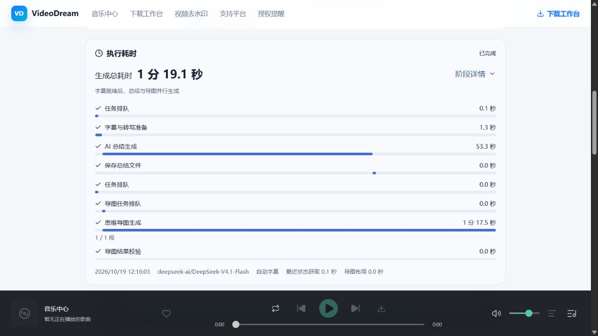
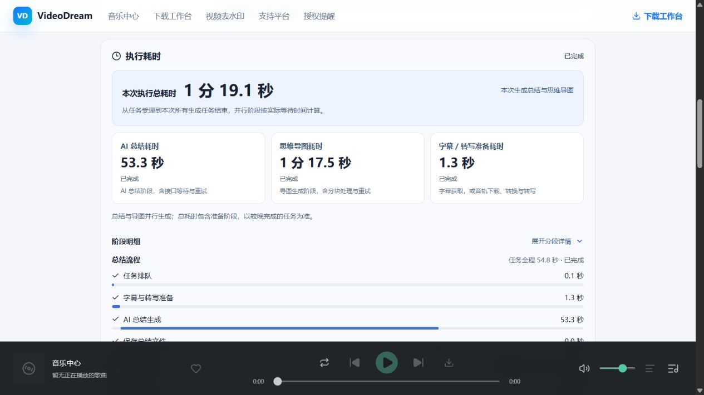
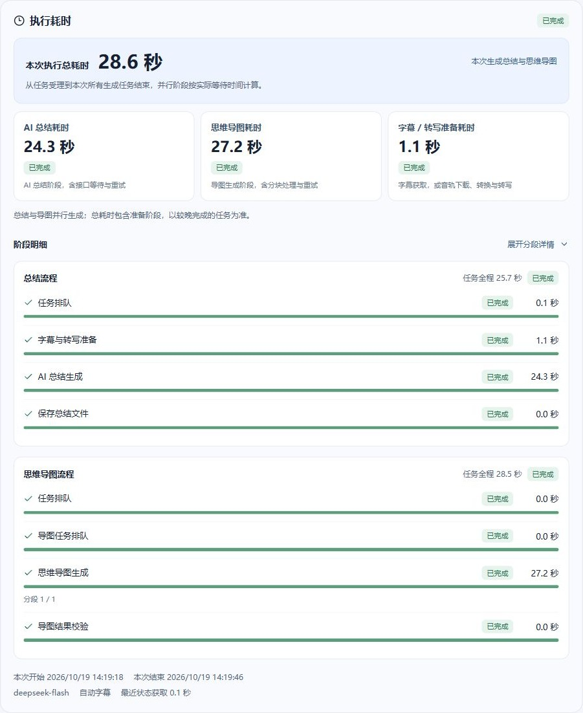
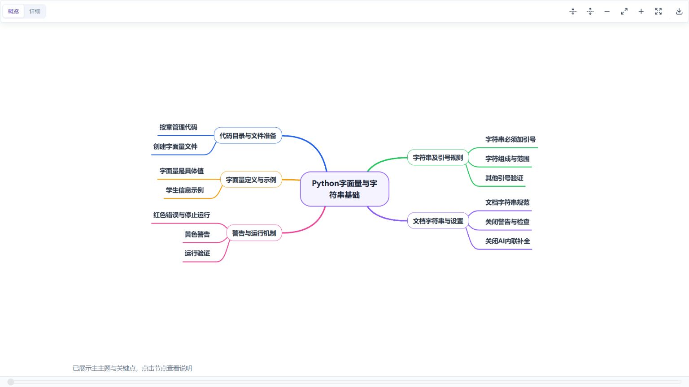
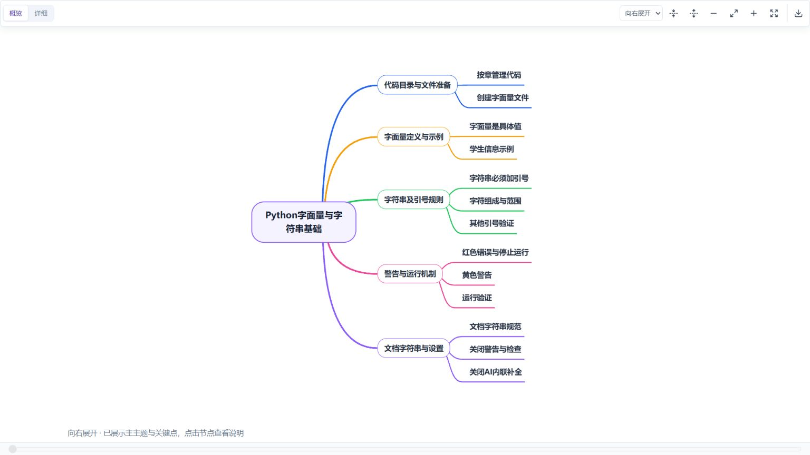

# 视频 AI 总结与思维导图链路性能记录

记录日期：2026-10-19，时间均按 Asia/Shanghai 展示。对应功能为现有视频页的“生成总结与思维导图”和“执行耗时”区域。

真实平台字幕样本的后端生成总耗时从 **160.566 秒降至 108.881 秒，减少 51.684 秒（32.19%）**。本轮导图请求自身更慢，收益主要来自总结与导图的时间重叠。强制语音转写分支另行测量为 77.427 → 19.715 秒，其中含明显的网络及服务端波动，不能将全部差额归因于并发。

原始毫秒值、阶段开始偏移、模型、结果数量和源码 SHA-256 持久化于 [JSON 数据记录](ai-video-generation-2026-10-19.data.json)。此文件不含 API Key、Cookie、完整模型输出或签名媒体地址。本文与该 JSON 一起保留，后续新增样本使用新日期文件，避免覆盖本次基线。

## 1. 原链路与调整

原链路：提取字幕或音轨转写 → 生成总结 → 保存结果 → 前端获得完成状态 → 再创建导图 → 逐块生成导图 → 布局。总结与导图输入均来自同一份字幕，因此不必等待总结正文。


| 调整项 | 最终行为 | 作用与限制 |
| --- | --- | --- |
| 总结/导图并行 | 文本就绪后同时派发，不重复提取文本 | 总耗时接近较慢分支；任一侧失败保留另一侧结果 |
| ASR 并发 | 最多 3 段并发，输出按音频顺序恢复 | 失败/取消停止新派发，等待在途任务退出后清理文件 |
| 导图分块并发 | 最多 2 块并发，按字幕顺序合并 | 保留完整输入和原有节点校验，不以缩短文本换速度 |
| 任务资源隔离 | AI 编排池 4、文本工作池 3、ASR 工作池 3；下载沿用 2 | 多个用户共享进程内限制；进程内模型/ASR在途请求合计最多 3，并非全服务集群限流 |
| 显式请求策略 | 文本请求 180 秒超时，禁用 SDK 重试；暂时性错误最多 2 次尝试 | 数值 Retry-After 等待 1–10 秒；认证/参数错误直接结束。超时为请求超时，不是整个任务的绝对截止时间 |
| ASR 重试 | 连接/读取超时 10/120 秒，最多 3 次尝试 | 网络错误指数退避；暂时性状态按 Retry-After 等待，最长 10 秒 |
| 计时与持久化 | 排队、准备、下载、转换、分段、ASR、总结、导图、校验、文件保存 | 单调时钟计算用时，终态冻结；历史任务缺字段显示“未记录” |
| 前端调度 | 两个任务各自轮询，禁止同一轮询请求重叠；先完成的结果先可用 | 保留约 1.4 秒轮询间隔，未把轮询频率当作模型提速 |
| 配置可追溯 | 文本就绪时固定该联合任务的配置，显示模型与任务开始时间 | 后台换模型不会改写历史任务所记录的模型 |

另在真实页面验证中发现旧 B 站 `x/player/v2` 返回的视频身份正确、字幕内容却变化。该轮出现 614 段非 Python 字幕，未纳入下述对比。更新为 `x/player/wbi/v2`，校验业务状态、bvid 和 cid 后，再次取回的 190 段字幕与基准 SHA-256 一致。身份校验不能替代语义核验；平台内容仍可能随时间改变。对应规格为[平台字幕](../features/video-summary-platform-subtitles.md)。

## 2. 测量方法与固定条件

- 视频：`https://www.bilibili.com/video/BV1tDsgzxECr/?p=2`，Python 概述，约 8 分 38 秒。
- 文本模型：`deepseek-ai/DeepSeek-V4.1-Flash`；ASR：`FunAudioLLM/SenseVoiceSmall`；服务主机：`api.siliconflow.cn`。沿用当时真实配置及密钥，未为基准切换更快模型。
- 优化前开始时间：11:17:55；优化后开始时间：11:21:37。各执行 1 次真实主链路，不代表 P50/P95 或稳定加速承诺。
- 两轮都取得 190 段、2998 个文本字符。序列化字幕字节 SHA-256 均为 `bed5017eabbcd3f2b86d9bd0b1206b70a39b4b1fd4f34f821cf58e6698b27844`，逐字节相同。
- 通过 `time.perf_counter()` 包装实际源码的来源提取、总结模型、文件保存与导图函数；优化前先按当时源码执行串行任务，优化后使用实际并行任务。没有用固定延迟代替真实 API。
- 隔离基准使用无账号任务，不写入个人任务历史；保留实际字幕下载、云端模型调用和本地结果文件写入。总计时含本地编排及测量脚本小量开销。
- 基准不包含用户点击、HTTP 排队、前端轮询延迟、浏览器导图布局和 MySQL 账号任务写入。因此这些阶段不能声称“优化前为零”，也不能把后端基准当作点击到画面完成的用时。
- 代码优化前的相关文件副本和本机脚本保留在 `.run/ai-generation-performance/baseline-source/`、`.run/ai-generation-benchmark.py`；由于工作区已有用户的目录重构，此次没有以 Git HEAD 作为基线，也没有提交代码。可长期引用的数字与源码摘要已另存于本目录 JSON。

## 3. 真实主链路：平台字幕路径

以下时间单位为秒；“减少”=优化前−优化后，负值表示本轮变慢。

| 阶段 | 优化前 | 优化后 | 减少 | 解释 |
| --- | ---: | ---: | ---: | --- |
| 字幕/文本准备 | 1.607 | 0.967 | 0.640 | 平台及网络波动；本轮没有触发 ASR |
| 总结模型 | 89.954 | 92.862 | -2.908 | 请求自身稍慢，提示词与温度沿用 |
| 总结文件保存 | 0.006 | 0.006 | -0.00009 | 差异约 0.09 ms，无可观收益 |
| 导图模型与既有清洗 | 68.996 | 107.910 | -38.914 | 云端响应波动明显，不能声称模型请求被加速 |
| **完整后端链路** | **160.566** | **108.881** | **51.684（32.19%）** | 并行阶段按实际跨度计，不累加 |
| 音轨下载/转换/分段/ASR | 未触发 | 未触发 | 不比较 | 另测语音分支，见下一节 |
| HTTP 任务排队/状态获取/页面布局 | 未采集 | 未采集 | 不比较 | 新页面可展示，基准无前值 |

阶段开始偏移进一步说明实际重叠：

| 阶段 | 优化前开始（秒） | 优化后开始（秒） |
| --- | ---: | ---: |
| 总结模型 | 1.607 | 0.969 |
| 导图模型 | 91.568 | 0.968 |
| 总结文件保存 | 91.562 | 93.831 |

优化前等待总结保存后才启动导图；优化后导图与总结几乎同时启动。两轮都成功，总结长度 4074/3996 字符、导图一级节点 4/5 个。生成内容不是确定性的，节点数量差异不直接代表质量优劣；本次验证输入一致、两类输出有效，不声称输出逐字一致。

## 4. 真实语音分支：同一视频强制 ASR

为覆盖本次主链路未触发的分支，单独执行真实音轨下载、转换、9 段语音转写。优化前从源码副本加载原语音实现，优化后使用新实现。此处没有接着生成总结与导图，不能把本节数字与上一节相加形成“完整语音链路提速”。

| 阶段 | 优化前（秒） | 优化后（秒） | 减少（秒） | 说明 |
| --- | ---: | ---: | ---: | --- |
| 下载及转换合计 | 30.665 | 10.510 | 20.154 | 真实网络波动很大 |
| 其中：音频转换 | 0.309 | 0.324 | -0.015 | 已包含在上一行，禁止重复相加 |
| 音频分段 | 1.434 | 1.017 | 0.416 | 本地处理波动 |
| 扣除下载/转换与分段后的剩余跨度 | 45.329 | 8.188 | 37.141 | 由总时间相减推导，含探测及 Python 编排开销，非独立测得纯 ASR 用时 |
| **下载至全部转写完成** | **77.427** | **19.715** | **57.712（74.54%）** | 同时受并发、网络及云端响应影响 |

各段请求用时如下，输出仍按原段序排列，优化后这些请求会重叠：

| 音频分段 | 优化前（秒） | 优化后（秒） |
| --- | ---: | ---: |
| 1 | 3.024 | 2.503 |
| 2 | 2.117 | 2.626 |
| 3 | 5.773 | 2.910 |
| 4 | 6.187 | 2.172 |
| 5 | 1.968 | 2.308 |
| 6 | 10.889 | 3.175 |
| 7 | 2.071 | 2.104 |
| 8 | 7.519 | 1.383 |
| 9 | 5.707 | 3.435 |

两次均成功，9 个转写片段；文本字符 3231/3230，云端识别有轻微差异。请求用时之和是工作量，不是并发完成的墙钟时间。

## 5. 固定延迟调度对照

为了单独验证调度收益，另做不调用真实服务的固定延迟测试，每种方式 3 次，取中位数。**这些毫秒数据仅为测试夹具，不能作为真实模型性能数据。**

| 场景 | 固定工作量 | 优化前中位数（ms） | 优化后中位数（ms） | 减少 |
| --- | --- | ---: | ---: | ---: |
| 总结与 4 块导图 | 来源 50 ms、总结 120 ms、每块导图 120 ms | 653.49 | 293.07 | 55.15% |
| 9 段 ASR | 每段 80 ms | 742.44 | 258.39 | 65.20% |

全部导图片段引用 `[0,1,2,3]` 均保留，转写顺序检查通过。三次原始值见 JSON 的 `controlled` 字段。该测试证明并行实际发生且按序归并；不模拟限流、模型输出差异或服务负载。

## 6. 页面与计时契约

现有视频页默认勾选同时生成导图，按钮为“生成总结与思维导图”。执行耗时区域在任务开始后出现，显示总时间、阶段完成进度、状态、实际模型及任务时间；展开可查看子阶段、分块进度、请求次数和重试等待。历史记录恢复相同后端计时，旧记录显示“未记录”。横条展示的后续调整见第 11 节。

任务响应新增可选字段：

```json
{
  "mind_map_task_id": "关联导图任务ID，仅总结响应存在",
  "model_info": {"model": "实际模型名称", "service": "服务主机名，不含路径和密钥"},
  "timing": {
    "version": 1,
    "accepted_at_ms": 1792380000000,
    "server_now_ms": 1792380003000,
    "finished_at_ms": null,
    "elapsed_ms": 3000,
    "stages": [{
      "id": "summary_model",
      "label": "AI 总结生成",
      "parent_id": null,
      "status": "running",
      "started_at_ms": 1792380001000,
      "finished_at_ms": null,
      "elapsed_ms": 2000,
      "attempts": 1,
      "retry_wait_ms": 0,
      "completed_units": 0,
      "total_units": 0,
      "reused": false
    }]
  }
}
```

- 全部时间戳/用时为毫秒；`accepted_at_ms` 是任务受理时墙钟锚点，后续时刻由单调时钟推导，系统时间回拨不改变用时。`finished_at_ms=null` 表示尚未冻结。
- 阶段状态为 `running/finished/failed/cancelled`。`attempts` 是真实派发尝试次数，`retry_wait_ms` 是累计计划等待时长，等待被取消时可能与实际已等待时间有差异；不将其作为另一个可相加的阶段。`reused` 为预留字段，当前不据此宣称命中模型结果缓存。
- 顶层阶段包括 `queue/source/summary_model/save` 与导图的 `queue/waiting_source/map_queue/map_model/map_validate`；下载、转换、音频分段、ASR 及其分段、导图分块使用 `parent_id` 归属父阶段。
- 模型阶段含提供方并发槽等待、请求及重试；属于用户实际等待时间，未进一步拆分服务端排队与推理耗时。
- 联合总耗时是两个关联任务最早开始到最后结束的跨度；单独重生成导图仅用本次导图用时，不计算用户空闲间隔。
- 浏览器收到快照后以 `performance.now()` 推进正在执行的显示值；终态停止计时。网络中断时显示为本地估计，重新收到快照后校准，不作为独立服务端测量证据。
- 状态获取和导图首次布局为前端本次会话指标，单独显示、不持久化为服务端执行耗时、不和并行阶段累加。

## 7. MySQL、Redis、兼容与回滚

### MySQL

**无新增或修改的表、列、索引、外键和关系，无 DDL 迁移。** 新数据复用既有 JSON 列，因此不需要新增计时表。以下为涉及的两张既有表的完整定义，与 `backend/modules/video/store.py` 一致：

```sql
CREATE TABLE IF NOT EXISTS video_summaries (
    task_id VARCHAR(64) PRIMARY KEY, user_id BIGINT NOT NULL, parse_record_id VARCHAR(64),
    webpage_url TEXT, status VARCHAR(24) NOT NULL, worker_id VARCHAR(255), content JSON NOT NULL,
    created_at DOUBLE NOT NULL, updated_at DOUBLE NOT NULL, deleted BOOLEAN NOT NULL DEFAULT FALSE,
    INDEX video_summary_record(user_id,parse_record_id,deleted,created_at),
    INDEX video_summary_worker(deleted,status,updated_at)
) ENGINE=InnoDB DEFAULT CHARSET=utf8mb4;

CREATE TABLE IF NOT EXISTS video_mind_maps (
    task_id VARCHAR(64) PRIMARY KEY, user_id BIGINT NOT NULL, parse_record_id VARCHAR(64),
    summary_task_id VARCHAR(64), version INT UNSIGNED NOT NULL, status VARCHAR(24) NOT NULL,
    worker_id VARCHAR(255), content JSON NOT NULL, created_at DOUBLE NOT NULL, updated_at DOUBLE NOT NULL,
    deleted BOOLEAN NOT NULL DEFAULT FALSE, UNIQUE KEY video_map_version(summary_task_id,version),
    INDEX video_map_record(user_id,parse_record_id,deleted,created_at),
    INDEX video_map_summary(user_id,summary_task_id,deleted,status,created_at),
    INDEX video_map_worker(deleted,status,updated_at)
) ENGINE=InnoDB DEFAULT CHARSET=utf8mb4;
```

- 逻辑关系沿用：`user_id → users.id`、`parse_record_id → video_parse_records.record_id`、`video_mind_maps.summary_task_id → video_summaries.task_id`；现有定义没有数据库外键，应用校验账号、父记录及删除状态。
- `video_summaries.content` 增加可选 `timing/model_info/mind_map_task_id`；`video_mind_maps.content` 增加可选 `timing/model_info`。已有 `resources` 继续保存资源目录元数据，不复制全量计时。
- 创建联合任务时先保存两侧记录及关联 ID；阶段开始和终态强制保存，普通进度沿用约 1 秒节流。账号用户读取前校验归属；导图以持久化版本选择为准，存在匹配内存任务时返回实时快照，避免每轮轮询回到旧计时。
- 进程中断由既有 worker 恢复机制结束未完成任务，冻结最后一次快照，最后保存至中断间的小段时间可能未记录；不把服务离线时长猜作执行时间。不支持断点恢复云端请求。
- 历史 JSON 无新增字段仍可读取；不回填虚构旧耗时。`generate_mind_map` 请求默认 false，旧调用方继续只生成总结。
- 回滚：等待当前任务结束，恢复此前后端/前端实现并按原端口重启；无 ALTER/DROP 和数据回滚，新增 JSON 字段可保留。旧代码不会自动使用联合模式，也不会展示耗时；不要将历史任务重写成新的模型信息。B 站接口修复建议独立保留。

### Redis

本次无新增或修改 key 模板及示例、类型、值结构、TTL、读写、失效和一致性规则。任务计时保存在 MySQL，浏览器实时推进在内存中；无需为计时增加 Redis。既有解析缓存及会话 key 沿用现有规则，不因计时更新而失效。

## 8. 验证与复测

最终后端全量 **337 项全部通过，162.109 秒**。首次全量 334 项中 333 项通过，一项现有“最近链接迁移后首项排序”失败；该逻辑未被本次修改，单独复测、定向回归与最终全量均通过，保留首次偶发失败记录。新补充测试验证联合任务的关联 ID、实时计时、账号隔离、内存丢失后的冻结结果恢复，以及中断计时排除停机时间。

前端 34 项测试通过，`vue-tsc --noEmit` 与 Vite 生产构建通过。后端新增覆盖单调计时、终态冻结、有限派发、顺序/账号上下文、并行启动、双向部分失败、来源失败及取消；B 站接口覆盖当前地址、错误码和视频身份不匹配。

真实浏览器以当前登录账号完成联合任务（12:16:03 开始），总结与导图均成功。MySQL 中的 190 段字幕与基准解析后的结构完全相同；规范化排序 JSON 的 SHA-256 均为 `81cc7df252656fa64faa123ee0a03f609aeba6c255c1e3028e7f25f92de5dcda`。MySQL 会调整对象键顺序，不能将其原样序列化哈希不同误判为文本变化。

| 页面验证阶段 | 实际用时（秒） |
| --- | ---: |
| 总结任务排队 | 0.1（页面显示精度） |
| 字幕准备 | 1.3（页面显示精度） |
| 总结模型阶段 | 53.3（页面显示精度） |
| 导图模型阶段 | 77.5（页面显示精度） |
| 联合任务总耗时 | 79.055（数据库计时） |

本轮含账号任务调度与持久化，属于额外验收，**不替换第 3 节同口径的优化后样本**，也不据此重新计算优化百分比。详细计时保存在 JSON 的 `browser_validation` 中。

桌面及 390×844 窄屏验证通过：计时面板无横向溢出，可展开阶段详情，正常显示模型名称、总时间及并行条；导图结果可查看，控制台未捕获 warning/error。刷新恢复冻结计时，历史旧任务显示“未记录”。后端在原 8001 端口重启，前端沿用 5174，交付地址为 `http://127.0.0.1:5174/`。



[窄屏验收截图](ai-video-generation-2026-10-19.mobile.jpg)

本机复测命令（项目根目录，使用有效运行环境）：

```powershell
$env:PYTHONIOENCODING = 'utf-8'
& .run/startup-venv/Scripts/python.exe -B -m unittest discover -s backend/tests -t . -q
npm --prefix frontend test
npm --prefix frontend run build
git diff --check
```

真实 API 复测会产生实际调用与等待。保存当时源码与模型配置名称、先校验字幕哈希，分别记录各阶段开始时间和耗时；前后不要只比较不同输入的总时间。原始本机基准脚本分别为 `.run/ai-generation-benchmark.py`、`.run/asr-performance-benchmark.py`、`.run/controlled-generation-benchmark.py`，当前源码上的 `before` 参数不能自动还原旧实现，不应将其误当新基线。

## 9. 已知限制与下一步

- 当前总结仍保留 **28000 字符输入上限**，过长文本追加截断提示；导图仍处理完整文本。本次没有把长视频总结覆盖问题伪装成性能优化。下一步可另行设计分层总结，并同时测量内容覆盖和额外请求成本。
- 单次真实样本不能证明所有视频稳定减少 32.19%；长文本、不同模型、账号配额和 429 都会改变关键路径。下一步应在短/中/长视频及多人并发下记录 P50/P95、失败率和请求成本。
- 提高并发会更快用到服务配额；共用上限限制在途请求，未解决多进程间限流。可据实际 429 记录再设计提供方级动态并发。
- 当前采集的是阶段用时；服务端真实 token 数、计费金额、首 token 延迟和精确推理时间未采集，不作推断。

## 10. 执行耗时展示细分（2026-10-19）

顶部新增独立的“本次执行总耗时”主指标，并列出“AI 总结耗时”“思维导图耗时”“字幕 / 转写准备耗时”。下方按总结与导图分组展示阶段、任务全程用时和状态，保留可展开的分段明细，同时展示本次执行范围及开始/结束时间。

计时口径：总结指标读取 `summary_model`，导图指标读取 `map_model`，准备指标读取 `source`；总时间仍按实际执行跨度计算。以用户截图为例，AI 总结 83.1 秒、导图 37.6 秒、准备 1.4 秒、总计 84.7 秒；由于并行，四者无需相加。单独重生成导图时，总时间仅包含本次导图任务，原总结用时标为之前执行，避免把用户空闲间隔计入。

实时显示按每条任务各自的快照接收时间推进，解决另一条任务更新时共享计时基准被重置的问题。尚未开始、未执行、未生成及未记录分别展示；模型阶段仍包含接口等待与重试，不推测服务端排队或首字延迟。

数据与回滚：仅消费既有任务 `timing` JSON，MySQL 无新增或修改表、字段、索引和关系，无迁移与数据回滚；Redis 无新增或修改 key 模板、示例、类型、值结构、TTL、读写、失效及一致性规则。回滚计时组件及计算工具即可恢复旧展示，已有测量数据保持可读。此前性能样本和基准记录保持原值。

本次验证：前端 **36 项测试通过**，TypeScript 类型检查与 Vite 生产构建通过；浏览器验证桌面与 390×844 手机宽度、独立总时间与模型阶段时间、分组及展开详情、旧任务“未记录”、刷新恢复，控制台未捕获 warning/error。前后端继续使用原 5174/8001 端口。本次为前端展示和计算调整，不重新调用模型生成性能样本。



[细分后的手机页面](ai-video-generation-2026-10-19.timing-details.mobile.jpg)

## 11. 阶段进度样式统一（2026-10-19）

原阶段横条按开始时间偏移及耗时占比绘制，短阶段显示成散落的小点，与“已完成”的勾选并列后容易被理解为没有完成。现改为阶段完成进度：完成时统一绿色满条、勾选和状态标记；运行时为蓝色，只有已知多段任务才使用完成段数计算进度，未知进度用动效表示；失败和取消分别显示红色、灰色状态，隐藏进度条。具体耗时继续由右侧数字展示。

总结与导图各自使用独立分组卡片；总任务、指标卡、分组及阶段使用一致的状态标记。分段数、请求次数和重试等待合并到详情行，避免孤立计数和多余分隔符。支持手机布局及减少动态效果偏好。

本次仅调整前端展示，计时口径和历史性能样本保持原值。MySQL 无新增或修改表、字段、索引或关系，无迁移；Redis 无新增或修改 key 模板、类型、值结构、TTL、读写、失效或一致性规则，因为仍直接读取已有任务计时快照。回滚该组件即可恢复旧展示，无数据回滚。

验证：前端 36 项测试全部通过，TypeScript 类型检查与 Vite 生产构建通过，`git diff --check` 及本次修改文件的空白检查通过。沿用前端 5174 的 Vite 热更新，后端 8001 健康检查正常。真实页面验证所有已完成阶段均为同色满条且无障碍进度值为 100；390×844 手机宽度无横向溢出，展开与收起详情正常。历史失败版本的模型阶段显示红色标记、不渲染完成进度条，已完成的准备阶段仍保持绿色；切回成功版本可正常恢复。浏览器控制台无 warning/error。本次不重新调用模型，仅使用已有真实任务验证展示。

以下截图使用用户 14:19:18 开始的成功任务：本次总计 28.6 秒，总结模型阶段 24.3 秒、导图模型阶段 27.2 秒、准备 1.1 秒，仅用于页面验收，不替换前述优化对比样本。



[统一完成状态后的手机页面](ai-video-generation-2026-10-19.progress-unified.mobile.jpg)

## 12. 中心导图与一屏概览（2026-10-19）

### 实现与范围

中心节点固定在画布中央，按可见子树内容量把主主题分配到左右两侧，保持各侧原有顺序，使用彩色曲线及圆角主题框。默认概览尝试展示主主题和关键点；超过 25 个可见节点，或适配后标签约小于 12px 时，降为全部主主题。小于 640px 的画布直接使用主主题概览。点击主题可读完整标题、说明及下级要点；详细模式保留全部节点、说明、时间戳、缩放和拖拽。提供全屏、适应画布、概览及完整两种 SVG / PNG 导出。

概览只控制显示层级，不删除存量节点，也不覆写详细视图的历史缩放和折叠。新生成提示词按知识关系组织内容，合并重复讲解、示例和结尾回顾，提炼中心标题；目标为 4–6 个主主题、每个 2–3 个关键点、含根节点约 25 个节点以内。不增加模型调用；长视频仍沿用分块生成，未新增跨分块的语义合并请求，因此不能保证所有长视频最终都在此数量以内。清洗兼容上限仍为四层、每级十个节点。

手机主题间距需覆盖导图库的内联主题变量。390×844 验证中，页面画布宽约 316px，根节点和全部五个主主题均位于画布内，根节点中心偏差小于 0.01px，15px 标签经适配后的有效字号约 12.1px。更窄窗口及更长历史标题仍可能需要放大或点击详情；一屏概览展示核心结构，详细模式可继续浏览全部内容。

### 同一视频的实际生成记录

样本为用户截图中的 B 站 p09 字面量课程，解析记录 `7671f5b22490`，总结任务 `2e7b7f6ce68e`，直接复用其 380 段自动字幕。本轮通过页面“重新生成思维导图”得到 v2，原 v1 保留；未重新生成总结。

| 项目 | 原 v1 | 新 v2 |
| --- | --- | --- |
| 导图任务 | `b76a530a30d4` | `1139213ddc1c` |
| 中心标题 | python零基础教程，Python入门到大神，AI人工智能必备 | Python字面量与字符串基础 |
| 主主题数量 | 8 | 5（减少 37.5%） |
| 完整树节点数（含中心） | 33 | 19（减少 42.4%） |
| 桌面全屏概览 | 旧内容自动折叠为主主题 | 19 个节点全部可见 |
| 手机概览 | 保留全部原主主题 | 中心及全部 5 个主主题可见，说明按需查看 |
| 导图模型阶段 | 27.2 秒 | 26.4 秒 |
| 字幕准备 | 原联合任务 1.1 秒 | 复用既有字幕，本次不执行 |
| AI 总结 | 原联合任务 24.3 秒 | 复用原总结，本次不执行 |
| 本次执行总耗时 | 原联合任务 28.6 秒 | 仅重生成导图 26.4 秒 |

v2 于本机时间 15:24:25 开始、15:24:51 完成，使用 `deepseek-flash`。以上时间按页面 0.1 秒显示精度记录。两次任务范围不同，且单次模型调用有波动，**不将总时间差或模型阶段差归因为稳定性能提升，也不替换第 3 节原性能基准**。本轮主要验收节点组织和阅读效率；新归类仅适用于新生成版本，旧版本只改变展示布局。

### 验证与导出

前端 38 项测试通过；后端相关总结、导图、计时、历史及所引用账号集成测试共 77 项通过（64.077 秒）。TypeScript 类型检查与 Vite 生产构建通过。浏览器验证新旧版本切换、概览 / 详细、节点详情、全屏及 390×844 窄屏。桌面全屏 1536×864 下，19 个节点均在画布边界内，根节点中心偏差小于 0.01px；控制台无 warning/error，后端模型接口 HTTP 200。

四类导出均完成实际下载和文件检查：全屏概览 SVG 为 991×373、19 个文本元素，完整 SVG 为 1473×725、55 个文本元素，包含说明及时间戳，均不含 foreignObject；完整 PNG 为 2946×1450。普通页面因概览回落为主主题，所导出的概览 PNG 为 1346×484，内容随当时概览的展开状态变化。已人工检查完整 PNG 的中文、彩色连线及节点边界。

前端沿用 5174 热更新，后端确认原进程属于本项目后在 8001 重启，交付地址仍为 `http://127.0.0.1:5174/`。



[手机一屏主主题概览](ai-video-generation-2026-10-19.mindmap-centered.mobile.jpg)

### 数据兼容与回滚

MySQL 无新增或修改的表、表结构、字段、索引和关系，无数据库迁移；继续使用现有 `video_mind_maps.content` 保存版本，`map_view` 继续使用 `scale/x/y/collapsed`。仅将后端 `scale` 校验下限从 0.5 修正为 0.2，上限仍为 1.6，与既有前端画布范围一致；概览模式、层级、节点详情不新增持久化字段。新 v2 由正常生成流程保存，未覆盖旧 v1。

Redis 无新增或修改的 key 模板与示例、类型、值结构、TTL、读写、失效或一致性规则，因为本次布局在客户端计算，导图仍由原持久化链路保存。

回滚生成提示词、画布组件、数据适配器、导出和样式，并恢复缩放校验，即可恢复旧行为，无数据迁移或数据回滚。已经生成的 v2 继续符合原节点契约，可保留或切回 v1；不自动批量重写历史导图。

## 13. 导图布局可选与自动适配（2026-10-19）

### 行为修正

第 12 节实现将画布与导出固定为根节点居中、左右展开，未保留用户截图中的单向结构。本节取代其中“固定居中”的现行规则，第 12 节的生成样本和测量记录保留为当时结果。

现在提供四个布局选项：自动布局、居中双向、向右展开、向左展开。向右展开时根节点位于树的左侧，全部分支向右；向左展开相反。手动方向在概览、详细、展开收起、窗口尺寸变化及导出时保持一致。切换方向保留当前展开状态，概览的字号与可见节点限制仍可触发主主题概览。

自动布局在当前画布实际渲染并测量双向与向右展开两种排法，比较可容纳的缩放比例；向右展开比双向大超过 8% 时采用单向，其余优先双向。双向按根节点两侧最大伸展范围适配并将根节点居中；单向按整树边界适配和居中，避免浪费根节点背面的画布。导出沿用当前实际方向，不以独立导出画布重新决定自动方向。

本轮复用已有 v2（`1139213ddc1c`），不重新生成总结或导图，没有增加 AI 调用。第 3 节基准与第 12 节模型耗时不变，本轮不新增或宣称模型生成性能收益。

### 数据结构、兼容与回滚

MySQL 无新增或修改的表、列、索引、外键和关系，无 DDL 迁移。布局选择复用现有 `video_view_states.view_state.map_view` JSON；该既有表完整结构如下：

```sql
CREATE TABLE IF NOT EXISTS video_view_states (
    user_id BIGINT NOT NULL, record_id VARCHAR(64) NOT NULL, view_key VARCHAR(255) NOT NULL,
    selected_tab VARCHAR(24) NOT NULL, playback_time DOUBLE NOT NULL, view_state JSON NOT NULL,
    created_at DOUBLE NOT NULL, updated_at DOUBLE NOT NULL, deleted BOOLEAN NOT NULL DEFAULT FALSE,
    PRIMARY KEY(user_id,record_id), UNIQUE KEY video_view_key(view_key),
    INDEX video_view_recent(user_id,deleted,updated_at)
) ENGINE=InnoDB DEFAULT CHARSET=utf8mb4;
```

逻辑关系沿用 `user_id → users.id`、`record_id → video_parse_records.record_id`，现有定义没有数据库外键；接口继续校验登录账号和解析记录归属。读取沿用 `GET /api/videos/records/{record_id}` 的 `view`，保存沿用 `PUT /api/videos/records/{record_id}/view`，浏览器继续使用原 650ms 防抖及串行保存队列，无新增缓存层。

`map_view` 的完整字段契约如下：

| 字段 | 类型与范围 | 默认 / 用途 |
| --- | --- | --- |
| `scale` | 有限数字，0.2–1.6 | 1，详细视图缩放 |
| `x`、`y` | 有限数字，-100000–100000 | 0，相对画布的根节点位置 |
| `collapsed` | 字符串数组，至多 12000 项 | 空数组，按既有规则清理无效节点 ID |
| `layout` | `auto/balanced/right/left` | `auto`，新增可选布局偏好 |
| `resolved_layout` | `balanced/right/left` | `balanced`，新增可选实际方向，匹配坐标 |
| `framing_valid` | 布尔值 | true，新增可选位置有效标记 |

示例：

```json
{"scale":1,"x":0.2,"y":0.4,"collapsed":[],"layout":"right","resolved_layout":"right","framing_valid":true}
```

旧 JSON 缺少新增字段仍可读取：布局默认为自动，旧坐标按双向解释。概览更换布局时只保存偏好，保留原详细视图的坐标和实际方向；尚无详细视图时标记 `framing_valid=false`。进入详细模式，仅在位置有效且实际方向一致时恢复坐标，否则重新适配，避免恢复到另一种排法的位置。概览几何位置、层级及节点详情不持久化。

Redis 无新增或修改的 key 模板与示例、类型、值结构、TTL、读写、失效和一致性规则；布局在浏览器计算，偏好随既有 MySQL 视图保存，不需要 Redis。

回滚前后端新增布局代码及可选字段即可恢复上一版本的固定双向显示。JSON 中的新字段可以保留，旧 Pydantic 请求模型忽略未知字段；无表结构回滚、数据删除或历史导图改写。

### 验证记录

前端 40 项测试通过，TypeScript 类型检查与 Vite 生产构建通过。后端导图与视图历史相关测试及其引用的账号集成测试共 56 项通过（348.142 秒）。测试覆盖单向完整树、顺序和折叠状态，尺寸与缩放比较、8% 阈值，布局字段默认值 / 非法值及账号隔离下的保存恢复。

真实页面验证四种布局、概览 / 详细、展开收起、节点详情、布局保存后刷新恢复及 SVG / PNG 导出。1536×864 全屏向右概览中 19 个节点均在画布内；普通双向概览根节点中心偏差小于 0.01px；向左展开的全部分支均在根节点左侧。390×844 手机宽度下工具栏换行、无页面横向溢出，中心和全部 5 个主主题均在画布边界内。浏览器未捕获 warning/error。

实际导出的单向概览 SVG 为 455×379，根节点在左、5 个主题向右；完整 PNG 为 1746×2676，包含全部 19 个节点的标题、说明及时间戳，已检查中文与节点边界。完整导图包含长说明，允许纵向浏览；一屏预览使用概览模式。

确认占用进程属于本项目后，后端在原 8001 端口重启并通过健康检查；前端继续使用 5174 热更新，交付地址为 `http://127.0.0.1:5174/`。


